# robot_v4 상세 제작 설명서 · Rev B
병합 기준: d8c21f4 · 기구 원형: b37de3e9 · 조립 단순화: 전산봉/간격관 제거, 위치 결정 턱, 한쪽 체결

## 이 문서를 사용하는 순서

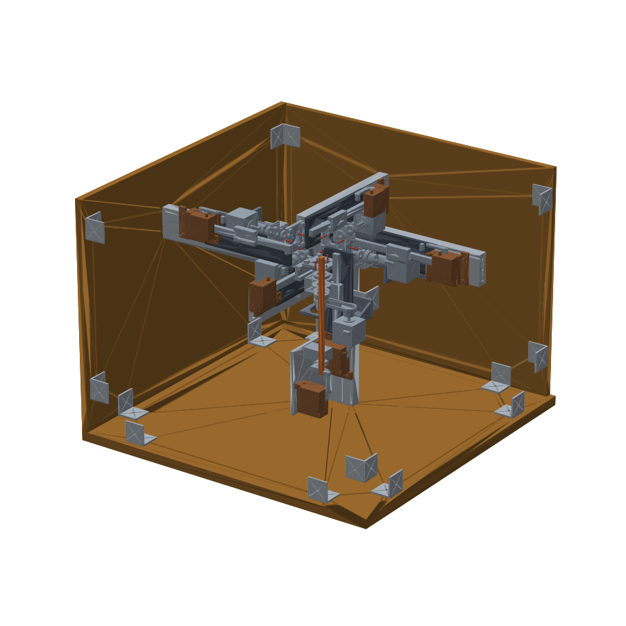

### 첫 장은 작업대용 부품 지도

P는 출력, J는 조립 지그 출력, B는 구매, K는 사진 속 키트에서 확인해 재사용, M은 재료를 구매해 절단·가공하는 부품이다. 같은 번호는 PDF·CSV·도면에서 계속 사용한다. 첫 장은 부품을 모두 보기 위한 A2 가로 판형이다. 이후는 A4이며 도면을 종이 축척으로 재지 않는다.

### 제작 기준

병합 기준 d8c21f4의 V4 구동 방식과 배치를 유지한 조립 단순화 Rev B다. 출력32종93개와 부품 번호는 유지하며, 전산봉20개·간격관20개를 제거했다. P13/P14/P15/P23/P25/P26/P29는 새 파일을 쓴다. 본체 출력은 models/robot_v4/print, 추가 받침은 assembly_kit/print, 지그는 assembly_kit/jigs다.

### 그림의 방향

전체 프레임 그림은 실제 설치 방향이다. 개별 모듈 그림은 작업대에서 보기 쉽게 국소+z를 위로 표시한다. D 모듈의 국소+z는 실제 설치하면 아래를 향하므로 잠금 막대의 긴 선단은 실제로 큐브 쪽인 위를 향한다. 부품 카드끼리는 같은 축척이 아니다.

### 가장 먼저 할 일

① B05 레일·B02 서보·B18 스위치 구매 도면 대조 → ② P06/J02 시험편만 출력 → ③ 큐브 손회전 → ④ 측면 모듈 하나 → ⑤ 프레임과 나머지 모듈 → ⑥ 무부하 이송 → ⑦ 한 면 회전 → ⑧ 뒤집기 순서다. 앞 단계 합격 없이 전체 부품을 한꺼번에 출력하지 않는다.

### 완료의 의미

CAD 간섭 검사와 PDF 제작은 실물 작동 인증이 아니다. 뒤집기에서 가운데 층이 마찰로 따라오는지, 잠금 유격과 핀 재진입이 허용되는지는 실물 시험으로 확인해야 한다. 뒤집기 시험 전에는 한 면씩 시험하며 자동 섞기·풀이를 실행하지 않는다.

## 사진 속 키트에서 무엇을 쓰는가

### 사용하는 네 종류

K01 LCD1602 with IIC 1개, K02 TACT 스위치1개, K03 부저1개, K04 점퍼선이다. 사진은 구성표이므로 실제 수량·제품명·전압을 작업대에서 확인한다. MCU 보드는 사진에서 확정되지 않아 B04로 분류했다.

### 이름이 비슷해도 대체할 수 없는 부품

사진의 28BYJ-48 5V 스텝모터와 ULN2003 계열 드라이버는 B01 NEMA17 + B03 A4988을 대신하지 않는다. 사진 속 소형 서보는 대개 SG90급으로 보이며, 모델·토크를 확인하지 않은 상태에서 MG996R 6개 중 하나로 계산하지 않는다.

### 이번 구조에 사용하지 않는 것

HC-SR04, HC-SR501, RFID, HC-06, ESP8266, 조이스틱, 4×4 키패드, RTC, 물 수위·습도·소리·불꽃 센서, IR 부품, FND, 8×8 도트, RGB LED, 74HC595, LM35 등은 현재 V4 구동에 필요하지 않다. 키트에 있다고 추가 배선하지 않는다.

### 브레드보드·9V 배터리

브레드보드는 전원이 꺼진 신호 시험용으로만 쓴다. 모터와 서보의 공급 전류를 브레드보드 접점으로 통과시키지 않는다. 사진의 9V 배터리 캡은 이번 모터·서보 전원으로 쓰지 않는다.

### 별도로 준비할 것

캘리퍼스0.01 mm 표시급, 직각자, 평평한 판, M2/M3/M4 육각렌치, 소형 드릴·리머, 납땜기와 인서트 팁, 멀티미터, 스프링 저울, 인쇄면 다듬기 도구, 보안경을 준비한다. 필요한 전원선·단자·퓨즈는 F23이다.

## Rev B: 길이 맞춤 대신 끼우고 세 곳 조이기

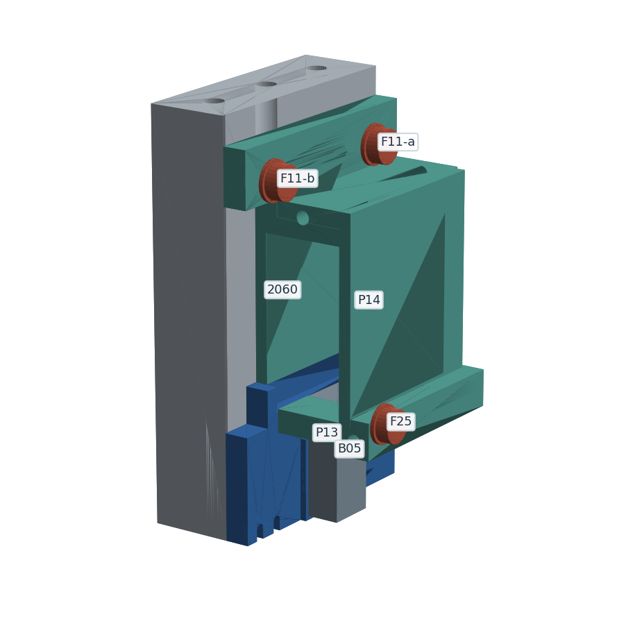

### 유지하는 설계

측면4헤드+D중공헤드, 위로 큐브를 넣는 배치, 잠금 막대, 여섯 서보 크랭크, 24/30 mm 행정을 유지한다. 프레임621 mm와 프로파일268/301.5 길이도 같다. 동작 코드나 큐브의 핀 패턴을 바꾸지 않는다.

### ① 레일 지지대가 기준

P13을2060에 고정한다. 레일은 좌우 턱 사이에 놓고 앞 멈춤 턱까지 민다. 일곱 장공으로 공급사별 첫 홀 위치 차이를 흡수한다. 턱은 정렬을 돕는 기준이고 볼트가 고정한다.

### ② 서보 받침의 돌기부터

P14 아래 돌기를 P13의 한쪽 포켓에 넣는다. 아래 발은 P13, 위 플랜지는2060에 밀착한다. 아래 F25를 손으로 먼저 물린 뒤 위 F11-a/b 두 개를 번갈아 조인다. 그림은 고정부 확대를 위해 프로파일·레일·P13 일부를 잘라 표시했다. 서보·캡은 생략하고 세 볼트의 머리와 와셔를 표시했다.

### ③ 같은 모듈을 다섯 번

측면과 D 모두 P13/P14 및 세 나사가 같다. 전산봉20본 절단과 간격관20본의 길이 맞춤이 없어지고 패널 구멍20개도 줄어든다. 이 연결의 낱개 수는 봉·너트2·와셔2·관의120개에서 나사·와셔·T너트의45개로75개 줄어든다. 전체 로봇의 출력 개수32종93개는 같다.

### 남아 있는 필수 조정

큐브 중심 정렬, 서보 혼 각도, 핀 깊이, 축 고정 링, 스위치 작동점은 실물에 맞춰야 한다. 금속판 뒤에서 조이는 P23/P29 인서트는 프로파일에 완전히 고정하기 전에 조립한다. 이번 변경만으로 잠금 유격·뒤집기 마찰 문제가 해결되었다고 보지 않는다.

## 조립 오차를 줄이는 설계 원칙

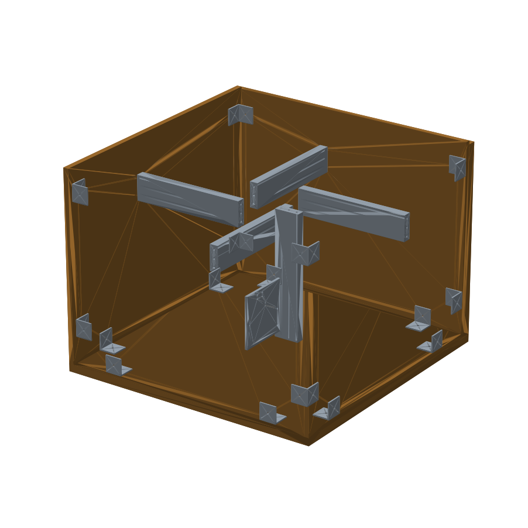

### 기준은 한 번만 만든다

프레임 바닥 윗면을 A, 좌우 중심면을 B, 앞뒤 중심면을 C로 정한다. 큐브 중심은 A 위332 mm다. 프레임 각 모듈 위치를 이전 모듈에서 이어 재지 않고 B/C 기준선에서 각각 잰다. J01은 57 mm 정렬 기준이며 실제 큐브 대신 잠깐 사용한다.

### 볼트와 위치 결정의 역할

2060 넓은 면→P13 평면→레일 좌우 턱/앞 멈춤 턱 순서로 기준을 전달한다. P14 아래 돌기는 P13 포켓에 들어가 서보 위치를 반복해서 잡는다. 돌기를 볼트로 강제로 눌러 끼우지 않는다. 정렬이 끝나면 밀착면과3점 체결이 하중을 받는다.

### 접착하는 곳·접착하지 않는 곳

접착은 실리콘 패드의 얇은 접착층과 스티커에만 사용한다. 프레임·가이드·서보·허브·레일·링크는 볼트와 금속 고정 링으로 고정한다. 베어링을 순간접착제로 붙이면 축 정렬·교체가 어려워지므로 그렇게 맞추지 않는다.

### 하중 경로

면 회전: 모터→축→허브→구동판→강철핀→엣지·코너. 반력: 코어→파인 센터→사각 막대→P23→M04→D2060→바닥. 무거운 헤드의 반력은 MGN 블록/레일→P13→2060→합판과 금속 앵글로 전달한다.

### 조임 순서

손으로 접촉시킴 → 두 볼트를 번갈아 가조임 → 움직임 확인 → 나머지 볼트 체결 → 위치 재측정 → 마지막 조임 순서다. 출력물에는 일률적인 금속 체결 토크를 적용하지 않는다. 하얗게 변하거나 층이 벌어지면 즉시 멈추고 부품을 교체한다.

## 시험편·출력 설정·후가공

### P06 핀 소켓 시험편

지름3.2/3.4/3.6 세 구멍을 실제 B06 핀으로 시험한다. 힘으로 밀어 넣지 않고 반복 삽입되는 구멍을 기록한다. 기본 엣지 소켓3.4를 쓸 수 없으면 실제 측정값을 설계에 반영하고 다시 생성한다. STL 전체 확대는 피치·베어링 치수까지 바꾸므로 사용하지 않는다.

### J02 사각 막대 시험편

8.2/8.3/8.4 구멍을 왼쪽부터 시험한다. 버를 제거한 실제 막대가 손 힘으로 이동하고 스스로 비틀려 걸리지 않아야 한다. P23은8.3이 기본이다. 흔들림을 없애려고 억지로 조이지 말고 유격과 마찰을 함께 측정한다.

### 기본 출력 조건

구조 부품 PETG, 0.16~0.20 적층, 외벽5~6, 상·하부6겹, 충전50~70%를 시작점으로 한다. 코어·허브·크랭크·가이드는 국부 솔리드/높은 충전율을 검토한다. 큐브 접촉면은 PLA를 시험할 수 있다. 이는 강도 보증값이 아니다.

### STL의 z=0은 권장 인쇄 방향이 아니다

P07은 평평한 뒤판을 베드에, 캡·링크·크랭크는 넓은 면을 베드에 놓는다. 레일 지지대는 넓은6T 면을 눕힌다. 베어링 집은 베어링 축을 수직으로 두되 돌출 귀 아래 서포트를 검토한다. 캐리지·센터·엣지·코너는 슬라이서에서 내부 서포트 제거 가능성을 먼저 확인한다.

### Rev B 받침 출력

P14는 국소-X 평면(조립 좌표x=-30)을 베드 쪽으로 놓고 +X로 적층하는 방향을 먼저 검토한다. 서보가 들어가는 열린 면이 위를 향해 내부 서포트 제거를 줄인다. M5 가로 구멍의 짧은 브리지는 시험편으로 확인한다. P13은 y=-57 평면을 베드에 놓아 레일 턱과 서보 포켓이 위로 오게 한다. 기준면의 코끼리발은 면을 깎지 말고 돌출 버만 제거한다.

### 후가공 원칙

핀·베어링·인서트 구멍은 실제 구매품에 맞춰 시험 출력 후 보정한다. 서로 다른 베어링 좌대를 드릴로 손으로 확장하면 동축도가 나빠지므로 작은 시험 하우징을 먼저 출력한다. 접촉 트랙의 서포트 자국만 다듬고 걸림 방지용 발을 깎아 없애지 않는다.

## 프레임 가공 치수와 기준선

### M01 패널 절단

바닥621×621×18 한 장, 앞/뒤597×450×12 두 장, 좌/우621×450×12 두 장이다. 좌/우가 앞/뒤의 절단면을 덮는다. 바닥 위에 측판을 올리면 내부 x/z ±298.5, 바닥 윗면 y=-332, 측판 위 y=118이 된다.

### 구멍은 DXF를 기준으로

assembly_kit/cut/panel_*.dxf는 mm 1:1이다. CNC나 레이저 업체에 외곽과 구멍 중심을 전달한다. 수공 가공이면 한 면을 기준으로 모든 구멍을 재고, 양쪽에서 각각 재서 누적하지 않는다. 프린터 인쇄물 크기로 치수를 복사하지 않는다.

### M02 프로파일 절단

측면268 길이4개, 하부301.5 길이1개다. 앞끝은 국소z=2, 뒤끝은270 또는303.5에 놓인다. 앞2 mm를 비워 R/D 모듈의 사각 프로파일 끝이 겹치지 않게 했다. 끝 직각도와 길이 편차≤0.1 mm를 가공 목표로 의뢰한다.

### 구매 도면 확인

2060은 폭60·높이20 외형만으로 확정하지 않는다. 넓은 면 T슬롯 중심 x=-20/0/+20, 옆면 슬롯 y=-67, 끝 코어 x=±20에 M6 탭을 낼 수 있는 단면이어야 한다. 중앙 슬롯은 레일 M3 T너트, 양쪽은 지지대/서보 M5용이다. 공급자 단면과 슬롯용 너트를 함께 확인한다.

### 금속 가공

M04는124×126×6 알루미늄 판으로 홀 위치가 중요하다. 단면은 D국소 x=-36..-30이다. 앵글16개는40×40×40,3T, 면당20 mm 위치에 Ø4.5 홀이다. 날카로운 모서리와 모든 구멍 버를 제거한다.

## 프레임을 먼저 직각으로 조립

### 1. 바닥과 측판 표시

바닥 위에 앞F·뒤B·오른R·왼L, 중심선 B/C, 큐브 중심 높이332를 표시한다. 앞뒤판은 두 좌우판 사이에 들어간다. 바닥과 측판 사이의 이물질을 제거하고 평평한 작업대에서 시작한다.

### 2. 바닥 앵글8개

각 면 두 곳(중심에서±200)에 앵글을 놓는다. 볼트머리→와셔→합판→앵글→와셔→너트 순서로 F14를 넣고 손으로만 조인다. 볼트를 목재 절단면에 직접 박아 프레임을 구성하지 않는다.

### 3. 수직 모서리 앵글8개

각 세로 모서리에 두 개, y=-250/+60 높이에 넣는다. 두 면 모두 F13으로 관통 체결한다. 측판 바깥에서 너트가 한쪽으로 파고들지 않도록 대형 와셔를 쓴다. 앵글의 두 면은 모두 패널에 붙어야 한다.

### 4. 대각선 확인 후 교차 조임

바닥 평면의 두 대각선을 재서 차이≤0.5 mm를 초기 목표로 맞춘다. 각 면의 수직을 직각자로 확인한다. 대각 반대편의 앵글을 번갈아 조이고 다시 측정한다. 볼트로 휜 판을 강제로 당겨 맞추지 않는다.

### 합격 기준

작업대에서 네 모서리가 들뜨지 않고 손으로 옆면을 밀었을 때 앵글·패널 사이에서 눈에 보이는 미끄러짐이 없어야 한다. 전면 위는 열려 있다. 설치 공간은621×621, 바닥부터 측판 상단468 mm이며 위쪽으로 손을 넣을 여유를 추가한다.

## 프로파일·레일 지지대 위치 잡기

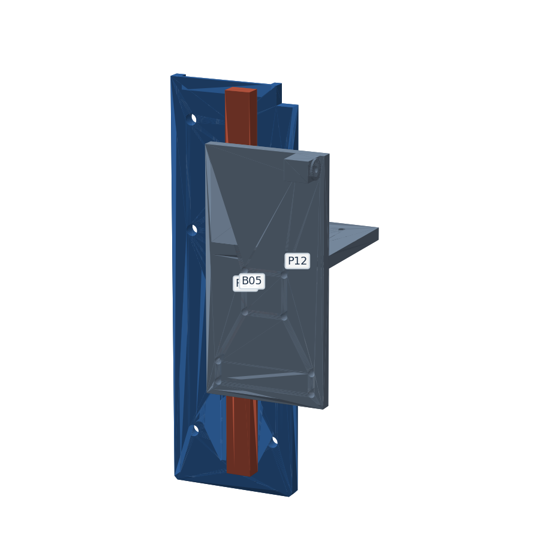

### 1. 프로파일 끝 체결

각 측판의 M6 구멍2개에 F12와 큰 와셔를 넣고 프로파일 끝의 탭에 물린다. 처음에는 가조임한다. D 프로파일은 바닥에 같은 방식으로 체결한다. 앞끝이z2, 뒤끝이270/303.5인지 확인한다.

### 2. T너트 배치와 P13 체결

2060 중앙 슬롯 x=0에 F10의 M3 T너트 일곱 개를 레일 홀 위치에 배치한다. P13 뒷면(y=-57)을2060 앞면에 밀착한다. x=±20,z25/120 네 곳에 F11을 머리→와셔→P13 6T→양쪽 슬롯 T너트 순서로 넣는다. 중앙 너트는 P13 장공에서 보이게 한다. 프레임 끝을 막기 전에 끝삽입 너트를 넣거나 호환 드롭인 너트를 쓴다.

### 3. 레일 설치

레일을 좌우 턱 사이에 놓고 앞끝을 멈춤 턱 z4.5에 민다. 뒤끝184.5는 서보 몸체와0.45 명목 여유다. 턱은 양쪽0.2 여유이며 장공7개가 첫 홀 오프셋10/15 차이를 받는다. F10을 레일→P13→중앙 M3 T너트 순서로 체결한다. 머리는 카운터보어 안에 두고, P13 뒤에 일반 너트를 가둬 넣지 않는다.

### 4. 평행 확인

처음과 끝 볼트만 약하게 조인 뒤 블록을 전 구간에 움직여 본다. 중간 볼트는 안쪽부터 바깥쪽으로 조금씩 조인다. 특정 구간에서 무거워지면 레일 밑 버·지지대 휨·볼트 돌출을 확인한다.

### 오차 관리

5개 모듈을 모두 처음부터 완전히 조이지 않는다. 큐브와 한 쌍 헤드를 맞춘 뒤 위치를 확정한다. 나머지도 같은 중심선에서 각각 맞춘다. MGN 블록을 레일에서 완전히 빼면 볼이 빠질 수 있으므로 운반용 스토퍼를 유지한다.

## 큐브 코어와 인서트 설치

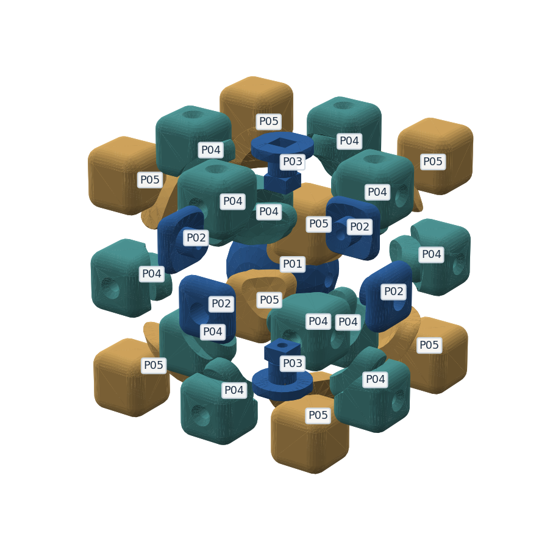

### 1. 코어 방향 표시

P01의 사각 키 구멍2개가 위/아래(U/D)다. 둥근 센터4개는 옆면용이다. F/R/B/L/U/D를 임시 표시하고 사각 구멍 축을 바꾸어 조립하지 않는다.

### 2. 인서트6개

일반4면은 바깥쪽 Ø4.6 자리, U/D는 사각 포켓 안쪽의 깊은 Ø4.6 자리(중심에서7..11 mm)에 F01을 설치한다. 원래 V4는 사각 포켓이 바깥 인서트 자리를 없애므로 Rev A에서 두 깊은 자리를 추가했다. 인서트가 사각 줄기의 삽입 공간으로 튀어나오지 않게 한다.

### 열삽입 방법

재료·인서트 제조사 권장 온도로 납땜 인서트 팁을 설정한다. 코어를 평면 지그에 받치고 축을 똑바로 유지해 천천히 넣는다. 밀어 넣으면서 나사를 돌리지 않는다. 식은 다음 시험 나사가 손으로 들어가는지 확인한다. 구멍 주변이 녹아 찌그러지면 재출력한다.

### 3. 나사 길이 확인

일반 센터는 M3×16을 시작값으로 스프링 압축 길이에 따라 맞춘다. 파인 센터는 머리높이≤3인 M3×14를 쓴다. 머리 앉음면에서 끝까지 실제 길이를 재고, 인서트 물림≥3 mm 및 막힌 구멍 바닥 여유≥0.5 mm를 확인한다.

### 합격 기준

인서트가 나사와 함께 돌지 않고 균열이 없어야 한다. U/D 센터의 사각 줄기가 손으로 끝까지 들어가며, 나사머리는 막대 소켓 바닥 안쪽에 들어가야 한다. 나사 길이를 맞추려고 막대 소켓 바닥을 관통해 깎지 않는다.

## 큐브를 손으로 완성하고 먼저 시험

### 1. 일반 센터4개

P02의 나사 포켓에 와셔·스프링·나사를 넣고 코어에 연결한다. 스프링은 센터를 눌러 조각이 빠지지 않게 하되 센터의 자유 회전을 막지 않아야 한다. 네 면을 같은 기준 길이로 가조임한다.

### 2. 파인 센터2개

P03의 사각 줄기를 코어 U/D 키 포켓에 맞춘다. M3×14로 고정한다. 이 두 센터는 코어와 함께 고정되고, 그 주변 엣지·코너가 구면 트랙 위에서 회전한다. 일반 센터처럼 스프링으로 띄우지 않는다.

### 3. 엣지12·코너8

센터 한쪽을 잠시 느슨하게 둔 채 아래 층의 엣지/코너→중간 엣지→윗층 조각 순으로 유지 발을 트랙에 넣는다. 마지막 엣지가 안 들어가면 센터를 풀어 여유를 만든다. 발을 꺾거나 깎아서 넣지 않는다.

### 4. 색과 소켓

U 흰색, D 노랑 등 사용할 색 체계를 한 번 정한다. 스티커가 구동핀 소켓과 파인 센터 소켓을 막지 않도록 구멍을 미리 낸다. 각 엣지는 외부 두 면에 소켓이 있어 섞인 뒤에도 구동판 패턴과 맞아야 한다.

### 합격 기준

모터 없이6면을 각20회 돌린다. 엣지·코너가 함께 돌고 90° 위치에서 면이 정렬되어야 한다. 특정 각도 걸림, 조각 이탈, 스프링 바닥 닿음이 있으면 기계 모듈에 넣기 전에 해결한다. 인쇄 큐브가 이 시험을 통과하지 않으면 모터 전류를 높여 해결하지 않는다.

## 2핀 구동판: 핀 깊이를 같게 만든다

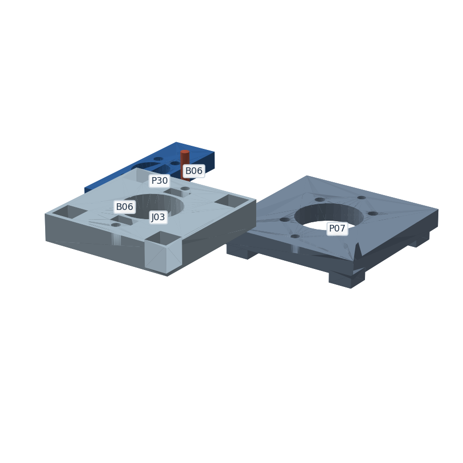

### 1. P07 준비

핀 구멍은 국소(0,±19.1), 두 구멍 간격38.2다. 네 모서리 발은 패드 받침이며 구동핀 위치가 아니다. 앞면은 발이 있고 뒤면은 허브가 붙는 평판이다.

### 2. J03으로 돌출8 mm 맞추기

J03의 평평한8T 면을 P07 앞판 평면(z5)에 밀착한다. 핀을 뒤에서 넣고 핀 앞끝이 J03 반대면과 같아질 때 멈춘다. J03을 빼면 판 평면에서 핀 돌출8, 뒤판에서2가 된다. 실제 J03 두께를 먼저 캘리퍼스로 재서8.00 기준을 확인한다.

### 핀 고정

기본2.9 파일럿은 실제핀에 맞춰 단계적으로 보정한다. 핀을 넣을 때 판을 구멍 주변에서 받치고 핀을 비스듬히 망치질하지 않는다. 적당한 압입이 안 되거나 판이 갈라지면 구멍 치수를 고쳐 재출력한다. 접착제만으로 헐거운 구멍을 때우지 않는다.

### 3. 실리콘 패드20개

8×8 패드를 모서리 받침4곳에 붙인다. 비압축 약1T, 작동 두께0.8을 시작값으로 한다. 접착층도 두께에 포함한다. 패드가 핀보다 먼저 닿아 축방향 위치를 정하고, 핀은 소켓 바닥을 누르지 않는다.

### 합격 기준

핀 두 개의 돌출 차이≤0.10 mm를 목표로 한다. 결합 시 삽입3, 소켓 깊이4.2이므로 바닥 여유1.2다. 각 핀을 약5 N 축방향으로 당겨 미끄러짐이 없는지 시험한다. 이 값은 현장 수입검사 목표이며 하중 인증값은 아니다.

## 측면 베어링·하우징 조립

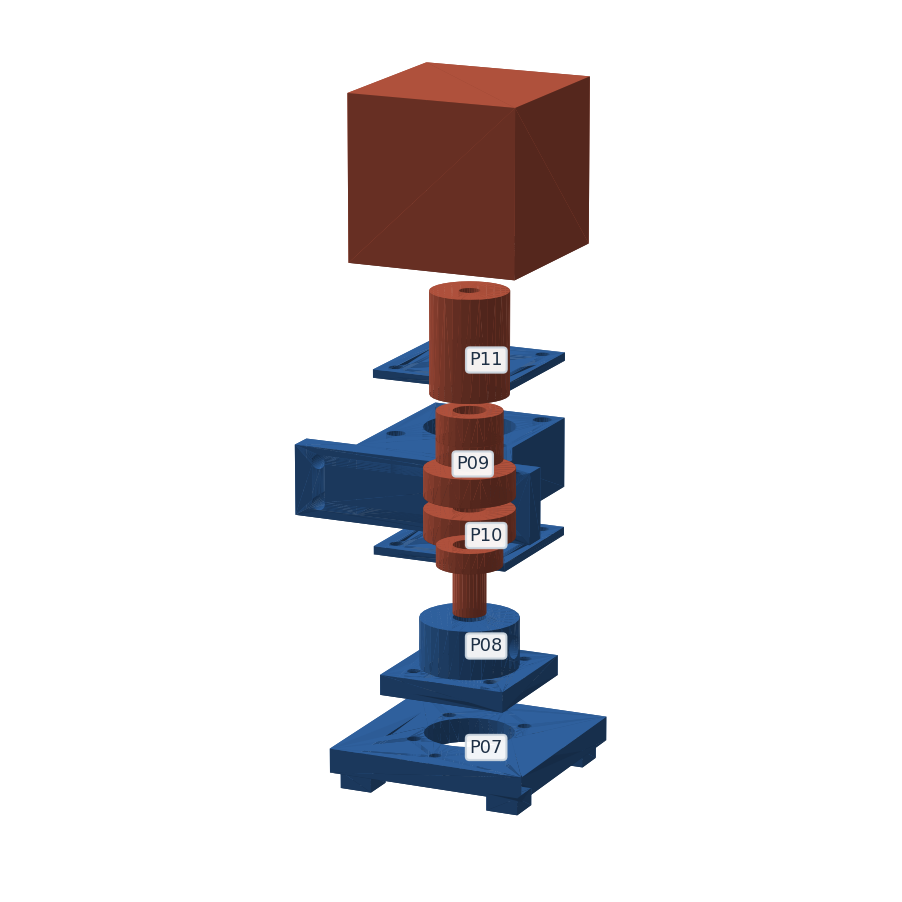

### 1. 베어링 집 P09

608 두 개를 z35..42,45..52 좌대에 넣는다. 바깥 링에만 힘을 주어 수직으로 누른다. 안쪽 링을 눌러 바깥 링을 끼우지 않는다. FDM 구멍을 강한 억지 끼움으로 쓰면 집이 갈라지거나 베어링이 비뚤어진다.

### 2. 앞/뒤 캡

P10은z33..35, P11은z52..54다. 인서트는 앞·뒤각4개다. F05를 대각 순서로 조인다. 캡의 중앙 구멍과 축이 닿으면 캡을 비틀어 조인 것이므로 다시 정렬한다.

### 3. 캐리지 P12 연결

하우징 귀와 캐리지의 x=±24,z=38.5/48.5 구멍을 맞춘다. F07 네 개를 머리→와셔→캐리지6T→집의 귀6T→와셔→너트 순서로 넣는다. 움직이는 베어링 부분과 구분해 이 연결은 단단하게 고정한다.

### 4. 블록에 연결

P12의 x=±10,z74/94 네 구멍으로 MGN12H에 F08을 넣는다. 나사끝이 블록 안에서 바닥에 닿으면 체결력이 생기지 않는다. 물림3~4 mm 범위를 공급자 도면과 대조한다.

### 합격 기준

축을 넣기 전에도 베어링 내륜이 매끄럽게 돌아야 한다. 축을 넣으면 두 좌대 사이에 강제로 휘어 들어가지 않고 손으로 회전해야 한다. 블록을 이동해도 특정 구간이 갑자기 무거워지지 않아야 한다.

## 측면 축·허브·모터를 연결

### 1. 앞에서 쌓는 순서

P07→P08→앞 F8-16M→P10→608→P09→608→P11→뒤 F8-16M→B14 금속 링 순서다. 추력 베어링은 두 궤도 와셔와 볼 케이지의 방향을 제품 안내대로 조립한다. 회전축과 함께 도는 와셔/고정면에 닿는 와셔를 구분한다.

### 2. 축방향 이탈 방지

뒤 추력베어링 z54..59, 고정 링z59..66이다. 앞 베어링과 허브가 닿은 상태에서 링을 앞으로 밀고, 회전이 무거워지지 않는 지점에서 고정한다. 당겨 빠지거나 축방향 딸깍임이 크면 다시 조절한다. 커플링을 유일한 축방향 스토퍼로 쓰지 않는다.

### 3. 허브 고정

P08에 M4 인서트2개를 설치한다. 축의 평면에 두 세트스크류가 닿도록 맞춰 번갈아 조인다. P07은 F05 네 개로 허브에 고정한다. 나사를 끝까지 조였는데 판이 들뜨면 나사 길이와 인서트 돌출을 확인한다.

### 4. 모터와 커플링

모터를 F09 네 개로 캐리지에 가조임한다. Ø8축은 커플링 z70..83, Ø5모터축은84..95에 들어간다. 축끝 사이 약1 mm 여유를 두고, 커플링 양쪽을 조인 후 모터 나사를 교차 조임한다. 양축 어긋남을 커플링을 휘어 흡수하게 만들지 않는다.

### 합격 기준

전원 없이 천천히 돌릴 때 일정한 모터 코깅 외의 뻑뻑함이 없어야 한다. 판을 앞뒤로 약10 N 밀어 고정 링·허브가 미끄러지지 않는지 본다. 네 모듈을 F/R/B/L로 표시하고 개별 결과를 기록한다.

## 서보 몸체를 나사로 고정

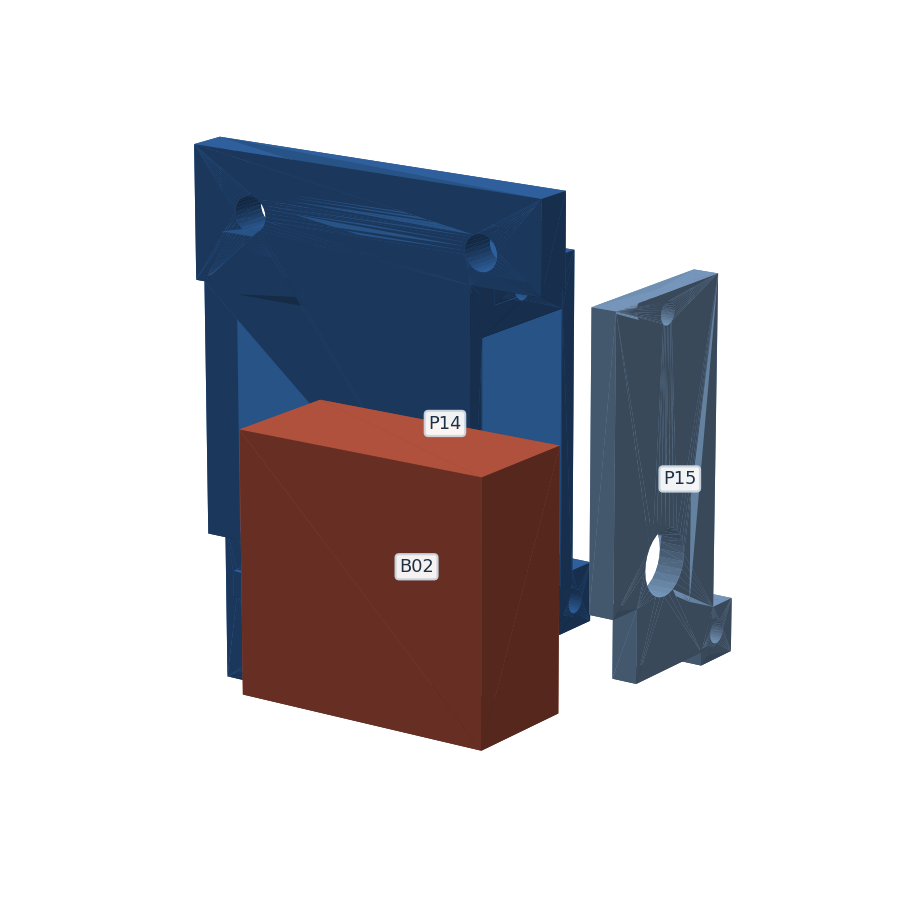

### 1. 몸체 대조

B02 실제 몸체와 크래들을 대조한다. 모델 기준 몸체 x=-24.95..17.95,y=-53.85..-34.15,z184.95..225.65다. 브랜드별 귀·배선·축 돌출이 다르므로 귀가 눌리거나 케이블이 끼이면 사용 전에 받침을 수정한다.

### 2. 크래들과 분리 캡

P14에 서보를 넣고 P15를 X축 방향에서 덮는다. 앞 체결점은(y=-30,z181), 뒤는(y=-44,z231)이다. F15 두 개를 머리→와셔→P15→크래들→와셔→너트 순서로 넣는다. 플라스틱 케이스가 찌그러지기 직전까지 조이지 않는다.

### 3. 위치 결정 돌기부터 끼우기

P14 아래 발의 폭16×높이4 돌기를 P13 왼쪽 뒤 포켓에 끼운다. 발 뒷면은 P13 앞면(y=-51)에, 위 플랜지 뒷면은2060 앞면(y=-57)에 동시에 닿는다. 돌기가 걸리면 버·코끼리발만 제거하고 두 면이 뜬 채로 조이지 않는다.

### 4. 같은 세 볼트로 고정

위쪽(x=±20,z239)에 F11 두 개: 머리→와셔→P14 6T→T너트. 아래(x=-20,z171)에 F25 한 개: 머리→와셔→P14 발3T→P13 6T→T너트. 아래 볼트를 먼저 손으로 물리고 위 두 개를 번갈아 조인다. 측면4개와 D 모두 같은 P14/방법이다. 전산봉·간격관·측판 추가 홀은 없다.

### 합격 기준

출력축 중심이(22,-44,195)에 있고 서보 몸체가 손으로 비틀어도 움직이지 않아야 한다. 캡 중앙 Ø10은 출력부 통과 여유다. 일반 나사를 출력축 스플라인에 억지로 넣지 않는다. 막대 서보는 P25/P26, 금속 지지판 M04에 F16으로 같은 방식 체결한다.

## 크랭크·링크: 흔들림 없이 자유 회전

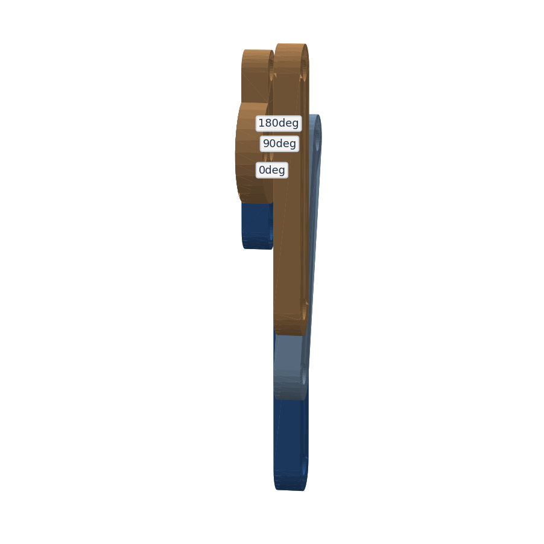

### 1. 서보 각도부터 설정

링크와 큐브를 분리한 상태에서 서보를 후퇴 명령180°로 보낸다. 실제 서보가0~180°를 움직이는지 먼저 확인한다. 서보가 기계적 끝에서 윙윙거리면 혼을 억지로 맞추지 말고 펄스 범위를 교정한다.

### 2. 금속 혼에 크랭크 고정

P16/P27의 중심 구멍은 스플라인이 아니다. 실제25T 금속 원형 혼에 중심 나사로 고정하고, r5 위치 두 Ø2.2 홀로 F20 두 개를 넣는다. 혼의 실제 두께·볼트 머리가 모델 간격에 들어가는지 확인한다. M2 볼트 두 개가 토크를 전달하며 중심 나사만의 마찰에 의존하지 않는다.

### 3. 링크 두 조인트

크랭크 끝과 링크 한쪽, 링크 반대쪽과 캐리지 보스를 F19로 연결한다. 축 표면이 매끈한 Ø3 조인트를 쓴다. 너트는 잠금 너트/더블너트로 고정하되 두 출력물을 함께 압착하지 않는다. 얇은 와셔로 옆 유격0.1~0.2를 시작값으로 맞춘다.

### 4. 치수 확인

일반 크랭크 반경12, 링크 중심거리36, 서보축z195다. 결합 캐리지 핀z147, 후퇴171로24 이동한다. 막대는 반경15, 축z255, 캐리지 핀204→234로30 이동한다. 부품 끝에서 끝까지가 아니라 구멍 중심 사이를 잰다.

### 사점 주의

0°/180° 근처에서 변위가 작아져도 이상이 아니다. 정확한 사점이 자동으로 안전한 잠금을 보증하지 않는다. 링크가 휘거나 축이 비틀리면 하중이 서보 기어로 전달된다. 무부하로15° 간격 이동해 간섭·볼트머리 접촉·지지대 휨이 없는지 확인한다.

## D 하부 모듈: 중공축과 벨트

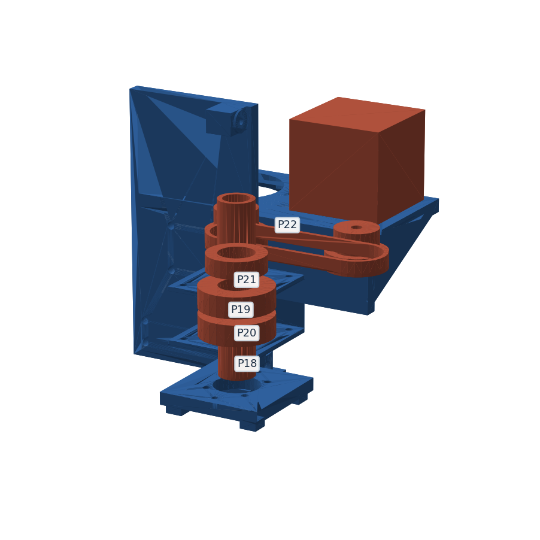

### 1. 전용 부품 사용

P18~P22, 6003 두 개와B08 중공축을 쓴다. 측면608 집과 섞지 않는다. D 허브는 OD32로 두껍게 보강했으며17.15 보어·M4 인서트2개를 사용한다.

### 2. 베어링과 양방향 포획

6003은z35..45와48..58, 앞 캡z33..35, 뒤 캡z58..60이다. 앞 추력 유닛z28..33, 뒤는60..65, B15 링은65..73이다. B13은 총두께5인 실제 적층을 확인하고, 9T짜리51103을 그대로 넣지 않는다.

### 3. 모터·벨트

모터 중심은 국소x+60이다. 모터5보어와 축17보어 풀리를 맞춘다. 벨트는40T:40T, 피치길이200, 폭6이다. 두 풀리 치면이 같은 z평면을 이루도록 맞춘 뒤 장공에서 모터를 조금씩 움직여 장력을 준다.

### 과도한 장력 금지

벨트를 손가락으로 눌러 약간 휘어지는 초기 상태에서 저속으로 시험한다. 처짐 목표값은 실제 벨트 공급자 기준으로 확정한다. 장력을 주었을 때 축 회전이 급격히 무거워지거나 플라스틱 캐리지가 휘면 너무 세게 당긴 것이다.

### 합격 기준

막대를 넣기 전에 중공축을 손으로 회전하고24 mm 전 구간 이송한다. 종동 풀리와 뒤 링 사이 명목3 mm, 막대와 내경 사이 대각 여유약0.59 mm다. 금속 가공 버·축 휨·풀리 편심으로 이 여유를 소모하지 않아야 한다.

## 승강 잠금 막대와 금속 지지판

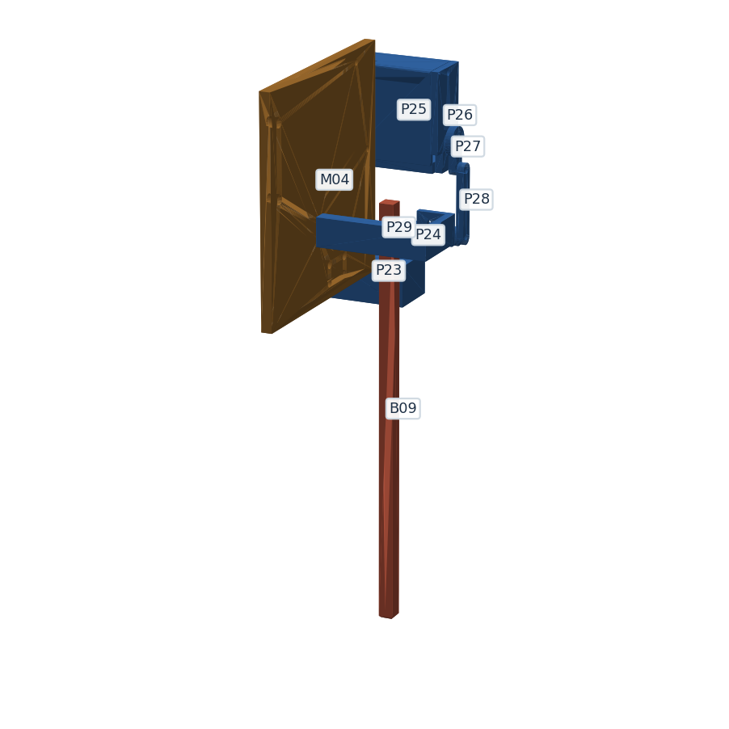

### 1. M04부터 고정

D 프로파일의 옆면 슬롯에 M04를 붙인다. M04는 국소x=-36..-30이다. y=-67,z240/280 두 곳에 F11을 넣어 고정한다. 금속 지지판의 옆면과 프로파일 사이에 이물질이 없어야 한다.

### 2. P23 고정

먼저 P23 왼쪽면x=-30의 네 Ø5.6 자리에 F02 M4 인서트를 열삽입해 면과 같게 만든다. M04에 밀착하고 y=±9,z180/190 네 곳을 뒤에서 F21로 조인다. 머리→와셔→금속판6T→인서트 순서다. 긴 관통 나사·반대편 너트는 없다. 인서트가 돌거나 들리면 교체하고 가이드를 압착해 막대를 조이지 않는다.

### 3. 막대 캐리지

P24에 M3 인서트1개를 설치하고 막대를 끼운다. M3×8 세트스크류는 막대 평면을 누른다. 단단히 고정하기 전에 결합 끝을 큐브 중심 기준y=-23.8로 맞춘다. 소켓 입구-26.5에서2.7 삽입되고 바닥-23.5까지0.3 여유가 남는다.

### 4. 막대 서보와 스위치 받침

P25/P26은 M04의(y38,z241)/(y24,z291)에 F16 두 개로 고정한다. P27/P28은 r15다. P29의 x=-30 면에 F01 M3 인서트 두 개를 먼저 열삽입한다. M04 뒤에서 F24 두 개를 y=-21,z208/216에 넣는다. 길이80 나사 대신12 mm를 쓰고 인서트 물림과 나사 끝 여유를 확인한다. 스위치는 P29 장공에서 조절한다.

### 합격 기준

막대를 손으로 전 구간 움직일 때 걸림이 없어야 한다. 막대가 잠금 센터에 닿기 전에 가이드에 끼어 멈추면 축 정렬부터 다시 한다. 결합 센서가 눌렸다는 사실만으로 코어를 충분히 잡았다고 판단하지 않고 유격 시험을 따로 한다.

## 한 쌍씩 큐브 중심에 정렬

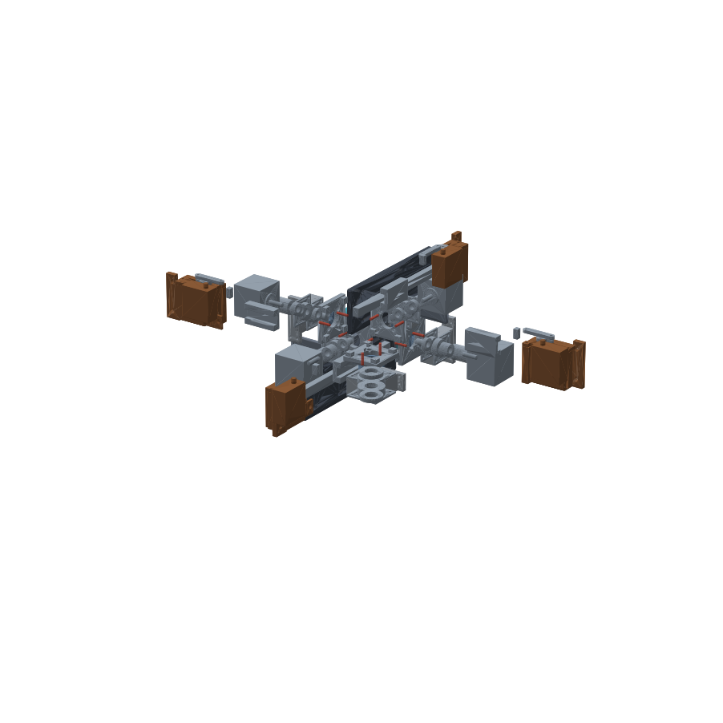

### 1. 전원 차단·가조임

전원 두 개를 끄고 링크를 캐리지에서 분리한다. J01을 큐브 중심에 임시 받침으로 올린다. 블록 실제 외형57.00과 직각을 확인한다. J01은 전동 구동 대상이 아니므로 이 상태에서 회전시키지 않는다.

### 2. D 높이

D구동판 네 패드가 J01 바닥면에 고르게 닿게 D 프로파일 끝 체결·P13 위치를 맞춘다. 패드 하나만 심하게 눌리면 판의 기울기부터 고친다. 바닥 A에서 블록 중심까지332인지 확인한다.

### 3. F/B 한 쌍

F/B 판이 J01의 두 면에 균일하게 닿게 한다. 두 판의 중앙축을 같은 높이에 맞추고 반대편을 먼저 완전히 조이지 않는다. 정렬 후 J01을 빼고 실제 큐브 소켓에 핀이 힘 없이 들어가는지 확인한다.

### 4. R/L 한 쌍

F/B로 지지한 상태에서 R/L을 같은 기준으로 맞춘다. 좌우판을 앞뒤판에서 이어 재지 않는다. J01은 외형 기준이고 핀의 소켓 정렬은 실제 큐브로 마지막 확인한다. 케이블이 틈에 들어가 패드 접촉을 바꾸지 않도록 한다.

### 합격 기준

각 헤드는 약한 손 힘으로 결합되어야 한다. 핀을 비틀어 억지로 넣어야 하면 각도 또는 피치 문제다. 코어 고정상태에서 새 쌍을 먼저 결합한 뒤 기존 쌍을 푼다. 각 단계 후 고정 볼트에 표시선을 그어 이후 풀림을 찾는다.

## 마이크로스위치 여섯 개 조정

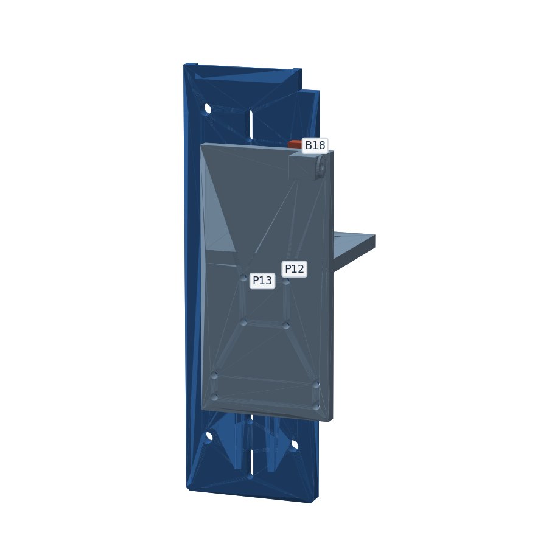

### 1. 접점 확인

멀티미터로 눌리지 않을 때 COM-NO가 열리고 눌리면 닫히는지 확인한다. 케이스의 단자 위치를 이름만 보고 단정하지 않는다. 세 단자 중 NC는 절연해 둔다.

### 2. 헤드 스위치

P13의x18.75/25.25,z154.9 부근 장공에 F22 두 개로 고정한다. 구동핀 삽입3 mm와 패드 접촉이 완료되는 근처에서만 NO가 닫히게 조절한다. 레버를 누르는 캐리지 접촉면에 모서리나 볼트머리가 걸리지 않게 한다.

### 3. 막대 스위치

P29에 같은 방식으로 고정한다. 실제 막대 끝2.7 mm 삽입을 확인한 뒤 스위치가 닫히게 조절한다. 막대가 소켓 위에서 막혔는데 스위치만 닫히는 경우에는 센서 위치나 접촉방식이 잘못된 것이다.

### 4. 쌍 직렬 배선

D12→F COM/NO→B COM/NO→GND, D13→R→L→GND로 직렬 연결한다. 둘 다 닫혔을 때만 입력LOW다. D는A0, 막대는A1이다. 내부 풀업을 사용하므로 스위치에6V나12V를 넣지 않는다.

### 제한과 합격 기준

결합 센서 하나의 해제만으로 두 헤드가 모두24 mm 후퇴했다고 증명할 수 없다. V4는 후퇴 끝 전용 센서가 없다. 최초 시험에서는 두 헤드를 각각 눈금으로 확인하며, 반복 운전 전에는 후퇴 감지·지지 상태 감지 추가를 검토한다. 20회 반복에서 조기 작동·채터링·위치 이동이 없어야 한다.

## 전원·신호 배선

### 전원 분리

모터VMOT는12V 단자대, 서보는별도6V 단자대, UNO와LCD/A4988 VDD는5V다. 세 전원 GND는 한 공통 기준점에서 연결한다. 서보6V와UNO5V 양극은 연결하지 않는다. USB가 연결된 보드5V핀에 다른5V를 동시에 밀어 넣지 않는다.

### A4988 5개

STEP은F/R/B/L/D 순D2/3/4/5/6, DIR은D7 공용. ENABLE은LOW, RESET/SLEEP은함께5V, MS1/2/3는LOW(풀스텝)다. 각 드라이버VMOT 가까이100µF/25V 이상을 달고 극성을 확인한다.

### 서보와 스위치

서보신호 FB=D8(2개),RL=D9(2개),D=D10,LOCK=D11이다. 신호만 공유하고 전원은 각각단자대에서 분기한다. 센서FB=D12,RL=D13,D=A0,LOCK=A1. 거울배치한 두서보가 실제로 동시에 안쪽/바깥쪽으로 움직이는지 링크 분리 상태에서 확인한다.

### 키트 부품

K01 LCD는SDA=A4,SCL=A5,VCC5V,GND. K02 버튼은A2-GND,내부풀업. K03 부저는A3이며정격전류를 확인한다. 버튼 짧게START,1.2초이상LOAD/배출이다. 신호선은K04, 전원선은전류에맞는별도전선을쓴다.

## 전류 제한과 무부하 전기 시험

### 1. 전원 전에

모터 네 선을 테스터로 재서 두 코일쌍을 찾고 각 쌍을1A/1B,2A/2B에 연결한다. 제조사 선색을 다른 제품에 그대로 적용하지 않는다. 전원 OFF에서만 모터 커넥터를 탈착한다.

### 2. 전류 제한

A4988의 감지저항 Rs를 확인한 뒤 해당 모듈 설명서로 VREF를 정한다. 대표식 Imax=VREF/(8Rs)는 실제 회로가 이 공식을 따르는 경우에만 사용한다. 모터 정격과 드라이버의 실제 냉각 한도 중 낮은 쪽을 넘지 않는다. VREF 숫자 하나를 모든 모듈에 복사하지 않는다.

### 3. 서보만 시험

링크를 분리한 여섯 서보를 한 개씩 시험한다. 짝 신호의 두 서보는 좌우/앞뒤 거울 조립이어야 같은 PWM에서 같은 결합 상태가 된다. 180°명령이 모든 MG996R에서 실제180°인 것은 아니므로 실제 r12 두 끝의 차이24를 측정한다.

### 4. 모터만 시험

큐브·핀을 분리하고 모터 하나씩50스텝(90°)을 저속으로 보낸다. 면을 바깥에서 보는 방향과 CW/CCW가 맞는지F/R/B/L/D별로 표시한다. 풀스텝200/회전,벨트1:1 기준이다. 마이크로스텝을 바꾸면 펌웨어50스텝 상수도 함께 바꿔야 한다.

### 합격 기준

반복 동작 동안 전압 강하·보드 리셋·서보 발진·드라이버 과열 정지가 없어야 한다. 열화상/온도계로 부품 정격을 넘지 않는지 확인한다. 과열을 손으로 만져 판단하지 않는다. 이동 케이블은24 mm+굽힘 여유를 두고 레일·벨트·링크에 묶지 않는다.

## 최초 기계 시험은 한 면씩

### 1. 회전부보다 이송부터

큐브 없이 헤드0↔24, 막대0↔30을 각20회 움직인다. 조인트가 구속되지 않고 캐리지·링크·혼의 나사머리가 닿지 않는지 본다. 스위치가 각 끝의 실제 상태를 올바르게 읽는지 확인한다.

### 2. 장착

큐브의 흰색U를 아래로 놓는다. LOAD 1단계는 D만 결합시키고 큐브를 핀 두 개에 맞춰 올리게 한다. 두 번째 LOAD에서 막대와 FB가 결합한다. 화면의 LOADED orient=1을 확인한다. 표시만 보고 핀 삽입을 추측하지 않는다.

### 3. 단일 회전

현재 orientation=1에서 논리U가 물리D다. 자동 뒤집기를 피하려면 논리U의 한 수부터 시험한다. 한 수 전후 실제 스티커 정렬을 재고, 이어서 논리 F/B/R/L을 각각 시험한다. 처음부터 S/V 전체 수열을 실행하지 않는다.

### 4. 상대면 유지

움직이는 면의 반대면 모터는 유지 토크로 고정되어야 한다. 잠금 막대는 코어의 반력을 받는다. 핀·축·코어 중 어디서 미끄러지는지 표시선으로 구분한다. 탈조나 걸림이 보이면 전원을 차단하고 원인을 찾는다.

### 합격 기준

각면90°/180°/역방향을각20회시험해면정렬과재진입을기록한다. 목표반복오차<0.5°는실측시험목표다. 모델내표시값이맞아도실제오차가커지면통과가아니다. 필요구동토크를재고모터전류·속도를정한다.

## 뒤집기·재진입: 자동화 전 마지막 시험

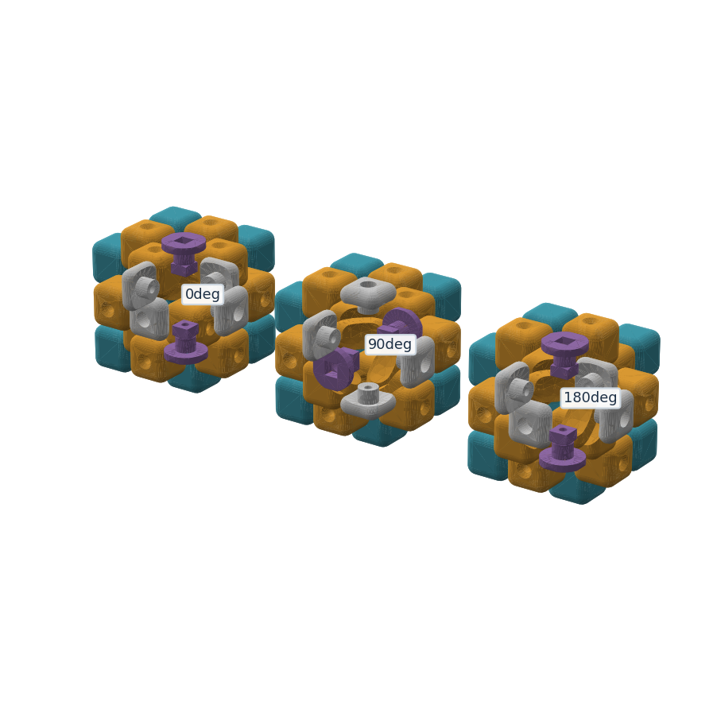

### 순서

RL결합→FB후퇴→D후퇴→LOCK후퇴→R/L이 같은 월드 방향으로180°회전한다. R/L의 바깥면에서 보는 회전 방향은 서로 반대이므로 축의 방향 표시를 확인한다. 공용 DIR 배선 때문에 두 STEP 펄스를 교차해 내보내는 현재 펌웨어를 사용한다.

### 먼저 손으로 지지하며 확인

전원 OFF에서 낙하 방지 받침을 준비하고 실제 큐브가 중간 각도에서 빠지지 않는지 확인한다. 첫 저속 동작은 손을 구동 범위 밖에 두고 관찰한다. RL판은 옆층만 직접 잡으므로 가운데층과 코어가 따라오는지 색 표시선으로 확인한다.

### 마찰 가정의 한계

현재 V4는 가운데층이 마찰로 따라온다고 가정한다. CAD 간섭 통과만으로 강체처럼180°뒤집힌다고 보장할 수 없다. 가운데층이 지연되거나 서로 다른 층이 틀어지면 자동 풀이를 중단한다. 그 경우 전체 큐브를 붙잡는 별도 크래들·재색인 구조가 필요하며 단순 전류 증가는 해결책이 아니다.

### 재진입 검사

뒤집기 후 막대 끝이 사각 소켓에 부드럽게 들어가고 새 헤드가 핀을 힘없이 삽입하는지 확인한다. 막대 끝 모따기를 이유로 몇 도의 어긋남을 억지로 눌러 맞추지 않는다. 소켓 벽이 눌리거나 유격이 커지면 실패다.

### 합격 기준

20회왕복뒤집기후층각도·코어각도·핀삽입·막대삽입을각각기록한다. 실패0회,누적오차와재진입이허용범위에들어올때만자동섞기/풀이를시험한다. 실패하면이문서의제작완료범위는개별면회전과수동정렬을통한기구시운전까지다.

## 오차·강성 계산과 실제 합격 조건

### 구동핀의 하중

토크0.10 N·m, 반경19.1 mm일 때 두 핀의 균등 분담은 핀당2.62 N, 한 핀 집중은5.24 N이다. 삽입3×지름3의 투영 면적9 mm²에 대한 평균 접촉압력은 약0.29/0.58 MPa다. 적층 방향·충격·소켓 모서리 응력 집중은 이 계산에 포함되지 않는다.

### 핀 간극에 의한 각도

소켓3.4, 핀3의 명목 반경 유격0.20을 반경19.1로 나누면 한 방향 약0.60°다. 반전 시 총 유격은 약1.20°까지 될 수 있다. 따라서0.5°미만 반복 목표를 CAD 기본 간극만으로 보증할 수 없다. 실제 핀·소켓 선정과 항상 같은 방향 최종 접근 등의 검증이 필요하다.

### 사각 잠금의 유격

8×8 막대가8.4 사각 소켓에 있을 때 8(cosθ+sinθ)=8.4에서 한 방향 약2.94°의 회전 여유가 가능하다. 가이드8.3의 약2.19°와 코어 키 포켓 유격도 작용한다. 이 값은 상한 성격의 기하 예시다. 출력물만으로 정밀 잠금이 완성되었다고 주장하지 않는다.

### 실물에서 판단할 것

코어에50 mm 레버를 임시 연결해2 N(0.10 N·m)을 양방향으로 가하고 고정 지그 기준 각변위를 잰다. 지속 미끄러짐0, 목표 각변위0.5°미만과 핀 재진입 합격을 요구한다. 불합격이면 금속 키·정밀 부싱·테이퍼 결합 등 잠금부 재설계가 필요하다. 임의 종이 끼움이나 접착제 채움으로 자동 운전을 승인하지 않는다.

### 충돌 여유

핀 후퇴 끝49.5, 큐브 외곽 회전 반경40.31로 명목9.19 mm다. 막대 후퇴 끝53.8은13.49 mm 여유다. 중공축12.5 안의 사각8 대각 여유는(12.5−8√2)/2≈0.59 mm다. 실제 휨·배치 오차·나사머리·배선·출력 변형을 이 여유 안에서 관리한다.

## 증상별 점검 순서

### 핀이 안 들어간다

①큐브 층 각도→②핀 피치38.2→③핀 돌출 차이→④모듈 중심→⑤소켓 시험편 순서로 확인한다. 핀 끝에 잉크를 가볍게 묻혀 어느 쪽 벽에 닿는지 본다. 모터 토크로 밀어 넣지 않는다.

### 한 방향에서만 걸린다

베어링 두 좌대의 동축도, 커플링 삽입 깊이, 구동판 패드 편차, 뒤 링의 과한 예압, 벨트 풀리면 정렬을 확인한다. 부품을 하나씩 풀어 원인을 구분하고 전체 프레임을 한 번에 느슨하게 하지 않는다.

### 서보가 윙윙거리거나 전원이 꺼진다

링크 분리 상태의 각도 범위→캡의 케이스 압착→조인트 잠금→반대 헤드와의 간섭→공급 전압·전류 순서로 확인한다. 사점에서 과도하게 밀어붙이는 상태를 기본값으로 두지 않는다.

### 센서는 합격인데 실제 결합이 틀리다

스위치가 눌린 위치와 실제 핀·막대 끝의 위치를 동시에 관찰한다. 센서 받침 휨, 레버 조기 접촉, 직렬 스위치 중 하나의 고착을 의심한다. 센서 상태만을 개별 헤드의 후퇴 끝 확인으로 사용하지 않는다.

### 계속 누적 오차가 생긴다

전원이 꺼지거나 축을 손으로 돌리면 보드의 논리 큐브와 실물이 어긋날 수 있다. 실제 큐브를 풀린 기준 상태로 맞추고 R명령으로 동기화한다. 탈조·유격·뒤집기 지연을 해결하기 전에는 SOLVED 표시를 실제 완료 증거로 쓰지 않는다.

## 작업대 최종 확인표

### 가공·출력

[ ]구매품외형대조 [ ]핀/사각시험편기록 [ ]모든STL층분리없음 [ ]코어인서트6개 [ ]베어링집/허브인서트 [ ]모든날카로운금속버제거 [ ]프레임대각선차이기록

### 기계

[ ]큐브6면×20손회전 [ ]5헤드각24mm [ ]막대30mm [ ]핀돌출차이≤0.10 [ ]막대삽입2.7/바닥여유0.3 [ ]양방향축포획 [ ]크랭크혼M2두개 [ ]모든조인트자유회전

### 전기

[ ]GND공통/양극분리 [ ]A4988전류제한5개 [ ]VMOT콘덴서5개 [ ]서보피크전압 [ ]스위치6개개별시험 [ ]직렬쌍시험 [ ]두전원차단 [ ]이동배선여유

### 성능 기록

날짜:____________ 작업자:____________ 6면손회전:____________ 코어0.10N·m각변위:____________ 각면20회후오차:____________ 뒤집기20회실패수:____________ 막대재진입실패수:____________ 최대온도/주변온도:____________

### 운전 승인 범위

[ ]개별면시험까지 [ ]수동정렬을포함한시운전 [ ]뒤집기20회와핀재진입합격후자동풀이시험. CAD통과항목과실물합격항목을혼동하지않는다. 불합격내용과수정이력:________________________________________________

## 출력 부품

|번호|항목|수량 또는 역할|설명|
|---|---|---|---|
|P01|cube_core|큐브 코어|1|
|P02|cube_center|일반 센터|4|
|P03|center_recessed|U/D 파인 센터|2|
|P04|cube_edge|엣지|12|
|P05|cube_corner|코너|8|
|P06|socket_coupon|핀 공차 시험편|1|
|P07|drive_plate_2pin|2핀 구동판|5|
|P08|shaft_hub|측면 허브|4|
|P09|bearing_housing_direct|측면 베어링 집|4|
|P10|bearing_front_cap_direct|측면 앞 캡|4|
|P11|bearing_rear_cap_direct|측면 뒤 캡|4|
|P12|carriage_direct|측면 캐리지|4|
|P13|rail_support|공통 레일 지지대|5|
|P14|servo_mount|공통 서보 크래들|5|
|P15|servo_clamp|공통 서보 고정 캡|5|
|P16|crank|r12 크랭크|5|
|P17|link|36 mm 링크|5|
|P18|shaft_hub_hollow|D 중공 허브|1|
|P19|bearing_housing_hollow|D 베어링 집|1|
|P20|bearing_front_cap_hollow|D 앞 캡|1|
|P21|bearing_rear_cap_hollow|D 뒤 캡|1|
|P22|carriage_hollow|D 캐리지|1|
|P23|lock_guide|막대 가이드|1|
|P24|lock_carriage|막대 캐리지|1|
|P25|lock_servo_mount|막대 서보 크래들|1|
|P26|lock_servo_clamp|막대 서보 고정 캡|1|
|P27|lock_crank|r15 크랭크|1|
|P28|lock_link|막대 36 mm 링크|1|
|P29|lock_switch_bracket|막대 스위치 받침|1|
|J01|alignment_cube|57 mm 정렬 블록|1|
|J02|square_fit_coupon|사각축 공차 시험편|1|
|J03|pin_depth_gauge|8 mm 핀 깊이 지그|1|

## 구매 부품

|번호|항목|수량 또는 역할|설명|
|---|---|---|---|
|B01|NEMA17 1.8° 모터|5|몸체42.3×42.3×40 이하, 축Ø5/돌출20, 홀 피치31. 5개 동일 규격.|
|B02|MG996R 서보 + 금속 25T 원형 혼|6|몸체42.9×19.7×40.7 외형 기준. 실측·180° 실제 이동 확인. 사진의 소형 서보로 대체하지 않음.|
|B03|A4988 모듈 + 방열판|5|사진의 스텝모터 드라이버와 별개. VMOT 12V, VDD5V, 모터 정격 전류에 맞는 제품.|
|B04|Arduino UNO R3 또는 R4 WiFi|1|사진에서 보드 자체의 포함 여부를 확인할 수 없어 구매로 분류. 이미 보유하면 재사용.|
|B05|MGN12 180 + MGN12H 블록|5세트|블록20×20 M3 장착 홀, 설치 총높이13. 첫 홀 오프셋10 또는15/피치25를 도면과 대조; P13 장공으로 수용.|
|B06|강철 다월핀 Ø3×16|10|2개/헤드. 실제 지름을 먼저 측정. 앞 돌출8, 판 두께6, 뒤 돌출2.|
|B07|정밀 강재축 Ø8×67|4|베어링 맞춤부 h6 권장. 허브·커플링 세트스크류 접점 평면 가공, 베어링 자리는 가공하지 않음.|
|B08|중공 정밀축 OD17 / ID12.5 ×82|1|OD17 h6, 내경12.5(+0.05/0) 시작 요구. 동심도·곧음≤0.05 목표. 제작업체 도면 확인.|
|B09|강재 사각 막대8×8×230|1|실측8.00±0.03 목표, 휨≤0.10/230 목표. 선단1 mm 모따기. 결합 끝 y=-23.8로 고정.|
|B10|608 베어링 8×22×7|8|측면 2개/헤드. 실드/실링 제품의 실제 회전 저항 확인.|
|B11|6003 베어링17×35×10|2|D 전용. 6001과 혼용하지 않음.|
|B12|F8-16M 추력 베어링8×16×5|8|측면 앞/뒤 1개씩. 축방향 반력용이며 608을 과도하게 예압하지 않음.|
|B13|D 추력 유닛17×30×총5|2세트|AXK1730 2T + AS1730 1T 2장 + 1T 정밀 시임의 적층 예. 실제 공급 도면·총두께를 확인. 51103 9T는 그대로 맞지 않음.|
|B14|분할 축 고정 링 Ø8 / OD≤16 / 7T|4|금속 클램프 링, 축방향 조절 가능. 세트스크류 단독 링보다 분할형 권장.|
|B15|분할 축 고정 링 Ø17 / OD≤28 / 8T|1|D 뒤 추력 베어링-풀리 사이. 지정 두께 초과품은 재설계 필요.|
|B16|5→8 클램프 커플링 Ø≤19×25|4|양쪽 삽입 길이 및 축끝 사이 1 mm 여유 확인.|
|B17|GT2 40T 풀리2 + 200-2GT-6 벨트1|1세트|모터 보어5, 종동 보어17. 풀리OD≤28, 전체길이≤18, 허브OD≤20. 종동17 보어는 가공품 가능.|
|B18|레버 마이크로스위치|6|몸체12.8×6.5×5.8, 홀 피치6.5. COM-NO 사용, 장공으로 작동 위치 조절. 스위치의 실제 레버는 CAD 외형에 없음.|
|B19|12V 모터 전원 + 6V 서보 전원|각1|초기 후보12V 10A/6V 10A. 모터·서보 정격과 동시 피크 전류/발열 측정 후 확정. 인증된 외장 DC 전원 사용.|
|B20|나사·너트·인서트·전원 부속|1묶음|별도 체결표 F01~F25 참조. Rev B에서 F17/F18은 삭제. 핀·스프링·실리콘 패드·스위치 배선도 누락하지 않음.|
|K01|LCD1602 + I2C 모듈|1|사진의 LCD1602 with IIC. 전압5V·주소를 확인.|
|K02|TACT 버튼|1|사진의 택트 스위치. 눌림으로 연결되는 접점을 테스터로 확인.|
|K03|부저|1|사진의 부저. 능동/수동과 전류를 확인; 핀 정격을 넘으면 트랜지스터 구동 필요.|
|K04|점퍼선|필요량|사진의 점퍼와 F-M 케이블. 신호선에 사용; 모터·서보 주전원 배선은 별도 구매.|
|M01|합판 패널|5|바닥621×621×18, F/B 597×450×12, R/L 621×450×12. 각2개, DXF 1:1.|
|M02|2060 알루미늄 프로파일|5|측면268 mm 4개 + D301.5 mm 1개. 앞끝 국소z=2, 뒤끝270/303.5. 단면 슬롯·코어 도면 확인.|
|M03|금속 L앵글40×40×40, 3T|16|수직 모서리8 + 바닥8. 홀 중심은 면당20, Ø4.5. 각 앵글은 두 면 체결.|
|M04|알루미늄 잠금 지지판6T|1|124×126×6, DXF. D2060 측면 슬롯에 M5 두 개로 체결. 가이드·서보·스위치 받침을 여기에 고정.|

## 체결 부품

|번호|항목|수량 또는 역할|설명|
|---|---|---|---|
|F01|M3 인서트 OD4.6×L4|69|코어6 + 허브20 + 베어링 집40 + 막대 캐리지1 + P29 받침2|
|F02|M4 인서트 OD5.6×L4|14|회전 허브2/헤드×5 + P23 가이드4|
|F03|M3×16 / M3×14|4 / 2|일반 센터4 / U·D 파인 센터2. 실제 머리 높이≤3, 도면의 삽입 깊이 확인|
|F04|압축 스프링 + M3 와셔|4세트|일반 센터 전용: ID≥3.2, OD≤6.5, 작동 압축 길이 실측. 파인 센터는 키 고정|
|F05|M3×8 + 와셔|60|구동판-허브20 + 베어링 앞/뒤 캡40. 인서트 유효 물림≥3 확인|
|F06|M4 세트스크류 M4×8|10|허브 2방향, 축의 평면에 닿게. 구매 인서트 길이에 맞춰 실측|
|F07|M3×20 + 너트 + 와셔2|20|하우징-캐리지 4개/헤드, 6+6=12T 관통|
|F08|M3×10 + 와셔|20|MGN12H 블록-캐리지4/헤드. 6T+와셔 뒤 유효 나사3~4 mm|
|F09|M3×10 + 와셔|20|NEMA17 4/모터, 6T+와셔 뒤 모터 나사깊이≤3 확인; 필요 시 더 짧게|
|F10|MGN 레일 M3 나사+중앙 슬롯 T너트|35|레일7홀×5. 2060 x=0 슬롯에 M3 T너트. 카운터보어 받침면~밑면+P13 6T+물림으로 길이 선정|
|F11|M5×12 + T너트 + 와셔|32|P13 4×5 + P14 위쪽2×5 + 잠금 지지판2. 6T+와셔1 뒤 물림5|
|F12|M6×30 + 대형 와셔|10|프로파일 끝2/개. 측판12T에서는 물림16, 바닥18T에서는 물림10. 코어 탭M6 깊이20|
|F13|M4×25 + 너트 + 와셔2|16|수직 모서리 앵글8개×2면. 12T합판+3T금속|
|F14|M4×30 + 너트 + 와셔2|16|바닥 앵글8개×2면. 바닥18T 쪽에도 충분한 물림|
|F15|M3×60 + 너트 + 와셔2|10|일반 서보 고정 캡2개/대. 사출 몸체를 찌그러뜨리지 않고 캡 틈으로 조절|
|F16|M3×70 + 너트 + 와셔2|2|잠금 서보 고정 캡2. 실제 쌓임 길이에 맞춰 여분 와셔|
|F17|전산봉: 사용하지 않음|0|Rev B에서 삭제. P14를 2060에 직접3점 고정|
|F18|길이 맞춤 간격관: 사용하지 않음|0|Rev B에서 삭제. 서보 높이는 P13 포켓과 P14 돌기로 결정|
|F19|M3 어깨 나사 / 평활 핀 조인트|12세트|크랭크-링크6 + 링크-캐리지6. 평활 Ø3, 너트 잠금 시 회전 유격0.1~0.2. 나사산을 베어링면으로 쓰지 않음|
|F20|M2×8 + 너트 / 서보 중심 나사|12 / 6|원형 금속 혼-크랭크2/대. 중심 나사는 서보 제조사 규격, M3로 단정하지 않음|
|F21|M4×12 + 와셔|4|M04 6T판 뒤에서 P23 M4 인서트로 체결. 유효 물림약4, 끝 여유 확인|
|F22|M2×20 + 너트 + 와셔2 / 패드|12 / 20|마이크로스위치2개/대 / 실리콘 패드8×8×약1T. 막대 캐리지 M3×8 세트스크류1 별도|
|F23|전원·배선 부속|1묶음|100µF/25V 이상5개, 서보측470~1000µF/10V, 단자대, 퓨즈홀더, 두 전원 차단 스위치, 굵은 전원선, 케이블 타이|
|F24|M3×12 + 와셔|2|M04 6T판 뒤에서 P29 M3 인서트로 체결. 유효 물림약4, 끝 여유 확인|
|F25|M5×16 + T너트 + 와셔|5|P14 아래 발3T + P13 6T + 와셔1. 유효 물림약6; T너트/슬롯 바닥 여유 실측|
