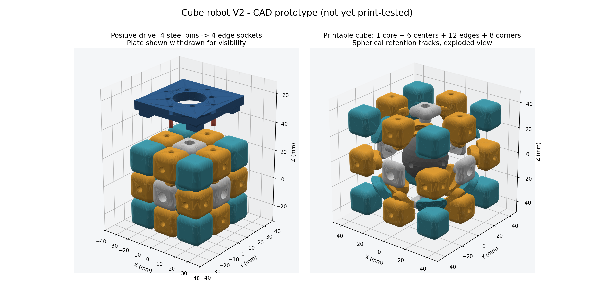
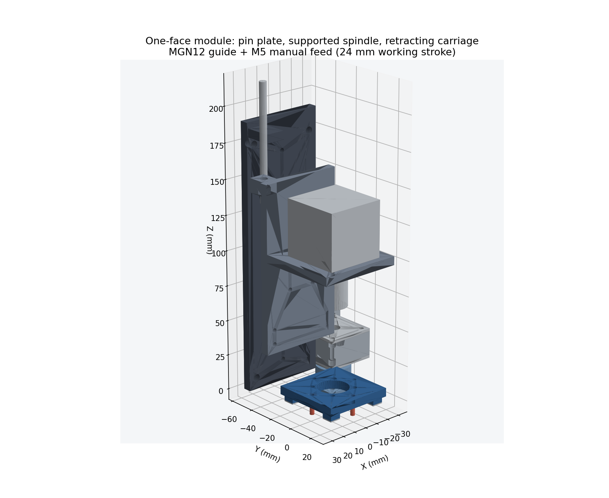

# 회전 전달 재설계 V2 — 출력 큐브와 엣지 핀 구동

2026-10-23 · 설계 상태: **출력 전 CAD 시제품**. 현재 클라우드에서는 로컬 Fusion 360 브리지 연결이 되지 않는다. STEP/STL 형상 생성과 기하 검사를 진행했으며, 실제 Fusion 가져오기·F3D 저장·출력·부하 시험은 로컬에서 이어서 확인해야 한다.

## 변경한 구조

센터 캡에 토크를 거는 V1 부품을 대신해 **출력 큐브의 엣지 조각 4개에 강철 핀을 끼우는 구동판**을 사용한다. 핀은 엣지의 구멍 벽을 직접 밀어 회전력을 전달한다. 코너는 큐브 내부 트랙에 붙잡혀 같은 층과 함께 회전한다. 센터는 나사와 코어를 중심으로 자유롭게 회전할 수 있다.

각 엣지는 큐브의 어느 위치로 이동하더라도 두 외부 면에 같은 구동 구멍이 나타나도록, **노출 면 2곳 모두**에 소켓이 있다. 따라서 섞인 뒤에도 동일한 핀 패턴을 사용한다.

다른 면을 돌릴 때 구동 핀이 조각을 붙잡지 않도록 헤드를 후퇴시킨다. 회전할 면과 반대 면을 잡고, 직교하는 나머지 네 면은 24 mm 물러난다. 축을 바꿀 때는 새 두 면을 먼저 결합하고 기존 두 면을 해제해 큐브가 지지되지 않는 순간을 피한다.



## 출력 큐브

| 항목 | 기본값 / 수량 |
|---|---|
| 완성 외형 | 57 × 57 × 57 mm |
| 조각 기본 폭 | 18.8 mm |
| 조각 중심 간격 / 핀 배치 반경 | 19.1 mm |
| 명목 조각 간극 | 0.30 mm; 프린터에 맞춰 시험 필요 |
| 출력 조각 | 코어 1, 센터 6, 엣지 12, 코너 8 |
| 내부 유지 구조 | 반지름 17.5~23.5 mm 구면 트랙, 엣지 스키드·코너 접촉판 |
| 엣지 소켓 | Ø3.4 mm, 깊이 4.2 mm, 입구 Ø4.4→3.4 / 0.6 mm 유도면 |
| 센터 조립 | M3 나사·스프링·와셔, 코어 M3 인서트 |

큐브 내부는 [Jared Deckard의 공개 기구 모델](https://github.com/deckar01/3x3x3-cube-puzzle)을 MIT 라이선스로 수정했다. 원본도 출력 검증이 완결됐다는 증거가 없으므로 **검증된 상용 큐브로 소개하지 않는다.** 원본 커밋, 수정 사항, 라이선스는 [THIRD_PARTY_LICENSE.md](../models/robot_v2/THIRD_PARTY_LICENSE.md)에 보존했다.

원본과 달라진 부분은 해석 가능한 STEP 솔리드로의 재구성, 0.30 mm 간극, 양면 구동 소켓, 센터의 M3 체결·스프링 자리다. 큐브 외부 플라스틱 조각과 코어는 모두 출력 대상이며, 나사·인서트·스프링은 구매 부품이다. 면 색은 스티커나 도색으로 구분한다.

## 한 면 구동 모듈

| 부품 | 역할 / 치수 |
|---|---|
| `drive_plate` | 50 × 50 mm, 판 두께 6 mm. 중앙 Ø22 mm 비접촉 구멍. 네 모서리 축 방향 받침 포함 |
| 강철 핀 4개 | Ø3 × 16 mm. 판 앞 8 mm 중 5 mm는 간격, 3 mm는 엣지에 삽입. 뒤로 2 mm 노출 |
| 모서리 패드 4개 | 8 × 8 mm, 실리콘 약 1 mm. CAD에서는 0.8 mm 압축 두께로 표시. 축 방향 위치를 잡는 용도 |
| `shaft_hub` | 8 mm 축과 구동판 연결. M4 인서트·세트스크류 2방향, M3 인서트로 판 체결 |
| 강철 축 | Ø8 × 67 mm, 표준 축 절단 가공 |
| 608 베어링 2개 | ID 8 / OD 22 / 폭 7 mm, 반경 방향 축 지지 |
| F8-16M 추력 베어링 | ID 8 / OD 16 / 두께 5 mm. 큐브를 누르는 축 방향 힘을 하우징에 전달 |
| 5→8 커플링 | 모델 외형 Ø19 × 25 mm. 실제 구매품 치수·삽입 길이 확인 필요 |
| `carriage` | NEMA17 31 mm 피치 장착, 베어링 하우징 고정, MGN12H 블록 장착 |
| MGN12 가이드 | 명목 길이 180 mm, MGN12H 20 × 20 mm 나사 패턴. 구매 도면 확인 필요 |
| `rail_support` | 가이드와 후단 이송 나사 지지. 외부 프레임 고정용 M5 구멍 |
| M5 이송 나사 | 첫 시제품의 **수동** 결합·해제용. 포획 너트를 통해 캐리지를 이동 |



기존 NEMA17 6개는 회전에 사용한다. V2의 6개 슬라이더를 자동으로 움직이려면 별도 구동기와 위치 확인 장치가 필요하다. 현재 CAD는 수동 M5 이송으로 기구를 먼저 시험할 수 있도록 구성했다. MGN 가이드·모터·베어링·커플링은 배치 검토용 구매 부품 형상이며, 특정 제조사의 완전한 가공 도면은 아니다.

모듈의 축 방향 이송 나사 끝을 포함하면 6면 조립의 최대 외형은 약 493 mm다. 레일 지지판을 연결하는 전체 외부 프레임은 이 CAD에 포함하지 않았으며, 구매품과 출력 실측 후 정한다. V1의 작은 프레임에 그대로 장착할 수 있는 부품은 아니다.

## 회전 전달 경로와 계산

```text
NEMA17 → 5/8 커플링 → 8 mm 축 → 허브 → 구동판 → 강철 핀 4개
                                                      ↓
                                  엣지 소켓 벽 → 해당 층의 엣지·코너

축 방향 지지: 구동판 → 허브 → F8-16M → 전면 캡 → 하우징 → 캐리지
```

예를 들어 구동 토크를 0.10 N·m로 가정하면, 반경 19.1 mm의 핀 네 개에 균등 분배되는 접선력은 핀당 약 **1.31 N**이다. 하나의 핀이 전부 받는 경우는 약 **5.24 N**이다. 삽입 깊이 3 mm의 단순 투영 접촉 압력은 각각 약 0.15 / 0.58 MPa다. 이는 하중 규모를 확인하는 계산이며 적층 방향·충격·응력 집중을 포함한 강도 검증은 아니다. 실제 출력 큐브의 회전 토크를 재서 모터 전류와 속도를 정해야 한다.

- 소켓 바닥 여유: 4.2 − 3.0 = **1.2 mm**. 핀 끝으로 큐브를 밀지 않고 모서리 패드가 축 방향 기준을 잡는다.
- 핀의 명목 반경 간극: (3.4 − 3.0) / 2 = **0.20 mm**. 반경 19.1 mm에서 한 방향 약 0.60°의 유격에 해당한다. 입력 방향 반전·탈조·정렬 오차를 실제로 확인한다.
- 후퇴 헤드의 가장 안쪽 핀 끝: 큐브 중심에서 28.5 + 24 − 3 = **49.5 mm**.
- 큐브 한 층 외곽의 보수적 회전 반경: 28.5 × √2 ≈ **40.31 mm**. 따라서 직교 헤드의 핀 끝 평면까지 명목 **9.20 mm** 여유가 있다.

소켓 지름과 핀 끼움은 출력 오차에 민감하다. 판의 Ø2.9 mm 파일럿은 출력 후 실제 Ø3 mm 핀에 맞춰 리밍하는 시작값이다. 핀을 억지로 끼워 판이 갈라지는 공차를 확정 치수로 취급하지 않는다.

## 파일과 재생성

- `models/robot_v2/cube/*.stl`: 큐브 4종과 소켓 공차 시험편. 각 파일은 바닥이 z=0이 되도록 이동되어 있다.
- `models/robot_v2/head/*.stl`: 출력용 헤드 부품 7종.
- `printable_cube.step`: 조립 상태의 큐브, 27개 조각.
- `one_face_module.step`: 헤드·베어링·축·모터·수동 가이드를 포함한 한 면 모듈.
- `robot_assembly.step`: F/B가 결합되고 나머지 네 면이 후퇴한 6면 배치.
- `validation.json`: 솔리드 유효성·부피·외형·기본 여유.
- `mechanical_checks.json`: 조립 및 회전 표본에서의 기하 간섭 결과.

```text
python tools/build_robot_v2.py --cube-mm 57 --gap-mm 0.30
python tools/check_robot_v2.py
python tools/render_robot_v2.py
```

로컬에서 재생성하려면 Python과 CadQuery 2.7 계열이 필요하다. **생성된 STEP를 Fusion에서 여는 것에는 CadQuery 설치가 필요 없다.**

재생성용 패키지는 `python -m pip install -r tools/requirements-robot-v2.txt`로 설치한다.

## 로컬 Fusion 360 MCP로 이어서 실행

Fusion 360에서 `FusionMCPBridge` 애드인을 실행하고, 이 저장소를 연 로컬 Codex 터미널에서 다음 순서로 실행한다.

```text
node tools/fusion-bridge/import-robot-v2.mjs cube
node tools/fusion-bridge/import-robot-v2.mjs head
node tools/fusion-bridge/import-robot-v2.mjs robot
```

이 명령은 저장소의 실제 MCP 서버에 `fusion_ping` → `fusion_exec`를 요청한다. 각 단계는 **새 Fusion 문서**를 만들고 STEP 솔리드를 가져온 뒤, `models/robot_v2/CubeRobotV2_{cube|head|robot}.f3d`와 `fusion_{cube|head|robot}.png`를 저장한다. 기존 활성 문서는 덮어쓰지 않는다.

가져온 것은 편집 가능한 BRep 솔리드다. 원래 생성 피처의 타임라인이나 운동 조인트가 포함되지는 않는다. `source_*` 사용자 매개변수는 원본 치수 기록이며, 이 값을 바꿔도 STEP 형상이 자동 갱신되지는 않는다. 설계 치수 변경은 생성 스크립트에서 반영해 다시 내보내야 한다.

이 채팅에서는 `fusion_ping`이 로컬 `127.0.0.1:7432` 연결 실패를 반환했다. 따라서 아직 Fusion에서 실제 가져오기·F3D 저장이 완료됐다고 간주할 수 없다.

## 출력·조립 순서

1. **공차 시험편부터 출력:** `socket_coupon.stl`의 왼쪽부터 Ø3.2 / 3.4 / 3.6 mm. 실제 핀으로 삽입·해제를 시험하고 소켓 치수를 정한다. 핀 지름과 표면 마감도 함께 확인한다.
2. **큐브 내부부터 검증:** 코어·센터·엣지·코너를 조립해 손으로 6면을 돌릴 수 있는지 확인한다. 첫 출력은 0.16~0.20 mm 적층, 외벽 4겹을 시작값으로 삼고 접촉면을 다듬는다. 코어 구면과 내부 스키드는 서포트·출력 방향 검토가 필요하다. 바닥 z=0 배치가 무서포트 출력을 뜻하지는 않는다.
3. **센터 체결:** M3 인서트 6개와 약 M3×16 나사를 시작 규격으로 삼는다. 센터 포켓 Ø7 × 6.5 mm 안에 ID ≥3.2 / OD ≤6.5 mm 스프링과 와셔를 넣어 조절한다. 스프링 길이·실제 나사 머리·삽입 깊이는 구매품으로 확인하며, 조인 상태에서도 센터가 회전해야 한다.
4. **한 면 구동판 시험:** 판·핀·허브·베어링을 조립해 낮은 속도로 90° / 180° / 반시계 90°를 돌린다. 센터만 움직이는지 대신 엣지와 코너가 함께 움직이는지 직접 확인한다.
5. **상대 면과 함께 지지:** 수동 이송으로 F/B 헤드를 결합하고 직교 헤드는 24 mm 이상 후퇴시킨다. 상하·좌우 축으로 지지를 옮길 때 구멍과 핀 정렬을 시험한다. 레일을 고정할 외부 프레임 또는 시험 지그가 필요하다.
6. **자동화는 다음 단계:** 후퇴 구동기·결합 위치 감지·회전 기준점 감지를 추가하고 펌웨어에 지지 전환 순서를 구현한 뒤 전체 풀이를 시험한다. 지금 펌웨어를 그대로 실행하면 V2 이송을 제어하지 못한다.

## 기하 검사의 의미

생성 스크립트는 각 출력 부품이 단일 유효 솔리드인지 확인한다. 별도 검사는 27개 위치의 중복 여부, 조립 상태의 조각 간 부피 겹침, 대표 면 30°·45°·60°·90°의 조각 간섭, 전체 결합 인계 자세와 F/B 결합 자세의 모듈 간섭을 검사한다. 연속 구간 전체, 유격을 둔 조각의 이탈 가능성, 출력 변형, 나사·배선·실제 마찰은 증명하지 못한다. 결과의 실제 통과 여부는 `mechanical_checks.json`을 따른다.

**이번 생성본 결과:** 출력 부품 12종은 모두 단일 유효 솔리드다. 큐브 조립 위치 27개는 중복이 없고, 위 네 회전 표본과 두 모듈 자세에서 허용 부피 0.01 mm³를 넘는 교차가 0건이었다. 검사 결과 `passed: true`를 저장했다. Python 문법·Node 문법 검사도 통과했다. 실제 Fusion MCP 실행 명령은 브리지 연결 실패에서 중단됐으며, Fusion API 실행은 미검증이다.

## 시뮬레이터 반영

`sim/index.html`(Three.js)은 이 V2 기구를 CAD 치수 그대로 그린다. `node tools/embed_models.js` 가 `models/robot_v2/head/*.stl` 7종과 `parameters.json` 을 `sim/models.js` 에 넣고, `sim/app.js` 는 `build_robot_v2.py` 의 `head_parts()` 좌표(구동판 z 0.8~11, 허브 11~28, 추력 베어링 28~33, 하우징 35~52, 캐리지 32~152, 레일 지지판 0~190 mm)와 `FACES` 면 좌표계를 그대로 써서 `robot_assembly.step` 과 같은 자세(F/B 결합, 나머지 24 mm 후퇴)에서 시작한다. 회전할 면의 스핀들(판·핀·허브·축·커플링)만 층과 함께 돌고, 축이 바뀌면 새 축 결합 → 기존 축 해제 순서로 캐리지가 이송된다.

시뮬레이터에서 시드 1 풀이(50수)를 실행하면 축 전환이 **48회** 필요했다. 즉 V2 의 풀이 시간은 회전(90° 60회)보다 이송(결합·해제 96회)에 좌우된다. 이송 시간 슬라이더는 자동화 목표값이며, 현재 시제품의 수동 M5 이송 속도도, 기구가 실제로 작동한다는 증거도 아니다. 하중·마찰·핀 정렬은 실물 시험으로 확인한다.
