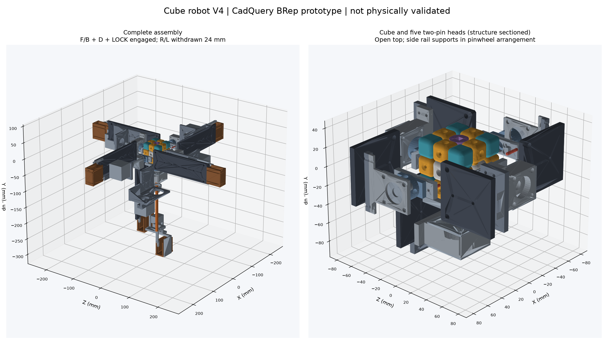
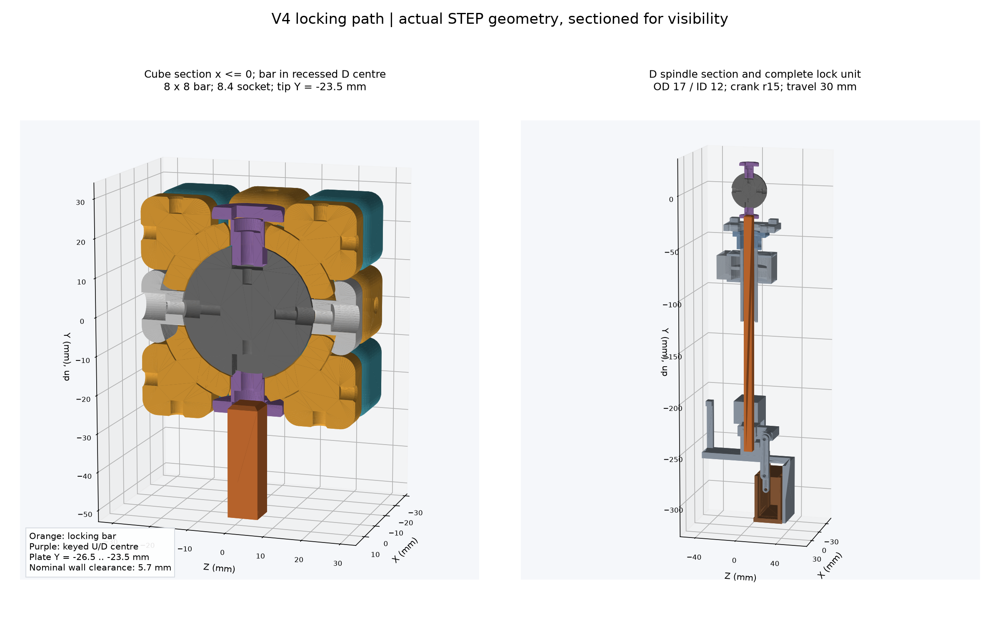

# 하드웨어 V4 — 위 헤드 제거, 중앙축 대신 승강 잠금 막대, 도넛 큐브, 자동 이송·뒤집기·장착

2026-10-23 · 상태: **CAD 시제품 + 펌웨어·시뮬레이터 구현, 실물 출력·조립·부하 시험 전**.
V3(고정 중앙축·수동 잠금·매 수 `H` 승인)를 대체한다. 이 문서는 펌웨어(`firmware/main/mechanism.*`), 시뮬레이터(`sim/mechanism.js`, `sim/app.js`), CAD(`tools/build_robot_v4.py`)가 공유하는 **치수·좌표·절차의 기준**이다. 세 곳의 숫자가 다르면 이 문서를 고치고 세 곳을 맞춘다.

## 0. 장치 목록 — 기능과 추가한 이유 (현재 기능을 위한 가장 단순한 구성)

큐브 둘레에 **같은 측면 모듈 4개**(F R B L), 아래에 **D 회전 모듈 1개**(측면 모듈과 같되 축이 비어 있고 모터가 옆으로 비킴)와 그 축 속을 지나는 **잠금 막대 1개**. 위는 비어 있다. 이송(결합/후퇴)은 여섯 유닛 모두 같은 서보 크랭크이고 결합은 마이크로스위치로 확인한다.

| 장치 | 수량 | 기능 | 왜 필요한가 (없으면 무엇이 안 되나) |
|---|---|---|---|
| NEMA17 + A4988 (측면 F R B L) | 4 | 면 90°/180° 회전. 정지 중에는 유지 토크로 잡은 층을 고정 | F·B·R·L 수를 돌린다 |
| NEMA17 + A4988 (아래 D, 옆으로 60 mm 비킴, GT2 40T:40T 벨트) | 1 | **아래 면(D) 회전** (사용자 요구: 아래 회전축 유지) | 위 헤드가 없으므로 U/D 층은 모두 아래에서 돌린다. 모터가 축 위에 있으면 잠금 막대가 지나갈 수 없어 옆으로 비키고 벨트 1:1 로 돈다 |
| **중공 회전축** (OD 17 / ID 12.5, 6003 베어링 2) | 1 | D 구동판·핀을 돌리면서 가운데로 잠금 막대를 통과시킨다 | 막대가 아래에서 큐브 중심까지 올라오는 길 |
| 2핀 구동판 + 강철 핀 Ø3 | 5 (측면 4 + D 1) | 엣지 2개의 소켓에 핀을 꽂아 층을 민다 (측면은 적도 엣지, D 는 DF·DB 엣지) | 핀으로 층을 돌린다(V2 그대로). 4핀 대신 2핀: D 를 돌릴 때 측면 핀이 D 층 엣지에 박혀 있으면 안 되고, 구동판 가운데 구멍(Ø22)으로 막대가 지나가야 한다 |
| **잠금 막대** (강철 8×8, 승강 30 mm) | 1 | 아래에서 중공축을 지나 큐브 **가운데 위치**(U/D 센터 칸 → 센터 판의 사각 소켓)까지 올라와 **코어를 고정** — V3 의 고정 중앙축 역할. 면을 돌리는 동안 올라가 있고, **큐브를 180° 뒤집을 때만 내려간다** | 측면 한 면을 돌릴 때 큐브 전체가 따라 도는 것을 막는다(V3 가 축으로 해결한 문제). 축과 달리 내려갈 수 있어 뒤집기·장착이 가능하다 |
| 서보 MG996R + 크랭크 + 링크 36 | 6 (신호 4) | 이송 유닛 결합/후퇴. F/B 서보 2개 한 신호, R/L 2개 한 신호, D 1, 막대 1 (크랭크 r12 → 24 mm, 막대는 r15 → 30 mm) | V2/V3 의 수동 M5 나사(24 mm 에 30바퀴)를 자동화. 절대 위치라 **원점 센서가 없고**, 크랭크 0°/180° 가 사점이라 하중이 서보를 되밀지 못한다 |
| 결합 마이크로스위치 | 6 (입력 4) | 캐리지가 결합 위치에 닿으면 눌림. F+B, R+L 직렬 | 핀/막대가 소켓에 안 들어가면 스위치가 안 눌린다 → **회전을 실행하지 않고 중단** |
| MGN12 레일 180 + MGN12H 블록 | 5 | 캐리지 직선 안내 | 24 mm 이송의 흔들림 없는 안내 (V2 그대로). 막대는 출력 가이드 블록으로 안내 |
| 608 ×2 + F8-16M + 커플링 5→8 + Ø8 축 | 4세트 | 측면 스핀들 지지 | V2 그대로 |
| 도넛 큐브 (출력, 코어 1·센터 4·**파인 센터 2**·엣지 12·코너 8) | 1 | U/D 센터는 두께 3 판이 8 mm 안에 있고(도넛 구멍), 판 바깥면에 **8.4 사각 소켓**, 판 줄기는 **사각**이라 코어와 함께만 돈다 | 막대가 들어갈 자리와 코어를 잡을 소켓. 나머지는 V2 출력 큐브 그대로 |
| 버튼 1개 (A2) | 1 | **짧게** = START (모델이 풀린 상태면 섞기, 아니면 풀기), **1.2 s 이상** = LOAD 단계(장착/배출) | 핀 18개 중 17개를 모터·서보·스위치·LCD 가 쓴다. 저항 사다리(버튼 3개를 A0 하나에)는 Wokwi 가 아날로그 저항망을 재현하지 못해 검증할 수 없어 버튼 하나로 줄였다 |
| LCD1602 I2C, 부저 | 1, 1 | 단계·상태 표시, 완료/오류 알림 | 기존과 같음 |

**없앤 것과 이유**: 위(U) 헤드 — 위가 열려야 큐브를 넣고 뺄 수 있고, U 층은 뒤집어서 D 로 돌릴 수 있다. 고정 중앙축·인덱스 휠·잠금핀(V3) — 승강 잠금 막대와 결합 스위치가 대신한다. 승강 벨트·원점 스위치(초안) — 큐브는 손으로 D 핀 위에 올려놓는다. 스텝모터 DIR 핀 5개 — 한 번에 한 모터만 움직이므로 DIR 1개를 공유한다.

## 1. 무엇이 바뀌었나 (V3 → V4)

| V3 | V4 | 이유 |
|---|---|---|
| 회전 헤드 6개 (U 포함) | **측면 헤드 4개 + 아래 D 헤드 1개**, 위는 비어 있음 | 위가 열려야 큐브를 넣고 뺄 수 있다. U 면은 큐브를 **뒤집어서** 아래에서 돌린다 |
| 큐브를 관통하는 고정 Ø6 중앙축 (F↔B) | **승강 잠금 막대 8×8** (아래 → 큐브 중심). 면 회전 중 올라가 코어를 잡고, 뒤집기 때만 내려감 | 축의 "큐브 전체 회전 방지" 기능은 유지하면서 뒤집기·장착이 가능 |
| F/B 중공축 + 벨트 | **D 만 중공축 + 벨트** (막대 통과), F/B 는 직결 | 막대가 아래에서만 들어온다 |
| 수동 M5 이송 | 여섯 유닛 모두 **서보 크랭크** 이송 | 축 전환 1회 ≈ 0.4 s 급, 원점 복귀 없음 |
| 수동 잠금핀 | 스텝모터 유지 토크 + 잠금 막대 + 결합 스위치 확인 | 자동 운전; 결합이 확인되지 않으면 회전을 **실행하지 않는다** |
| 4핀 구동판 | **2핀 구동판** (측면: 적도 엣지, D: DF·DB) | D 회전 중 측면 핀이 D 층을 막지 않게 |

## 2. 좌표계와 치수 (CAD = 시뮬레이터)

### 조립 단순화 Rev B (Rev A보다 우선)

Rev A의 큐브·축 배치, 모터/서보 수, 서보 축, 24/30 mm 행정과 링크36은 유지한다.
다음은 조립 기준면과 고정부만 바꾼다. 펌웨어의 행정·서보 각도는 그대로다.

- P14 공통 서보 크래들5개는 2060에 직접 3점 체결한다. 위쪽은
  국소(x,z)=(±20,239), 6T 플랜지에 M5×12 두 개, 아래쪽은(-20,171),
  3T 발+P13 6T를 관통하는 M5×16 한 개다. 모든 나사는 Y 방향이다.
  전산봉20개·간격관20개와 패널의 Ø3.6 구멍20개를 제거한다.
- P14 아래 발의 위치 결정 돌기는 x=-28..-12, y=-51.8..-51,
  z=179..183다. P13에는 폭16.4/높이4.4/깊이1.0 포켓을 둔다.
  위치를 손으로 맞추고 돌기가 들어간 상태에서 3점 체결한다. 돌기는 기준만
  제공하며, 하중은 밀착면과 볼트가 받는다. P25 잠금 서보는 기존 M04 체결 유지.
- P13의 레일 좌우 턱은 안쪽 x=±6.2, 돌출1.5(y=-51..-49.5),
  z10..180이다. 레일 폭12 대비 양쪽0.2, MGN 블록 날개 대비0.5 여유.
  레일 앞끝 z4.5/뒤끝184.5에 맞춰 멈춤 턱을 둔다. 기존 z5..185에서는
  서보 몸체 앞끝184.95와 0.05 겹치므로 레일만0.5 앞당겨0.45 여유를 만든다.
  블록/캐리지/축 위치와 행정은 유지한다. 레일 체결공은 중심
  z15부터25피치7개, 폭3.4/전체길이14의 Z방향 장공으로 바꾼다.
  최초 홀 오프셋10 또는15인 레일은 장공 안에서 맞추며, 그 밖은 구매도면 대조.
- 레일의 M3 체결은2060 중앙 T슬롯(x=0)의 M3 T너트7개/레일로 받는다.
  P13 뒤에 일반 육각너트를 가둬 조립 후 접근할 수 없게 만들지 않는다.
  구매2060은 넓은 면 슬롯 x=-20/0/+20을 모두 갖춰야 한다. 레일을 놓기 전
  중앙 슬롯에 T너트를 배치하고 위에서 체결한다. 나사 길이는 실제 레일의
  카운터보어 받침면~밑면+P13 6T+너트 물림으로 정하며 머리는 레일 안에 둔다.
- P23의 기존 네 X 관통공을 뒤쪽 M4 인서트 OD5.6×L4 자리로 바꾼다.
  M04 뒤에서 M4×12+와셔 네 개로 조립한다(6T 금속판+와셔 약1,
  인서트 유효 물림 약4). P29의 두 공도 M3 OD4.6×L4 인서트로
  바꾸고 M3×12+와셔 두 개를 쓴다. 긴 관통 나사와 반대편 너트를 없앤다.
  인서트 입구는 모두 국소 x=-30, 나사 끝 여유는 실측한다.
  인서트 뒤 나사 끝 도피공은 P23 Ø4.3(막힌 끝 x=-21), P29 Ø3.4(x=-19)다.
  나사 끝이 인서트를 지나도 출력물의 작은 파일럿 홀에 박히지 않게 한다.
  P29 가로 팔의 Y두께는6→8로 늘려 M3 인서트 주변 최소 벽을0.7→1.7로 확보한다.
- M3 인서트 총69, M4 인서트 총14. 출력은 기존과 같은32종93개다.
  프레임 크기와 2060 절단 길이, 핀/소켓/사각 잠금 공차는 유지한다.
- P14/P25와 캡의 X 맞댐 면은18.3, 크래들 끝은18.15로0.15 여유를 둔다.
  크래들 아래와 캡의 P13 공간을 제거하고 레일 끝 주위에 폭12.6/높이8.6
  통과 공간을 둔다. 고정부끼리의 기존 명목 중첩을 제거한다.

이 변경은 길이 맞춤·눈대중 정렬을 줄이는 제작 개선이다. 인서트 뽑힘,
출력물 크리프, 프레임 변형과 반복 뒤집기는 실물 시험으로 확인한다.

### 2026-10-24 제작 보강 Rev A 이력 (아래 Draft보다 우선, Rev B 변경은 위 절 적용)

행정 24/30 mm, 서보 축, 링크 36 mm, 큐브·핀 위치는 유지한다. 이송 명령과
펌웨어 상수는 바뀌지 않는다. `docs/BUILD_V4.md`와 새 PDF가 제작 순서를 정한다.

- 레일 지지대-2060 체결: 국소 x=±20, z=25/120의 Ø5.4 네 구멍.
- 서보 마운트: MG996R 몸체를 고정 크래들+분리 캡으로 포획. 몸체 공간은
  x=-24.95..18.3, y=-54..-34, z=184.65..225.95. 구매품 실측을 우선한다.
  관통 M3 구멍은 X 방향 (y,z)=(-30,181)/(-44,231). 4개 M3 봉은 x=-20/12,
  y=-55.5/-32.5에서 프레임까지 이어지고 마운트 뒤 z234부터 길이36/69.5
  간격관이 위치를 정한다. 캡 앞쪽 귀는 후퇴 캐리지 보스를 피한다.
- 크랭크 중심에 Ø16 디스크, 중심 Ø3.2, y=±5의 Ø2.2 두 구멍 추가.
  실제 25T 금속 원형 혼에 M2 두 개로 체결한다. 출력물 구멍을 스플라인으로 쓰지 않는다.
- D 허브의 원통부 OD32, 17.15 보어. M4 인서트 자리의 반경 범위12..17.
  D 하우징의 캐리지 체결 관통공은 x=±24,z=38.5/48.5, Y 방향 Ø3.4.
- 측면 뒤 추력 베어링8×16×5(z54..59)+금속 분할 링8×16×7(z59..66),
  D 뒤 추력 베어링17×30×5(z60..65)+금속 분할 링17×28×8(z65..73).
- 잠금 가이드는 사각8.3 보어/길이22, x=-30까지의 체결 팔과
  X 방향 Ø4.4 네 구멍(y=±9,z180/190)으로 금속 지지판에 고정한다.
- 공통 프레임: 바닥621×621×18, 측판450 높이, 내부 평면x/z=±298.5,
  바닥 위 y=-332. 측면2060 길이268, D2060 길이301.5. 프로파일 앞끝은
  국소z2, 뒤끝270/303.5다(사각 앞끝의 R/D 충돌을 피함).
  금속 잠금 지지판은 D 국소 x=-36..-30,y=-77..47,z=172..298.
  도면·절단 파일은 `models/robot_v4/assembly_kit/`에 있다.
- 잠금 막대 결합 끝 y=-23.8, 후퇴 끝-53.8. 실제 삽입2.7로 소켓 바닥에
  0.3 여유를 둔다. 이송30과 서보축은 바뀌지 않는다. 중공축 내경은12.5로
  확대해 사각 막대의 명목 대각 여유를0.59로 늘린다.
- 코어의 U/D 사각 포켓 안쪽 y절대값7..11.05에 Ø4.6 인서트 자리를 추가한다.
  M3×14로 파인 센터를 고정한다. 기존 외측 자리는 사각 포켓이 제거한다.
- D 하우징은 앞/뒤 인서트 자리 Ø4.6 깊이4.1을 추가한다. 총 M3 인서트67,
  M4 인서트10이다. 새 추가 P29와 J01~J03을 합친 출력은32종93개다.

시뮬레이터는 direct/hollow 접미사가 있는 실제 STL을 읽고 새 캡·잠금 가이드와
막대 끝·서보 축을 반영한다. 프레임은 STEP를 기준으로 검토하며 시뮬레이터의
운동 절차나 펌웨어의 서보 각도·행정 상수는 바뀌지 않는다.

명목 기하 검사는 실물 강도·반복 오차를 보증하지 않는다. 특히 마찰에 의존한
뒤집기, 센서가 실제 핀 삽입을 대신 확인하는 가정은 실물 검증 전이다.

월드 좌표: 큐브 중심 원점, **+y 위(U), +x 오른쪽(R), +z 앞(F)**. 단위 mm.
각 모듈은 자기 **국소 좌표 (x, y, z)**로 생성되고, 국소 +z 가 면 바깥 법선, 국소 z=0 이 큐브 면 평면이다 (V2 `head_parts()` 규약 그대로).

### 2.1 면 좌표계 `FACES_V4`

| 면 | 법선 n | 국소 x 방향 (xDir) | 국소 y = n × x | 레일(국소 −y)이 향하는 쪽 |
|---|---|---|---|---|
| F | (0, 0, 1) | (0, 1, 0) 위 | (−1, 0, 0) | **+x** |
| R | (1, 0, 0) | (0, 1, 0) 위 | (0, 0, 1) | **−z** |
| B | (0, 0, −1) | (0, 1, 0) 위 | (1, 0, 0) | **−x** |
| L | (−1, 0, 0) | (0, 1, 0) 위 | (0, 0, −1) | **+z** |
| D | (0, −1, 0) | (1, 0, 0) | (0, 0, 1) | **−z** (비킨 모터는 국소 +x = 월드 +x) |
| 잠금 막대 | (0, −1, 0) | (1, 0, 0) | (0, 0, 1) | D 모듈 아래, 막대 축 = y 축 |

네 측면 헤드는 국소 x 가 월드 +y(위)라서 **핀 2개는 국소 (0, ±19.1)** = 적도 엣지(FR/FL, RF/RB, BR/BL, LF/LB). D 헤드의 핀 (0, ±19.1) 은 월드 z ±19.1 = DF·DB 엣지. 레일 지지판(국소 y −51~−57, x ±30, z 0~190)은 바람개비로 돌아가 서로 만나지 않는다 (F: x 51~57 / z ≥ 28.5, R: z −51~−57 / x ≥ 28.5, B: x −51~−57 / z ≤ −28.5, L: z 51~57 / x ≤ −28.5, D: z −51~−57 / y ≤ −28.5, x ±30 — B 지지판과 x 가 겹치지 않는다). 위(+y)는 큐브 기둥(x, z ±28.5)이 비어 있어 손으로 큐브를 넣고 뺀다.

### 2.2 큐브 (`cube_mm`=57, 조각 18.8, 피치 19.1, 간극 0.30 — V2 그대로)

| 항목 | 값 |
|---|---|
| 엣지 소켓 | Ø3.4 깊이 4.2, 노출면 2곳 (V2 그대로) |
| F/R/B/L 센터 | V2 `cube_center` 그대로 (M3 나사·스프링, 자유 회전) |
| **U/D 센터 `center_recessed`** | 캡 대신 **판 두께 3** (면에서 2 mm 안쪽: 면 평면 −28.5 기준 z −26.5~−23.5). 판 바깥면에 **사각 소켓 8.4×8.4 깊이 3** (`lock_socket_mm`). 줄기는 **사각 8×8** 로 코어의 사각 구멍에 끼워져 코어에 대해 돌지 않는다 (M3 로 체결) |
| **소켓 칸 (도넛 구멍)** | 센터 칸 자리 = 엣지 4개의 측벽으로 둘러싸인 사각 구멍 19.4 × 19.4, 깊이 2 (`recess_depth_mm`) |
| **잠금 막대** | **8 × 8** (`lock_bar_mm`) 강재, 결합 시 끝이 y = −23.8 (소켓 입구−26.5에서2.7 삽입, 바닥 여유0.3). 엣지 벽까지 여유 (19.4−8)/2 = **5.7** → 측면 회전을 막지 않는다 |
| 코어 | V2 `cube_core` + U/D 사각 구멍 |

U/D 센터가 코어에 고정돼 있어도 층 회전은 가능하다: 엣지·코너의 발은 센터 판 밑 구면 트랙(회전 대칭)을 미끄러진다. 막대가 판 소켓을 잡으면 **코어가 프레임에 고정**되어 측면 회전의 반력을 받는다.

### 2.3 측면 모듈 (F R B L, 4개 동일) — V2 직결 모듈 바탕

| 부품 | 국소 위치 (z 는 면 평면 기준) | 변경 |
|---|---|---|
| `drive_plate_2pin` | 판 50×50×6, z 5~11, 중앙 Ø22 구멍; 패드 4개 z 0~0.8 | 핀 구멍 **2개** (0, ±19.1) |
| 강철 핀 Ø3×16 ×2 | z −3~13 | 삽입 3 |
| `shaft_hub`, 608 ×2, F8-16M, 하우징, 캡, Ø8 축, 커플링, NEMA17 | V2 그대로 (허브 11~28, 추력 28~33, 하우징 35~52, 모터 104~144) | 변경 없음 |
| `carriage` | 32~152, MGN12H 블록 | 너트 포켓 대신 **크랭크 링크 핀 보스** (x 22, y −44, z 147) |
| `rail_support` | y −54 (두께 6), z 0~190, 앞쪽 x 양끝 모서리 1.6 mm 모따기 | 뒤 끝에 **서보 마운트** (축 중심 x 22, y −44, **z 195**, 축 방향 국소 x) |
| 서보 크랭크 r **12**, 링크 **36** | θ=0° (−z, 큐브 쪽) → z 147 = **결합(0)**; θ=180° → z 171 = **후퇴 24** (양 끝 사점) | 195−12−36 = 147, 195+12−36 = 171 |
| 결합 스위치 | 레일 지지판 z 150 부근, 캐리지가 결합 위치에서 누름 | F·B 직렬 → `SENS_FB`, R·L 직렬 → `SENS_RL` |

### 2.4 D 모듈 — V3 중공 모듈 바탕 (`build_robot_v3.module_design(hollow=True)`)

| 부품 | 값 |
|---|---|
| 중공 회전축 | OD **17** / ID **12.5** (`hollow_id_mm`), 길이 82. 6003 베어링(17×35×10) 2, 추력 베어링 앞뒤 |
| 구동판·핀 | 측면과 같은 `drive_plate_2pin` (중앙 Ø22 로 막대 통과) |
| 모터 | NEMA17 국소 x = **+60** 으로 비킴, 40T:40T GT2 벨트 1:1, 200-2GT-6 (V3 그대로) |
| 이송·스위치 | 측면과 같은 서보 크랭크 r12 / 링크 36 / 24 mm, 스위치 `SENS_D` |

### 2.5 잠금 막대 유닛 (D 모듈 아래, y 축)

| 부품 | 값 |
|---|---|
| 막대 | 강재 8×8, 길이 ≈ 230 (끝 모따기 1). 결합 끝 y = **−23.8**, 후퇴 끝 y = **−53.8** (`lock_stroke_mm` = 30) |
| 안내 | 출력 가이드 블록(사각 구멍 8.3) + 캐리지, D 모듈 레일 지지판 뒤쪽 프레임에 고정 |
| 서보 크랭크 r **15**, 링크 36 | θ=0° 결합(위), 180° 후퇴(아래), 스위치 `SENS_LOCK` |
| 뒤집기 여유 | 큐브 외곽 반경 28.5·√2 = 40.31 < 53.8 → **13.49** |

### 2.6 여유 계산 (명목)

| 항목 | 값 |
|---|---|
| 후퇴한 F/B(또는 R/L) 핀 끝 | 28.5 + 24 − 3 = **49.5** → 뒤집기 여유 9.2 |
| 후퇴한 D 핀 끝 | 49.5 → 9.2 |
| 막대 끝 ↔ 센터 판 소켓 바닥 | 3 − 2.7 = **0.3** (소켓 깊이3, 실제 삽입2.7) |
| 막대 ↔ 엣지 벽 | **5.7** |
| 막대 ↔ 중공축 안 | (12.5 − 8·√2)/2 = **0.59** (대각) |

CAD 조정: V2 구면 유지 트랙을 보존하려고 센터 함몰 8→2 mm, 판 범위 −20.5~−17.5→−26.5~−23.5 mm, 막대 결합/후퇴 끝 −17.5/−47.5→−23.5/−53.5 mm로 조정했다. 원안은 엣지·코너 16쌍과 최대 115.178917 mm³ 겹쳤다. V2 목 반경 4.4와 트랙 여유 구면 반경 23.8을 연결하는 함몰 한계는 약 2.11 mm여서 2 mm를 채택하며, 판은 Ø18.8 회전 대칭 외곽, 사각 줄기와 원형 목 사이 전이는 트랙 안쪽에 둔다. R/D 지지판 앞모서리의 13.5 mm³ 겹침은 5개 공통 지지판의 앞쪽 x 양끝 1.6 mm 모따기로 없앤다(이론 접촉 한계 1.5 mm + 여유 0.1 mm). 행정 24/30 mm와 서보 축·크랭크·링크 치수는 유지한다.

## 3. 운전 절차 (펌웨어 `Mechanism` = 시뮬레이터 `mechanism.js`, 같은 규칙)

### 3.1 상태

이송 유닛 4개 `FB`, `RL`, `D`, `LOCK` ∈ {결합, 후퇴} · `orient` ∈ {0, 1} (1 = 논리 U 가 아래) · `loaded`.

논리 면 → 물리 면 (orient 1 은 x축 180° 뒤집기): `U→D, D→U(없음), F→B, B→F, R→R, L→L`. 회전 방향은 면 이름만 바뀌고 그대로다.
**장착은 흰색(U) 면을 아래로** 넣으므로 시작 `orient=1`: CFOP 의 U 수가 전부 D 헤드 회전이 되고, 뒤집기는 D 수에서만 일어난다.

### 3.2 한 수 실행 (`prepare(m)` → `turn`)

```
p = 물리 면(m)
if p == U(위):  FLIP → orient ^= 1 → p = D
p ∈ {F,B}: ENGAGE FB → RETRACT D → RETRACT RL → ENGAGE LOCK     # 새 지지 먼저, 그다음 해제; 막대는 항상 올림
p ∈ {R,L}: ENGAGE RL → RETRACT D → RETRACT FB → ENGAGE LOCK
p == D   : ENGAGE LOCK → ENGAGE D                                 # 막대가 코어를 잡고, 적도 핀은 D 층을 막지 않는다
회전 (STEP_p, 50 스텝 = 90°)
```

FLIP = `ENGAGE RL → RETRACT FB → RETRACT D → RETRACT LOCK → R·L 동시 180° (같은 월드 방향, 펄스 교차)`. M 슬라이스는 외부 접촉이 없고 R/L 층과의 마찰로 따라온다(저속 180°). **이 가정은 실물 시험 항목**이다 (막대·핀 끝 모따기가 몇 도의 어긋남을 받아 준다).

각 ENGAGE 뒤에는 **센서 확인**(서보 이동 400 ms 뒤 최대 1500 ms 대기, `T <ms>` 로 조정). 실패하면 `ERR ENGAGE FB timeout` 을 내고 서보를 되돌린 뒤 **그 수를 실행하지 않고 중단**(`ABORTED completed=i`, 완료한 수까지의 모델은 보존). RETRACT 는 센서가 풀리는지 확인한다.

### 3.3 장착·배출 (`LOAD` 버튼 / 시리얼 `L`, `E`)

| 상태 | LOAD 누름 | 출력 |
|---|---|---|
| 비어 있음 | FB·RL·LOCK 후퇴 → **D 헤드 결합 위치**로 → LCD `PLACE CUBE ON PINS / WHITE DOWN > LOAD` (큐브를 D 핀 2개에 맞춰 올려놓는다) | `ENGAGE D` `READY TO LOAD` |
| 비어 있음·D 결합 (큐브 올려놓음) | ENGAGE LOCK → ENGAGE FB → `loaded` | `ENGAGE LOCK` `ENGAGE FB` `LOADED orient=1` |
| 장착됨 | 배출: (D 결합 확인) → RETRACT LOCK → RETRACT FB·RL → LCD `REMOVE CUBE` (D 핀 위의 큐브를 손으로 꺼낸다) | `EJECT` … `EJECTED` |

실제 모드(`Q 0`)에서 `S`/`V`/`M`/`F` 는 `loaded` 가 아니면 `ERR not loaded`. 가상 모드(`Q 1`)는 절차를 **계획·출력만** 하고 서보·센서·스텝은 건너뛴다 (Wokwi 교차검증 시나리오가 flips/regrips 횟수까지 비교).

## 4. 핀 배치 (UNO R3/R4 공통, 18핀 전부 사용)

| 핀 | 신호 | 비고 |
|---|---|---|
| D2 D3 D4 D5 | STEP F, R, B, L | A4988 ×4 |
| D6 | STEP D | 아래 회전 (벨트 1:1) |
| D7 | **DIR 공용** | 한 번에 한 모터만 움직인다. 뒤집기는 R/L 펄스를 번갈아 내며 펄스마다 DIR 을 바꾼다 |
| D8 / D9 | SERVO FB / RL | 각각 서보 2개 같은 신호 (거울 장착) |
| D10 / D11 | SERVO D / LOCK | |
| D12 / D13 | SENS FB / RL | 결합 스위치 직렬, 풀업 (둘 다 눌림 = LOW) |
| A0 / A1 | SENS D / SENS LOCK | 풀업 |
| A2 | 버튼 (START / 길게 LOAD) | 풀업, GND |
| A3 | 부저 | |
| A4 / A5 | LCD1602 I2C | |

A4988 ENABLE 은 묶어서 LOW(항상 활성 → 유지 토크). 서보 6개는 **별도 5~6 V 전원**(MG996R 기동 전류 ≈ 1 A 이상)에서 급전하고 GND 공통. 모터 전원·전류 제한·커패시터는 V3 문서의 실제 배선 항목 그대로.

## 5. 시간 추정 (명목, 실측 아님)

| 동작 | 값 |
|---|---|
| 90° 회전 | 50 스텝, 12→8 ms 램프 ≈ 0.45 s + 정착 0.25 s (현행 상수; 실물 토크 확인 후 단축) |
| 서보 이송 | 0.4 s + 센서 확인 |
| 뒤집기 | 100 스텝 교차 ≈ 1.0 s + 막대·D·FB 후퇴 |
| 시드 1 풀이 53수 | 회전 62회, 결합·뒤집기 횟수는 시뮬레이터/보드가 센다 (`flips= regrips=`) |

## 6. 파일

- `tools/build_robot_v4.py`, `check_robot_v4.py`, `render_robot_v4.py` → `models/robot_v4/` (출력 STL/STEP, `robot_assembly.step`, `parameters.json`, `mechanical_checks.json`)
- `node tools/embed_models_v4.js` 는 `models/robot_v4/parameters.json` 과 `models/robot_v4/print/*.stl` 을 `sim/models.js` 에 넣는다
- `firmware/main/mechanism.h/.cpp` (절차·센서·서보), `motors.h/.cpp` (STEP 5 + DIR 공용, 뒤집기), `main.ino` (버튼 짧게/길게, `L`/`E`/`F`/`T` 명령)
- `sim/mechanism.js` (펌웨어와 같은 절차 → 동작 목록), `sim/app.js` (V4 3D), `tools/gen_mechanism_test.js` (Wokwi 실제 모드 시나리오), `tools/gen_wokwi_test.js` (풀이 교차검증 + 뒤집기·결합 횟수)

## 7. CAD 결과 (build_robot_v4.py)

2026-10-24 · CadQuery 2.7.0으로 생성한 CAD 시제품이다. 출력·조립·하중 시험은 아직 수행하지 않았다. 아래 검사는 STEP 솔리드의 이산 자세 표본 검사이며, 연속 궤적·마찰·변형은 후속 검증 대상이다.

`tools/build_robot_v4.py`는 V2 큐브 유지 트랙·직결 헤드와 V3 중공 모듈의 모터·벨트를 재사용한다. 결과는 [models/robot_v4](../models/robot_v4/)에 저장한다. [조립 STEP](../models/robot_v4/robot_assembly.step)과 [GLB](../models/robot_v4/robot_assembly.glb)는 큐브 장착, F/B·D·막대 결합, R/L 24 mm 후퇴 자세이다. 인덱스 휠·잠금핀·승강 벨트는 포함하지 않는다.

출력 부품은 **26종, 83개(소켓 검사편 1개 포함)**이다. 모든 출력용 STEP이 유효한 단일 솔리드임을 생성기 assert와 검사기에서 확인했다. [manufacturing.json](../models/robot_v4/manufacturing.json)에 부품별 수량·체적·크기와 구매품 외형 수량을 기록했다. 주요 구매품은 NEMA17 5개, MG996R 6개, 결합 스위치 6개, Ø3×16 핀 10개, MGN12/MGN12H 5세트, 608 8개, 6003 2개, 중공축 1개, 8×8×230 강재 막대 1개이다. 구매품 모델은 외형·맞춤 검토용이다.

2절의 CAD 조정을 적용했다. 센터 함몰은 2 mm, 막대 끝은 결합 −23.5 / 후퇴 −53.5 mm이며, 지지판 앞모서리는 1.6 mm 모따기이다. U/D 센터는 Ø18.8 판 외곽과 V2 구면 트랙을 유지하는 원형 목에서 8×8 사각 줄기로 이어진다. M3 관통공 Ø3.4와 나사 머리 자리 Ø7×깊이 3은 사각 소켓 바닥 아래에 있어 막대의 삽입 공간을 확보한다. D 하우징은 6003 외경 35에 맞춘 Ø35.15 좌대(z 35~45, 48~58), 축 통과공 Ø18.2와 44 mm 폭의 캡을 사용한다. 막대 서보 축은 D 국소 [22, 24, 255]로 두어 D 이송 서보를 피하며, 막대 캐리지 핀 위치 204/234와 행정 30 mm를 유지한다.

[mechanical_checks.json](../models/robot_v4/mechanical_checks.json)의 최종 결과는 **`passed: true`, `failure_count: 0`**, 검사기 종료코드 0이다. 겹침 판정 기준은 **0.02 mm³ 초과**이다.

| 검사 | 표본·수치 | 결과 |
|---|---|---|
| 큐브 조립 | 고유 위치 27개, 조각 쌍 351개 | 겹침 0쌍 |
| 층 회전 | X/Y/Z 양쪽 층, 15° 간격 15~90°, 총 36자세 | 겹침 0쌍 |
| 결합 막대 ↔ 큐브 전체 | U/D 센터 소켓 포함 | 겹침 0쌍 |
| 막대 ↔ D 엣지 | 구면 발을 포함한 실제 최소 거리 2.858936 mm; 외측 칸 벽 기준 명목 5.7 mm | 양의 여유 |
| 막대 ↔ 중공축 | D 이송 0/24 mm, 최소 거리 각각 0.343146 mm | 겹침 0쌍 |
| 뒤집기 | X축 0~180°, 15° 간격 13자세; F/B·D·막대 후퇴 | 겹침 0쌍 |
| 모듈 간·모듈 ↔ 큐브 | FB 결합 / RL 결합 / 모두 후퇴 3자세 | 겹침 0쌍 |
| 고정 지지부 | 레일 지지판 5개 상호, 막대 유닛 결합/후퇴 | 겹침 0쌍 |
| 크랭크 끝 위치 | θ 0°/180°: 헤드 147/171, 막대 204/234 mm | 최대 오차 0 mm (허용 0.01) |

층 회전에서 사각 줄기로 코어에 결합한 U/D 센터는 고정하고 엣지·코너를 회전시킨다. 모듈 자세 검사는 결합 FB/RL과 함께 D도 결합한 지지 전환 자세를 포함한다. 뒤집기에서는 큐브와 함께 회전하는 R/L 구동 헤드를 제외하고 후퇴한 F/B·D 및 막대 유닛 전체를 검사한다.

다음 표는 [parameters.json](../models/robot_v4/parameters.json)의 **전체 `print_offsets`**와 출력 수량이다. 값은 mm이며 소수점 5자리까지 표시했다. 큐브 부품은 V2 큐브 템플릿 좌표, 헤드 부품은 면 국소 좌표, 막대 유닛은 D 국소 좌표이다. STL은 회전 없이 XY 중심·바닥 z=0으로 평행 이동했으므로, `[x중심, y중심, z최소]`를 더하면 원래 조립 좌표가 된다. STEP은 원래 좌표를 유지한다.

| 출력 부품 | 수량 | print_offsets [x중심, y중심, z최소] |
|---|---:|---|
| cube_core | 1 | [0, 0, -17.04553] |
| cube_center | 4 | [0, 0, -28.5] |
| cube_edge | 12 | [0, 16.6, -28.5] |
| cube_corner | 8 | [16.6, 16.6, -28.5] |
| socket_coupon | 1 | [0, 0, 0] |
| center_recessed | 2 | [0, 0, -26.5] |
| shaft_hub | 4 | [0, 0, 11] |
| bearing_housing_direct | 4 | [0, -7.5, 35] |
| carriage_direct | 4 | [0, -12.5, 32] |
| rail_support | 5 | [0, -53.25, 0] |
| bearing_front_cap_direct | 4 | [0, 0, 33] |
| bearing_rear_cap_direct | 4 | [0, 0, 52] |
| drive_plate_2pin | 5 | [0, 0, 0.8] |
| servo_mount | 5 | [0, -41.5, 166] |
| servo_clamp | 5 | [20.3, -41.5, 177] |
| crank | 5 | [26, -44, 180] |
| link | 5 | [31, -44, 143] |
| shaft_hub_hollow | 1 | [0, 0, 11] |
| bearing_housing_hollow | 1 | [0, -5, 35] |
| carriage_hollow | 1 | [28, -12.5, 32] |
| bearing_front_cap_hollow | 1 | [0, 0, 33] |
| bearing_rear_cap_hollow | 1 | [0, 0, 58] |
| lock_guide | 1 | [-8, 0, 174] |
| lock_carriage | 1 | [10, 10, 199] |
| lock_servo_mount | 1 | [-5.925, 26.5, 237] |
| lock_servo_clamp | 1 | [20.3, 26.5, 237] |
| lock_crank | 1 | [26, 24, 237] |
| lock_link | 1 | [31, 24, 200] |

조립도와 잠금 막대 단면은 실제 STEP 솔리드를 matplotlib로 렌더링했다. 단면도는 큐브와 D 축 일부를 잘라 사각 소켓에 들어간 막대를 보여 준다.





재생성 명령(PowerShell, 저장소 루트):

```powershell
& .\.venv-cad\Scripts\python.exe tools/build_robot_v4.py --stl-tolerance 0.1 --stl-angular 0.3
& .\.venv-cad\Scripts\python.exe tools/check_robot_v4.py
& .\.venv-cad\Scripts\python.exe tools/render_robot_v4.py
node tools/embed_models_v4.js
```

의존성은 `tools/requirements-robot-v4.txt`에 기록했다. 기본 build(0.05 mm / 0.12)도 실행한 뒤, 임베드 용량 제한에 맞춰 위 0.1 mm / 0.3으로 재생성했다. `tools/embed_models_v4.js`는 전체 STL이 6 MB를 넘으면 이 허용오차로 자동 재생성·재검사하고, 그래도 크면 지시된 헤드 부품만 넣는다. 이번 결과는 **26종 전체를 포함**, `sim/models.js` **2,477,891바이트(약 2.48 MB)**이며 헤드 전용 축소는 사용하지 않았다. 디코딩한 26개 STL과 매개변수가 원본 파일과 일치함을 확인했다. 기존 `tools/embed_models.js`는 변경하지 않았다.
