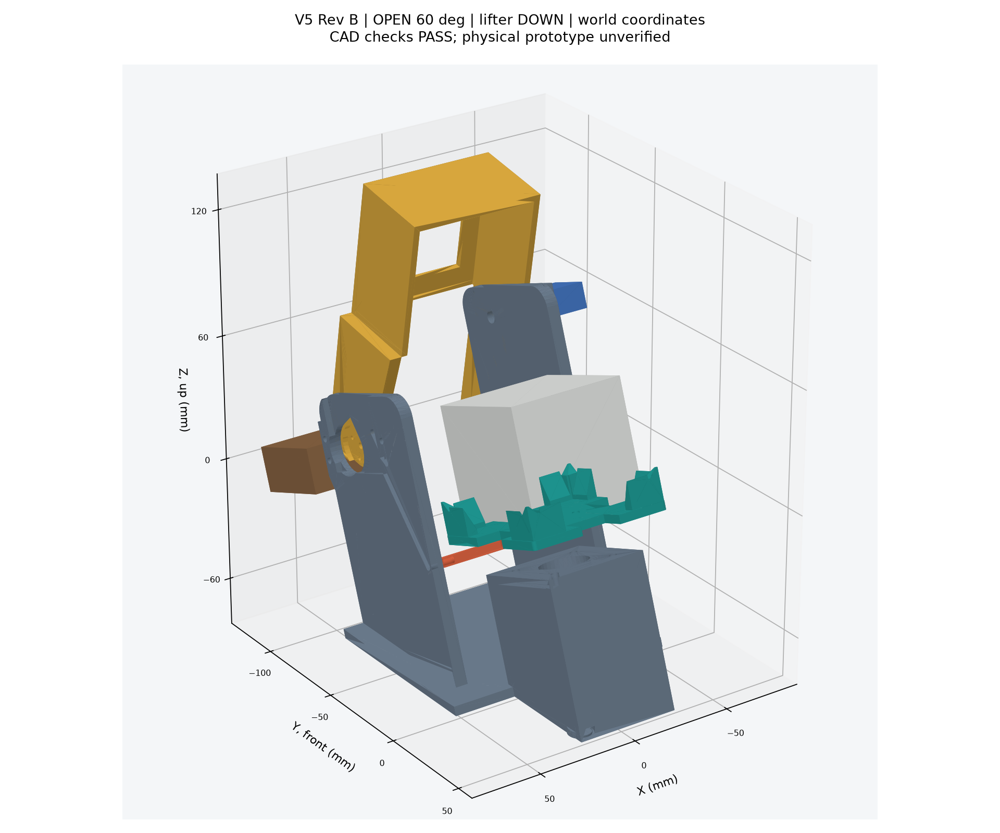
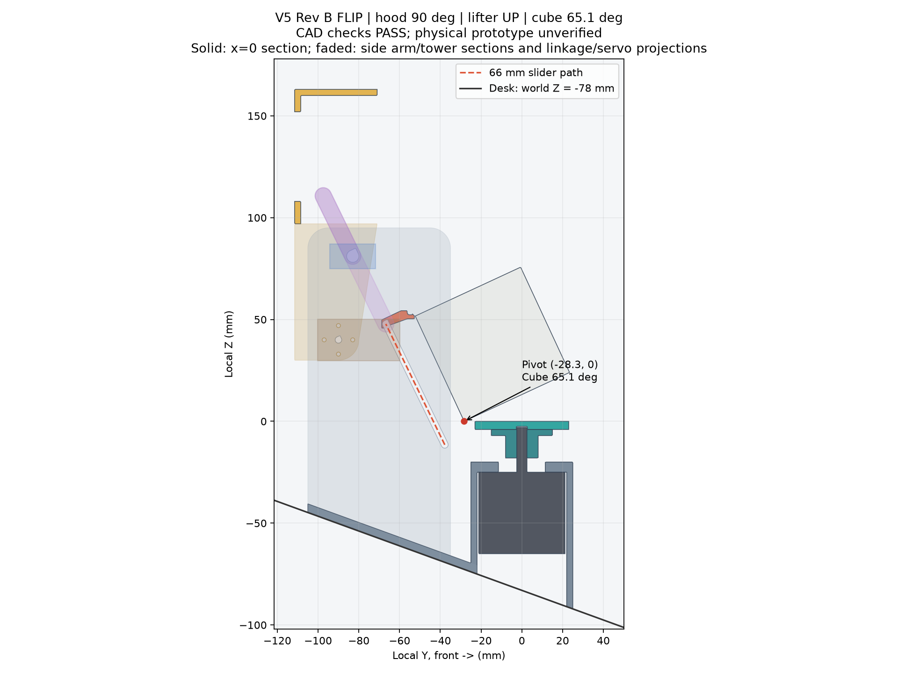
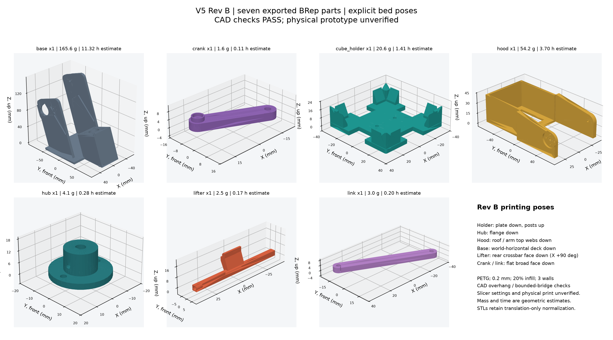
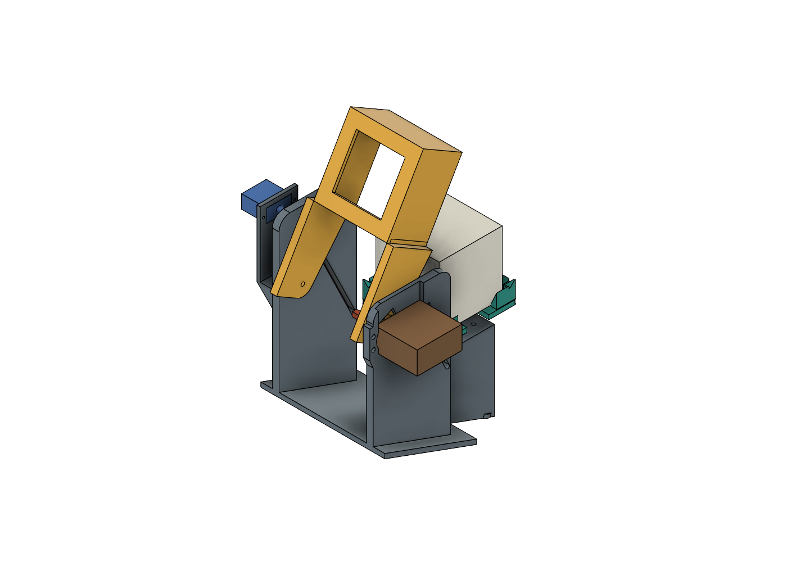

# 하드웨어 V5 — 하루에 만드는 3축 큐브 로봇 (기울어진 컵 + 후드 + 리프터)

2026-10-24 · 상태: **구조 확정(Rev B) + 2D 운동학·준정적 물리 검사 통과, 펌웨어·시뮬레이터·Wokwi 교차검증 통과, CAD 3D 검사 재실행 중, 실물 출력 전**.
Rev B(같은 날 오후): Codex 의 3D 간섭 검사가 찾아낸 8가지 문제(후드가 열리며 앞벽이 큐브로 들어옴, 리프터 크로스바-타워 간섭, 모터 상자 안치수, 기둥 모따기, 허브 서포트, 크랭크 지상고, 리프터 좌표 부호 오류, 크랭크 중간 행정 조건)를 치수와 검사기에 반영했다. 바뀐 값은 아래 표에 "Rev B" 로 표시.
V4(측면 2핀 헤드 4 + 중공 D 헤드 + 잠금 막대, 스텝모터 5 + 서보 6 + 스위치 6, 출력 93개, 합판 프레임)를 대체한다.
이 문서는 펌웨어(`firmware/main/mechanism.*`, `motors.*`), 시뮬레이터(`sim/mechanism.js`, `sim/app.js`), CAD(`tools/build_robot_v5.py`),
2D 검사기(`tools/check_robot_v5.py`)가 공유하는 **치수·좌표·절차·핀의 기준**이다. 숫자가 다르면 이 문서를 고치고 네 곳을 맞춘다.

## 0. 왜 바꾸는가 — 한 문장과 장치 목록

> **큐브 자체는 시중 3×3(56~57.5 mm)을 그대로 쓰고, 큐브를 받치는 컵 하나를 스텝모터로 돌리며, 위 두 층을 붙잡는 후드와 큐브를 넘기는 리프터를 서보 하나씩으로 움직인다.** 출력 부품 7종, 나사 21개, 구동기 3개.

V4 가 "모든 면에 헤드를 대고 핀으로 돌린다"는 발상이라 부품이 93개까지 늘어난 반면, V5 는 2축 큐브 로봇의 검증된 원리
(Tilted Twister 2008 → CUBOTino 2022: *기울어진 홀더 + 아래 층만 잡는 컵 + 위 두 층을 감싸는 뚜껑 + 모서리를 들어 넘기는 리프터*, CUBOTino 자료 CC-BY-4.0)를
우리 조건에 맞게 **독자 설계**한 것이다 (CUBOTino 와 다른 점: 컵은 서보 대신 **스텝모터 직결**이라 각도 보정이 없고 180° 도 한 번에 돈다,
후드와 리프터를 **분리**해 후드 힌지 하나로 두 기능을 겸하는 복잡한 캠 형상을 없앴다, 리프터는 **직선 슬롯**을 따라 움직여 복귀 경로가 큐브와 겹치지 않는다).

| 장치 | 수량 | 기능 | 없으면 안 되는 이유 |
|---|---|---|---|
| **시중 3×3 큐브** | 1 | 풀이 대상 | V4 도넛 큐브(출력 27개·핀 소켓)가 사라진다. 어떤 큐브든 56~57.5 mm 면 된다 |
| NEMA17 + A4988 | 1 | **컵(홀더) 회전**: 후드 닫힘 = 아래 층 회전(D 수), 후드 열림 = 큐브 전체 회전(y 스핀) | 모든 면 회전을 아래 한 축으로 한다. 50 스텝 = 90° 가 정확해 서보식(CUBOTino)의 CW/CCW/릴리스 보정표가 필요 없다. 보유 28BYJ-48 은 토크(0.03 N·m)가 모자라 예비용 |
| **컵(홀더)** 출력 | 1 | 모서리 기둥 4개가 아래 층 코너를 잡고, 4면 노치로 리프터 선반이 큐브 아래 모서리를 받친다 | 큐브를 바꾸지 않고 아래 층만 돌리는 유일한 접점 |
| MG996R 서보 | 1 | **후드** 개폐: CLOSE(위 두 층 감쌈) / OPEN(스핀·뒤집기 때 비킴) / LOAD(뒤로 완전히 젖혀 큐브를 위에서 넣음) | 아래 층을 돌릴 때 위 두 층이 따라 돌지 않게 붙잡는다 |
| SG90/MG90S 서보 (키트) | 1 | **리프터** 승강: 큐브 뒤쪽 아래 모서리를 비스듬히(위 + 뒤 26°) 66 mm 끌어올려 큐브를 앞으로 넘긴다(x' 회전) | 위 면(U)을 아래로 가져오는 유일한 방법. 토크 요구 0.33 kg·cm 라 9 g 서보로 충분 |
| **20° 기울기** (베이스 형상) | — | 홀더 바닥을 뒤(힌지 쪽)가 낮게 20° 기울인다 | 큐브가 항상 뒤 기둥에 기대어 **자리가 스스로 잡히고**, 뒤집기 전복각이 45°+20° = 65° 로 정해져 리프터 행정이 짧아진다 |
| UNO R3/R4 + LCD1602 + 버튼 1 + 부저 (키트) | 1식 | 보드 내 CFOP 풀이·표시·조작 | V4 와 같다 |

바뀐 것의 평가 근거(③ 완성도·⑥ 기한): 출력 93 → 7개(약 210 g, 0.2 mm 적층 기준 8~15 h), 구매 부품 20종 → 3종(NEMA17·A4988·MG996R, 나머지는 키트), 체결 나사 수십 → 21개, 센서 0.
잃는 것: 30 초 목표는 포기한다 (한 수마다 스핀·뒤집기가 끼어 56수 풀이에 약 2.5~3 분, 5절). ② 설계 근거는 2D 검사기의 수치로 남긴다.

## 1. 좌표계

**국소 홀더 좌표 (x, y, z)**: 원점 = 컵 바닥판 윗면 중심(=앉은 큐브의 아래면 중심), +x 오른쪽, **+y 앞(관중 쪽)**, +z 바닥 법선 위.
앉은 큐브는 |x|,|y| ≤ 28.5, z 0~57. 뒤(−y)에 힌지·타워·서보가 있다.
**월드 좌표** = 국소를 x축 둘레로 −20° 돌린 것: 뒤(−y)가 낮다. 월드 높이 z_w = z·cos20° + y·sin20°. 책상면은 z_w = **−78** (Rev B; 베이스 바닥, 고무발 4개. 모터 최저점 z_w −68.3).
CAD·시뮬레이터·검사기는 모두 국소 좌표로 부품을 만들고 마지막에 월드로 기울인다.

## 2. 치수 (= `tools/check_robot_v5.py` 의 `P`, `models/robot_v5/parameters.json`)

### 2.1 컵(홀더) `cube_holder` — NEMA17 축 직결

| 항목 | 값 |
|---|---|
| 바닥판 | **70×70**×4 (z −4~0), 모서리 **R1.5** (CAD 조정: R6에서는 기둥 바깥 코너가 떠서 무서포트와 높이 15를 함께 만족하지 못함). M3 체결 구멍 Ø3.2 ×2 @ (x ±11, y 0). 밑면 중앙 **Ø5.4×1.5** 축 여유 홈(z −4~−2.5): 길이22 모터 축 끝 z−3과 판의 1 mm 간섭을 제거 |
| 노치 | 4변 중앙, 폭 20(|x| ≤ 10), |y| ≥ **23** 을 잘라냄 → 큐브 아래 모서리가 5.5 mm 내민다 (리프터 선반이 들어가는 길) |
| 모서리 기둥 | 4개, L자. 안쪽면 |x|,|y| = **29.5** (큐브 여유 1.0/면), 두께 **5** (바깥 34.5), 팔 길이 17 (|x| 또는 |y| 16~34.5), 높이 **15** (z 0~15; 아래 층 19 보다 낮아 가운데 층에 닿지 않음), 윗부분 안쪽 45° 모따기 **4** → 윗면 1 mm 평면 유지 (Rev B; 착지 깔때기) |
| 기둥 FLIP 비움 | CAD 조정: 각 변의 큐브 폭 안(|x|≤28.6 및 90° 대칭)에 `y=−28.5−z/tan65.1°`보다 안쪽인 재료를 제거. 전복 피벗 (−28.3, 0)에 0.2 mm 여유를 둔 경사면이다. 낮은 팔은 아래 층을 잡고, 큐브 폭 밖 코너는 높이 15·기존 모따기 4를 유지한다. 기둥 바깥 외곽은 판 외곽으로 자른다 |
| 허브 `hub` (별도 부품, Rev B) | Ø16, z −18~−4 (판 아래 14) + 플랜지 Ø30×3 (z −7~−4) 을 판 밑면에 M3×8 ×2 (±11, 히트셋 또는 셀프탭) 로 체결. 구멍 Ø5 D컷(평면 4.5, NEMA17 축), 반경 방향 M3 멈춤나사 1 (28BYJ-48 축 Ø5 양면 D 도 끼워진다). 분리한 이유: 한 몸이면 판 위 기둥과 판 아래 허브 중 하나는 서포트가 필요 |
| 쓸림 반경 | 판 모서리 35√2 = **49.5** (z −4~0), 기둥 바깥 모서리 49.5 (z 0~15), 허브 플랜지 r 15 (z −7~−4), 큐브 28.5√2 = 40.3 (z 0~57) → 타워·리프터는 이 원통 밖 |

### 2.2 후드 `hood` — MG996R 직결, 힌지 뒤쪽

| 항목 | 값 |
|---|---|
| 안치수 | 60×60 (큐브 여유 **1.5**/면 → 위 두 층이 ±3.1° 어긋나도 들어감), 벽 3 → 바깥 66×66. **뒷벽 없음(ㄷ자: 앞벽 + 옆벽 2 + 지붕)** — Rev B: 힌지를 올리면 뒷벽이 열리며 큐브 뒷면으로 들어오므로 없앴다. 옆벽 2장만으로 위 두 층의 회전이 막힌다 |
| 벽 높이 | z **21**~58.5 (아래 층 윗면 19 위 2 mm, 기둥 위 15 위 6 mm) |
| 지붕 | z 58.5~61.5 (큐브 위 여유 1.5), 가운데 44×44 구멍(관중이 윗면을 본다), 테두리 8 |
| 힌지 | 축 ∥ x, 국소 (y, z) = (**−90, 40**) (Rev B: z 14.4 → 40 이어야 앞벽이 열리며 뒤로 휩쓸리지 않고, y −90 이어야 FLIP 90° 에서 팔이 리프터 크로스바 뒤(9 mm)에 있다). 허브 Ø20, 폭(팔) 6 (|x| 33~39) |
| 팔 | 허브에서 옆벽 뒤 모서리(y −33, z 21~58.5)까지 두께 6 판 2장 (|x| 33~39). CAD 조정: 윗변을 지붕 높이 **z 61.5**, 뒤끝 **y −100**까지 연결한 보강 웹으로 만들어 지붕을 베드에 놓으면 팔도 처음부터 지지된다. 오른쪽 Ø21.5×2.5 혼 포켓은 원형 끼움 공간 위에 출력 방향 45° 지붕 비움을 추가 |
| 각도 φ (CLOSE = 0, 앞이 올라가는 쪽 +) | **CLOSE 0° / OPEN 60° / FLIP 90° / LOAD 120°** (Rev B). 서보 각 = φ + 15 (15 / 75 / 105 / 135°) |
| 질량 | 약 50 g (PETG) → 힌지 토크 0.45 kg·cm (MG996R 9.4 의 1/20) |

### 2.3 리프터 `lifter` — 직선 슬롯 슬라이더, SG90 크랭크·링크

| 항목 | 값 |
|---|---|
| 경로 | 직선, 위로 가며 뒤로 **26°** (방향 (−sin26°, cos26°)). 행정 **66** |
| 선반 앞끝 Q | z = 0 을 지날 때 y = **−27**(큐브 뒤 모서리 안쪽 1.5 = 모서리 둥글기). 경로가 위로 가며 뒤로 가므로 최하 위치는 그보다 **앞**: Q0 = (−27 + 6.5·tan26°, −6.5) = **(−23.8, −6.5)** → 최상 (−52.8, 52.8) (Rev B: 초판의 −30.2 는 부호 오류) |
| 갈고리 (x 폭 16, 노치 20 안) | 선반 길이 3.5·두께 2.5, 앞윗모서리 1 mm 모따기; 뒤 입술 두께 3·선반 위 1.5 (큐브 둥근 모서리를 받치는 턱). **선반 윗면에 실리콘/고무 패드 0.5**(마찰 ≥ 0.62 필요, 모자라면 모서리가 입술에 걸려 기하로 끌린다) |
| 몸통·크로스바 | 갈고리 뒤로 몸통, 크로스바 4×4, **x ±38.5**(타워 안쪽면 39.5 안, Rev B) 중심 = Q + (−14, −5): 최하 **(−37.8, −11.5)** → 최상 (−66.8, 47.8). 양끝 Ø3.2 구멍에 M3×20 볼트 → 볼트 **몸통만** 타워 슬롯(폭 3.4, 길이 66 + 끝 R)을 지나고 바깥에서 너트. CAD 조정: 몸통 밑변을 바 밑변(z −13.5)에서 선반 밑까지, 윗변을 입술 윗면(z −5)까지 경사지게 연결한 평판 T형. 바의 뒤 평면(y=B0_y−2)을 베드에 놓는다 |
| 구동 | SG90 크랭크 r **33**(출력 팔) + 링크 **70**(핀 중심 간). 직결 크랭크-슬라이더: 축은 슬롯 직선 위, 최상 크로스바에서 (링크 − r) = 37 더 위·뒤 → 크랭크 축 국소 **(−83.0, 81.1)** (왼쪽 타워 바깥면 위쪽; Rev B — 초판의 아래쪽 축은 핀이 책상 아래로 내려갔다). 서보 0° = 최하(사점), 180° = 최상(사점). CAD 정정: 위쪽 축의 실제 중간(90°) 행정은 **41.266703**이며, 24.733297은 아래쪽 축 배치의 참고값이다. 식 `s=L+r−r cosθ−√(L²−r²sin²θ)`로 2D·3D를 맞췄다. 레버 평면은 크랭크 x **−55~−51**, 링크 **−50~−46**: 둘 다 타워 밖이고 링크는 접힌 사점에서도 서보 축과 겹치지 않는다 |
| 부하 | 선반 수직력 최대 0.63 N + 바닥 마찰 0.34 N → 크랭크 토크 **0.33 kg·cm** (SG90 1.8, MG90S 2.2) |

### 2.4 베이스 `base` (타워 2 포함, 1 출력)

| 항목 | 값 |
|---|---|
| 모터 상자 | 바깥 **50×50**, 벽 3 (안 44, 모터 42.3), 윗판 z **−25~−20** 이 모터 앞면(z −25) 위에 얹힘(두께 5, 중앙 Ø23, 볼트 Ø3.4 ×4 @ ±15.5), 모터 몸체 z −65~−25, 벽은 책상면(z_w −78)까지 (앞이 길고 뒤가 짧은 쐐기) (Rev B) |
| 뒤 데크 | 월드 수평판 z_w −78~−74, x ±56, 모터 상자 뒤에서 타워 뒤까지 |
| 타워 | 2장, 두께 6, 안쪽면 |x| = **39.5** (후드 팔 바깥 39 + 0.5), 국소 y −105~**−35**(앞끝은 판 쓸림 원통 밖: x 39.5 에서 쓸림 반경 49.5 → y −29.8), z 데크~**95**(왼쪽), **65**(오른쪽). CAD 조정: 오른쪽 뒤 M3 귀 중심 y −104.75가 타워 밖으로 열리지 않도록 y **−108**까지 3 mm 국소 러그를 추가(밑변 z21→28 경사, 위 z53) |
| 힌지 | 타워 Ø3.2 관통 (−90, 40). 오른쪽 타워 바깥에 MG996R(축 = 힌지, 몸체 40.5×20.5, M3 ×4), 안쪽면 Ø24×6 카운터보어에 Ø21 원형 혼이 들어가 후드 허브 포켓(Ø21.5×2.5)에 M2 ×4 로 체결. 왼쪽은 M3×25 볼트 + 출력 부싱. CAD 조정: 가로 원형 구멍은 원형 끼움 공간을 유지하고 출력 위쪽에 45° 물방울형 비움을 더한다. MG996R 바깥 포켓(깊이 3)은 위로 열어 천장 외팔을 없앴다 |
| 리프터 슬롯 | 양 타워, 폭 3.4, 중심선 (−37.8, −11.5)→(−66.8, 47.8) |
| 리프터 서보 | 왼쪽 타워 바깥 (−83, 81) 에 SG90 포켓(22.5×12.2, M2 ×2 @ ±14), 축 ∥ x. CAD 조정: 포켓 판은 **x −64.5~−61.5**, y=축±17, z=축−50~축+10. 아래 45° 거싯으로 타워와 연결한다. 몸체는 x −84.2~−61.5, 출력축+혼 단순 외형은 x −61.5~−55.5. 크랭크·링크는 포켓과 타워 사이의 바깥 평면에서 돈다(후드 팔은 타워 안쪽) |
| 고무발 | 4개, Ø10×1 홈, 접지 z_w −78. CAD 조정: 홈 바깥 보스 **Ø12×3**, 1 mm 둘레 링을 남겨 홈 천장을 양끝 지지한다 |
| 전자부 | UNO·A4988·브레드보드는 베이스 옆(별도). 전원: 12 V 2 A(모터) + 5 V 2 A USB(보드·서보 — 서보 전원은 보드 5 V 핀이 아니라 USB 어댑터에서 직접) |

### 2.5 여유·검사값 (`models/robot_v5/kinematic_checks.json`, Rev B 2026-10-24 통과 — 33항목)

| 검사 | 값 |
|---|---|
| OPEN 60° 후드(앞벽·지붕·팔) ↔ 스핀 쓸림 원통 | 18.1 mm; 옆벽 ↔ 원통(x 30 단면) 29.2 mm |
| **열리는 동안(0→60°, 2.5° 간격) 앞벽·지붕 ↔ 앉은 큐브** | 겹침 0 (힌지 z 40 — z 36 에서는 10° 에서 0.64 mm² 들어왔다) |
| LOAD 120° 후드 ↔ 큐브 투입 통로(자리 위 80 mm) | 51.5 mm, 후드 최저점 z_w −3.2 (책상 −78) |
| CLOSE 벽 아래끝 21 ↔ 아래 층 19 / 기둥 15 | 2 / 6 mm, 위 두 층 허용 어긋남 ±3.1° |
| 리프터 최하 입술 윗면 −5 ↔ 판 아래 −4 | 1.0 mm |
| **뒤집기**: 앞 모서리가 판 위를 미끄러져 뒤 기둥(−29.5)까지 가고 65.1° 에서 앞으로 전복 | 전복 시 앞 모서리 y −28.3, 착지 범위 −28.3~28.7 → 앞 기둥 안 **0.8**, 뒤 1.2 mm (기둥 모따기 4 가 더 받는다) |
| 필요 행정 63.3 / 설계 66 | 2.7 mm 여유 |
| 선반 마찰 요구 | 0.62 (고무 0.8) — 미끄러지면 입술이 받는다 |
| 넘어지는 큐브 ↔ FLIP 90° 후드·팔 | 25.5 mm |
| 리프터 복귀 ↔ 앉은 큐브 | z 0 에서 1.5 겹침(모서리 둥글기 안), 둥글기 끝(1.5)에서 0.77(선반 모따기 1 이 받음), z 3.08 위 완전 분리 |
| 리프터 최상 ↔ 후드 팔(90°) | 9.1 mm |
| 모터 상자 안치수 44 ↔ 모터 42.3 / 윗판 −20 ↔ 허브 −18 | 0.85/면 / 2 mm |
| 크랭크 핀 최저점(월드) | +14.8 (책상 −78) |
| 리프터 서보 토크 / 후드 서보 토크 | 0.33 kg·cm (SG90 1.8) / 0.45 kg·cm (MG996R 9.4) |

실물에서 확인할 가정: 큐브 모서리 둥글기 ≥ 1.5, 판 위 미끄럼 마찰 ≤ 0.35(PETG 매끈), 선반 패드 마찰 ≥ 0.62, 착지 소음.

## 3. 운전 절차 (펌웨어 `Mechanism` = `sim/mechanism.js`, 같은 규칙·같은 줄)

### 3.1 상태
`hood` ∈ {CLOSE, OPEN, LOAD}, `lifter` ∈ {DOWN, UP(순간)}, `loaded`, **`ori[6]`** = 물리 위치(U R F D L B 순)에 어떤 논리 면이 있는지.
장착은 **흰색(논리 U) 아래, 초록(논리 F) 앞** 이므로 시작 `ori` = z2: 물리 U←D, R←L, F←F, D←U, L←R, B←B. 그러면 CFOP 의 U 수가 전부 컵 회전만으로 끝난다.

### 3.2 기본 동작과 시리얼 줄

| 동작 | 조건 | 줄 | 물리 |
|---|---|---|---|
| 후드 | 상태가 바뀔 때만 | `HOOD CLOSE` / `HOOD OPEN` / `HOOD LOAD` | 서보 15°/75°/135°, 이동 300 ms |
| 컵 회전(층) | hood = CLOSE | `TURN D` / `TURN D2` / `TURN D'` | 50/100/50 스텝 + **오버슈트 2 스텝 후 복귀**(여유 1.5 mm 흡수), 램프 START 2400→MIN 1200 µs |
| 컵 회전(스핀) | hood = OPEN | `SPIN y` / `SPIN y2` / `SPIN y'` | 같은 스텝 수, 오버슈트 없음 |
| 뒤집기 | hood = OPEN → FLIP 각 | `FLIP` | 후드 90°(서보 105°) → 리프터 0→180° (700 ms, 20 ms 간격으로 조금씩) → 정착 250 ms → 리프터 180→0° (400 ms) → 후드 60°. 합계 약 1.65 s. 큐브 x' (F→D, D→B, B→U, U→F) |

스핀 `y`: 위에서 봐서 시계 방향으로 큐브 전체가 돈다 (U 와 같은 방향) = 컵을 위에서 봐서 시계 방향. 층 `D`: 아래에서 봐서 시계 = 위에서 봐서 **반시계** = 컵 반시계. 스텝모터 DIR: `CW_LEVEL` 이 위에서 봐서 시계.

### 3.3 한 수 실행 `prepare(m)` → `turn`
논리 면 f 가 물리 위치 p 에 있을 때 (p = ori 에서 f 를 찾음):

```
p == D : (없음)
p == F : FLIP
p == R : SPIN y  → FLIP          (y: R→F)
p == L : SPIN y' → FLIP
p == B : SPIN y2 → FLIP
p == U : FLIP → FLIP
그 뒤 HOOD CLOSE → TURN D^k   (k: 1=시계(그 면을 정면에서), 2, 3=반시계)
```
스핀·뒤집기 앞에는 `HOOD OPEN` 이 자동으로 들어간다. 횟수 `flips`, `spins`, `hoods`(후드 이동 수)를 센다 — Wokwi 교차검증은 `flips=.. spins=..` 를 비교한다.
가상 모드(`Q 1`)는 줄만 내고 서보·스텝을 생략한다. 실제 모드에서 `loaded` 가 아니면 `ERR not loaded`.

### 3.4 장착·배출 (`LOAD` 길게 / 시리얼 `L`, `E`)

| 상태 | LOAD | 줄 | LCD |
|---|---|---|---|
| 비어 있음 | 후드 LOAD, 리프터 DOWN | `HOOD LOAD` `READY TO LOAD` | `PLACE CUBE SOLVED` / `WHITE DOWN GRN FRONT` |
| 비어 있음·후드 LOAD (큐브 넣음) | 후드 OPEN → loaded, ori = z2 | `HOOD OPEN` `LOADED` | `CUBE LOADED` / `SCRAMBLE / SOLVE` |
| 장착됨 | 후드 LOAD → 손으로 꺼냄 | `EJECT` `HOOD LOAD` `EJECTED` | `REMOVE CUBE` |

`F`(시연용 뒤집기)·`Y <k>`(시연용 스핀)는 장착 상태에서만.

## 4. 핀 배치 (UNO R3/R4 공통)

| 핀 | 신호 | 비고 |
|---|---|---|
| D2 | STEP (A4988) | 컵 모터 |
| D7 | DIR | `CW_LEVEL` HIGH = 위에서 봐서 시계 |
| D6 | EN (A4988 ENABLE, LOW = 켬) | 대기 중 유지 전류 차단 가능(선택) |
| D8 | 후드 서보 MG996R | CLOSE 15 / OPEN 75 / FLIP 105 / LOAD 135° |
| D9 | 리프터 서보 SG90 | 0 = 아래, 180 = 위 |
| A2 | 버튼 1 (풀업) | 짧게 = 섞기/풀기, 1.2 s = LOAD 단계 |
| A3 | 부저 | |
| A4/A5 | LCD1602 I2C 0x27 | |

A4988: MS1~3 비연결(풀스텝), RESET–SLEEP 묶음, VMOT 12 V + 100 µF, Vref 0.6 A. 서보 전원 5 V 는 보드 5 V 핀 대신 USB 어댑터(공통 GND).

## 5. 시간 추정 (상수 기준, 실측 전)
층 회전 0.4 s(50 스텝 램프 + 오버슈트) / 180° 0.6 s, 스핀 90° 0.3 s / 180° 0.5 s, 후드 0.3 s, 뒤집기 1.65 s (`sim/mechanism.js` `durationMs` 와 같은 값).
시드 1 (풀이 53수): 뒤집기 60 · 스핀 39 · 후드 전환 약 100 → 약 2.8 분 (섞기 20수 약 1 분). 30 시드 평균 뒤집기 57.1회 — 24자세 DP(재배향 최적)로도 같은 횟수라 고정 재배향 표가 최적이다. U 수(약 40 %)는 재배향 0.

## 6. 하루 제작 순서 (상세는 `docs/BUILD_V5.md` / PDF)
1. 출력(아침, 동시에): base(≈130 g) · hood(55) · cube_holder(20) · hub(5) · lifter(4) · crank(2) · link(3). PETG 또는 PLA, 0.2 mm, 벽 3줄, 충전 20 %. 서포트 없음(후드는 지붕을 베드에, 베이스는 데크를 베드에, 홀더는 판을 베드에(기둥 위), 허브는 플랜지를 베드에).
2. 출력 중 배선: UNO–A4988–NEMA17, 서보 2, LCD, 버튼, 부저 (4절). `v5/scripts/build.ps1` → 업로드 → 시리얼 `Q 1` `S 1` `V` 로 가상 모드 확인.
3. 조립(30 분): 모터를 윗판에 M3×8 ×4 → 허브를 홀더 판 밑에 M3×8 ×2 → 홀더를 축에 끼우고 멈춤나사 → MG996R 을 오른쪽 타워에 M3×16 ×4, 혼을 후드 허브에 M2 ×4, 후드를 걸고 왼쪽 M3×25 피벗 → 리프터를 슬롯에 넣고 M3×20 ×2 → SG90 + 크랭크 + 링크(M3 ×1) → 고무발 4.
4. 조정(1 h): 시리얼 `H c o l` 로 후드 CLOSE/OPEN/LOAD 각 확인(큐브 넣고 벽이 닿지 않는 최소 각), `K <각>` 으로 리프터 최상 각(큐브가 넘어가는 최소 각 + 5°), `O <스텝>` 오버슈트(층이 90° 로 정렬되는 최소값). 값은 `mechanism.h` 상수로 저장.
5. 시험: 손으로 섞은 뒤 `R` 리셋 후 20수 `S` → `V`. 5회 연속 `SOLVED ok=1` 이면 시연 가능.

관중 가시성: 큐브는 책상에서 약 75 mm 높이, 앞·좌·우 면이 열려 있고 윗면은 후드 지붕 구멍으로 보인다. 타워·서보는 뒤쪽에만 있다. 큐브 투입은 후드가 뒤로 젖혀진 LOAD 자세에서 위에서 내려놓는다(기둥 모따기가 자리를 잡아 준다).

## 7. 재생성 명령
```
.venv-cad\Scripts\python.exe tools\check_robot_v5.py          # 2D 운동학·물리 검사 → models/robot_v5/kinematic_checks.json
.venv-cad\Scripts\python.exe tools\build_robot_v5.py          # CAD → models/robot_v5/print/*.stl|step, robot_assembly.step/glb, parameters.json
.venv-cad\Scripts\python.exe tools\check_robot_v5_cad.py      # 3D 간섭 검사 → mechanical_checks.json
node tools\embed_models_v5.js                                 # → v5/sim/models.js
node v5	ools\gen_wokwi_test.js 1 && node v5	ools\gen_mechanism_test.js
powershell -ExecutionPolicy Bypass -File v5\scripts\simulate.ps1 -Scenario tests\solve_seed1.test.yaml -TimeoutMs 180000   # 시나리오 경로는 v5 기준
```

## 8. CAD 결과 (build_robot_v5.py) — Rev B

2026-10-24 최종 재생성: **2D 33항목 PASS / 3D 23항목 PASS, 두 검사기 종료코드 0**. `mechanical_checks.json`의 `revision=B`, `passed=true`, `failures=[]`를 확인했다. 출력 7종은 모두 단일 유효 솔리드다. STL/STEP·OPEN/CLOSE/FLIP 조립 STEP·OPEN GLB와 매개변수를 갱신했다. 실물 작동·강도·재료별 출력 성공을 실측한 결과는 아니다.

### 8.1 CAD 조정

Rev B 기본 치수인 70 mm 판, 기둥 두께 5·높이 15·모따기 4, 힌지 (−90,40), 후드 0/60/90/120°, 바깥 50 mm 모터 상자, 몸체 z −65~−25, 책상 −78, 리프터 행정 66, 크랭크 r33·링크 70을 반영했다. 허브는 판에서 분리한 일곱 번째 부품이다. Ø5 D 보어·반경 M3 탭용 Ø2.5 파일럿·플랜지 체결 구멍 Ø3.2 ×2를 넣었다. 판과 플랜지 모두 관통 구멍이므로 너트 또는 별도 인서트가 필요하다. 관통+너트 구성은 M3×12를 권장하며, 기존 M3×8 표기는 매입 너트 등 별도 체결 설계가 있을 때만 적용한다.

**CAD 조정: 판 R6→R1.5·밑면 중앙 Ø5.4×1.5 축 여유 홈, 큐브 폭 안 기둥 팔의 65.1° 전복 비움(0.2 mm 여유), 후드 팔 윗변 z61.5·뒤끝 y−100 보강, 리프터 입술 아래 경사 지지면, SG90 포켓 판 x−64.5~−61.5와 45° 아래 거싯, 크랭크/링크 평면 x−55~−51 / −50~−46, 오른쪽 타워 높이65와 뒤 체결 러그 y−108, MG996R 포켓 위 개방, 가로 구멍의 원형 끼움 공간 위 45° 지붕 비움, 고무발 보스 Ø12(홈 Ø10 유지)를 P와 2절에 함께 기록했다.**

분리한 홀더 판에 들어가는 모터 축 끝의 18.613 mm³ 간섭도 밑면 중앙 Ø5.4×1.5 여유 홈으로 제거했다. 원래 L자 기둥 안쪽 팔과 FLIP 큐브는 597.194 mm³ 겹쳤다. 전복 경사면을 잘라내면서 큐브 폭 밖 코너 높이15·기존 모따기4·윗면1을 유지했다. R6 판에서는 기둥 코너가 판 밖으로 떠 있거나 외곽을 자르면 높이가14.743이 되었으므로 R1.5로 바꿨다. 후드·리프터에는 출력 지지 웹을 추가했고, 서보·구동 레버는 접힌 사점에서도 축과 링크가 겹치지 않는 평면에 배치했다.

크랭크 축은 P에서 파생한 `(y,z)=(-82.981966,81.075787)`이다. **위쪽 축 배치의 실제 90° 행정은41.266703 mm**이며 지시의24.733297 mm는 아래쪽 축 배치의 참고값이다. `s=L+r−r cosθ−√(L²−r²sin²θ)`로 2D 보고값과 3D 운동학을 맞췄다. 검사(e)는 요구대로 끝점0/180°의 행정0/66 mm를 검사하고 90°의 두 값을 구분해 보고한다. 모든 샘플의 실제 링크 길이는70 mm다. 90°를24.7 mm로 강제하면 이 축 위치에서 링크 길이가 맞지 않는다.

### 8.2 부품·질량·출력 시간·자세

| 부품 | 수량 | 체적 mm³ | PETG g | 시간 h | 출력 자세(국소 좌표 회전 후 베드 정렬) |
|---|---:|---:|---:|---:|---|
| cube_holder | 1 | 20662.032 | 20.584 | 1.407 | 판 밑면을 베드에, 기둥 위 |
| hub | 1 | 3994.088 | 4.055 | 0.277 | X 180°; 플랜지를 베드에 |
| hood | 1 | 56014.462 | 54.179 | 3.703 | X 180°; 지붕·팔 윗변 웹을 베드에 |
| lifter | 1 | 1951.320 | 2.478 | 0.169 | X +90°; 크로스바 뒤 평면을 베드에 |
| base | 1 | 197029.848 | 165.599 | 11.319 | X +20°; 월드 수평 데크·바닥을 베드에 |
| crank | 1 | 1240.160 | 1.575 | 0.108 | Y +90°; 넓은 평면 아래, 혼 포켓 위 |
| link | 1 | 2376.722 | 2.956 | 0.202 | Y +90°; 넓은 평면을 베드에 |
| **합계** | **7** | | **251.426** | **17.185** | **7종 모두 아래 기하학적 무서포트 조건 통과** |

PETG 1.27 g/cm³, 선폭0.4 mm·벽3줄·충전20%, 적층0.2 mm·속도60 mm/s의 근사다. 외피 체적 `min(체적,표면적×1.2 mm)`에 나머지 체적의20%를 더하고, 출력 시간은 플라스틱 체적을 체적 압출률로 나눈 뒤 이동·가감속 여유1.5배를 적용했다. 고무·구매품·체결물은 제외한다. 슬라이서 산출값이나 실측값이 아니다.

베드 자세의 최대 평면 크기는 base의120.5×183.337 mm, 높이는152.483 mm이며 모든 부품이220 mm 제한 안이다. **배포 STL에는 회전을 미리 적용하지 않았다.** 아래 `print_offsets`로 국소 좌표를 복원한 다음 표의 회전과 XY 중심·바닥z=0 정렬을 적용하는 것이 `print_pose()`의 기준이다. STL을 회전 없이 바로 슬라이싱하면 표의 출력 자세와 다를 수 있다.

### 8.3 3D 검사 결과

저장된 STEP을 다시 읽어 정확한 BRep 교집합을 계산한다. 간섭 판정 체적 허용치는0.02 mm³다.

| 검사 | 결과 |
|---|---|
| CLOSE 후드-큐브/홀더/베이스 | 간섭 판정0, 벽·지붕 큐브 여유 각각1.5 mm |
| 후드0~60°의 앉은 큐브·홀더 | 2.5° 간격, 간섭 판정0 |
| 후드0~120°의 타워·베이스 | 5° 간격을 포함한 총37자세, 간섭 판정0 |
| OPEN60°/LOAD120°의 회전 쓸림 | 홀더15° 간격 합집합 및 반경40.305087 mm 큐브 원통과 간섭 판정0 |
| 리프터0~66 mm 경로 | 2 mm 간격34자세, 실제 슬롯 타워/베이스·모터·홀더·별도 허브와 간섭 판정0 |
| 복귀 시 앉은 큐브 | z>3 mm 간섭 판정0. 허용한 아래 모서리 스침 최대 깊이0.853645 mm, 체적7.478807 mm³ |
| FLIP90°·리프터66·큐브65.1° | 큐브-후드/타워/홀더/허브/리프터 및 리프터-후드 간섭 판정0, 피벗(y,z)=(-28.3,0) |
| 크랭크0~180° | 5° 간격37자세, 끝점0/66 mm·링크70 mm. 레버-베이스·SG90 및 레버 사이 간섭 판정0 |
| 크랭크·링크 전 각도 책상 지상고 | 샘플 검사 외에 원궤적·직선 끝점의 해석적 하한으로 **50.255 mm 이상** |
| 바닥·고무발 | 홈 바닥 z_w=-77, 1 mm 고무 접지면과 베이스 최저점 z_w=-78, 오차0.01 mm 이내 |
| 모터 지상고 | 최저 z_w=-68.313746, 책상 위9.686254 mm |
| 모터 상자·서보·D축 끼움 | 모터 안44/몸체42.3 → 면당0.85 mm, 구매품-장착부 간섭 판정0 |
| 기둥·슬라이더 볼트 | 기둥 최상단15 mm·코너 윗면1 mm. 볼트 바깥 도달 요구11.5 mm≤M3×20 |

### 8.4 무서포트 검사 범위

`check_robot_v5_print.py`는 명시한 출력 자세의 **실제 BRep 수평 단면**을 직전0.2 mm 단면과 비교한다. 허용 가정은45° 확장, 직전 층에 붙은 최대0.6 mm 짧은 돌출, 양쪽 앵커가 있고 같은 출력 선분에 빈 공간이 없는 최대45 mm 브리지다. 떠 있는 섬·큰 외팔 돌출은 실패한다. 총347개 단면을 검사했으며 실제 승인된 최대 브리지는9.568 mm다.

| 부품 | 검사 단면 수 | 베드 접촉 mm² | 승인 브리지 최대 mm | 실패 단면 |
|---|---:|---:|---:|---:|
| base | 221 | 10172.714 | 9.568 | 0 |
| crank | 11 | 302.970 | 0.000 | 0 |
| cube_holder | 25 | 3899.551 | 4.966 | 0 |
| hood | 43 | 3224.000 | 0.000 | 0 |
| hub | 13 | 671.148 | 0.000 | 0 |
| lifter | 31 | 308.189 | 0.000 | 0 |
| link | 3 | 594.143 | 0.000 | 0 |

면 경계·극값·중간 및4 mm 보조 간격에서 단면을 취한다. 모든0.2 mm 레이어를 슬라이싱한 결과나 연속 운동 증명은 아니며, 곡선 허용오차0.025 mm·브리지 방향 탐색15°를 쓴다. 실제 출력은 냉각·압출·첫 층·PETG 처짐에 따라 달라질 수 있다. 구동부도 구매품 단순 외형이므로 실제 혼·나사 머리·너트·힌지 공차·하중·마찰은 실물 확인 대상이다.

### 8.5 print_offsets와 임베딩

값은 `[국소 x중심,국소 y중심,국소 z최소]`이며 STL 정점에 더하면 원본 부품 STEP 좌표가 된다.

```json
{
  "cube_holder": [0.0, 0.0, -4.0],
  "hub": [0.0, 0.0, -18.0000001],
  "hood": [0.0, -33.5, 21.0],
  "lifter": [0.0, -31.829738174321903, -13.5],
  "base": [-4.25, -41.5, -92.1051221097762],
  "crank": [-54.0, -75.7488423715771, 47.4155832409417],
  "link": [-48.0, -53.172728311939615, -15.5]
}
```

STL 허용오차0.05 mm/0.12 rad. `v5/sim/models.js`는 **1,370,525 bytes**이고 `CubeModels.parts`에7종, `CubeModels.params`에 `parameters.json` 전체를 넣었다. 6 MB 미만이라0.1/0.3 재생성은 실행하지 않았다. 임베더에서 매개변수 JSON과7종의 디코딩 STL이 원본과 바이트 단위로 일치함을 검증했다. `faces`는 빈 객체다.

### 8.6 렌더·재생성·Fusion







실행한 재생성 명령(모든 Python은 지정 가상환경):

```powershell
.venv-cad/Scripts/python.exe tools/check_robot_v5.py
.venv-cad/Scripts/python.exe tools/build_robot_v5.py
.venv-cad/Scripts/python.exe tools/check_robot_v5_cad.py
.venv-cad/Scripts/python.exe tools/render_robot_v5.py
node tools/embed_models_v5.js
```

렌더3장의 부품7종·FLIP 각도·표시 범위를 육안 검토했다. `fusion/scripts/import_robot_v5.py`는7종 매니페스트를 확인하고 새 문서로 STEP을 가져와 원본 수치·CAD 검사 상태를 기록한 뒤 `CubeRobotV5.f3d`를 내보내도록 갱신했다. 구문 검사만 했으며 **Fusion 실행 및 f3d 생성은 하지 않았다**. 별도 Fusion 세션에서 `run(context)`로 실행한다. 사용자 매개변수는 BRep를 구동하는 이력이 아닌 원본 수치 기록이다.

별도 에이전트가 출력 단면 검사와 렌더·임베딩·Fusion 스크립트를 나누어 검토했다. 출력 검사 보조 모듈은 큰 외팔·떠 있는 섬은 실패하고 양쪽 지지22 mm 브리지는 통과하는 합성 사례로 확인했다. 펌웨어·시뮬레이터 코드(models.js 제외)·테스트·회로는 변경하지 않았고 커밋하지 않았다.

### 8.5 Fusion 360 (2026-10-24, Fusion 2705.1.30, MCP `fusion_mcp_execute` script)

`fusion/scripts/import_robot_v5.py` 의 `import_design()` 을 Fusion MCP(127.0.0.1:27182) 로 실행해 `robot_assembly.step`(Rev B, OPEN 60°)을 새 문서 `CubeRobotV5`(DirectDesign) 로 가져오고 `models/robot_v5/CubeRobotV5.f3d`(327 KB)로 내보냈다. 이 Fusion 버전은 루트 컴포넌트 이름 변경과 직접 설계의 사용자 매개변수를 허용하지 않아, 매개변수 JSON 은 루트 컴포넌트 속성(`cube_robot_v5/parameters_json`)으로 남긴다. 가져온 BRep 에는 타임라인·조인트가 없다.


