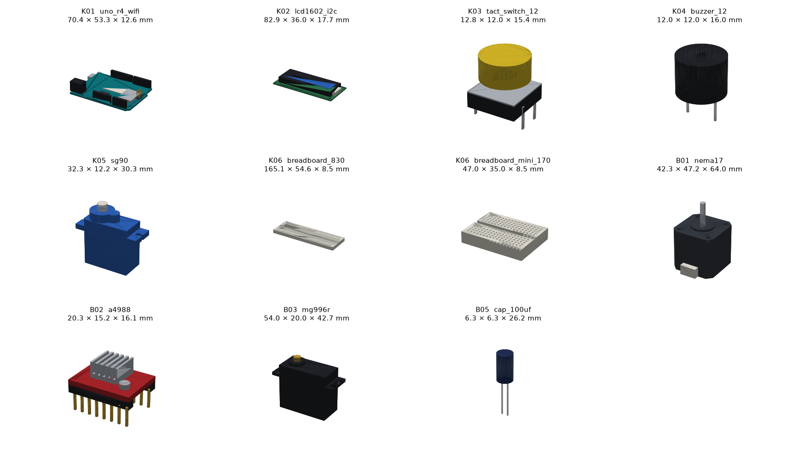

# Arduino Full Kit 구성품 정리와 V5 부품 3D 모델

원본: 키트 상자 안내지 사진 `a61db9f4-b52f-47db-8f75-18b27354e966.jpg` ("ARDUINO FULL KIT 구성품", 2026-11-15 정리).
안내지에는 품목 이름과 그림만 있고 **수량·규격은 적혀 있지 않다.** 아래 "규격"은 그림과 이름으로 본 통상 규격이며 실물 확인이 필요하다.
V5 준비물 기준은 `docs/BUILD_V5.md` 0절(`docs/BUILD_V5_제작설명서.pdf` 4쪽)이다.

## 1. 구성품 38종 (안내지 순서)

"V5" 열: ● 그대로 쓴다 / △ 쓸 수 있으나 확인·대체 필요 / — 쓰지 않는다.

### 통신·무선·입력 모듈
| # | 안내지 표기 | 통상 규격 | V5 |
|---|---|---|---|
| 1 | HC-SR04 초음파 거리센서 모듈 | 5 V, 2~400 cm | — |
| 2 | HC-SR501 인체감지센서 모듈 | PIR, 5~20 V | — |
| 3 | ESP8266 와이파이 모듈 | ESP-01, 3.3 V | — (R4 WiFi 에 무선 내장) |
| 4 | HC-06 블루투스 Slave 모듈 | UART 9600 | — |
| 5 | LCD 1602 With IIC 모듈 | 16×2, PCF8574 백팩 | ● **K02** (A4/A5, 주소 0x27 — 0x3F 인 백팩도 있다) |
| 6 | RFID Rc522 모듈 | SPI, 3.3 V | — |
| 7 | RFID 카드 | 13.56 MHz | — |
| 8 | RFID 키체인 | 13.56 MHz | — |
| 9 | 조이스틱 모듈 | 2축 + 스위치 | — |
| 10 | 4X4 KEY 모듈 | 16키 매트릭스 | — |

### 센서·구동 모듈
| # | 안내지 표기 | 통상 규격 | V5 |
|---|---|---|---|
| 11 | RTC 모듈 | DS1302 또는 DS1307 | — |
| 12 | 물 수위 센서 모듈 | 아날로그 | — |
| 13 | 습도 센서 모듈 | DHT11 | — |
| 14 | RGB LED 모듈 | 공통 캐소드 | — |
| 15 | 모터 드라이버 모듈 | ULN2003 (28BYJ-48 용) | — **A4988 이 아니다. NEMA17 을 돌릴 수 없다** |
| 16 | 스텝모터 DC 5V (28BYJ-48) | 5 V 단극, 감속 1/64 | — 토크·속도 부족 (컵 모터는 NEMA17) |
| 17 | 릴레이 1채널 모듈 | 5 V | — |

### 배선·표시·조작
| # | 안내지 표기 | 통상 규격 | V5 |
|---|---|---|---|
| 18 | 미니 브레드보드 | 170홀, 47×35 mm, 전원 레일 없음 | ✓ **K06** — V5 배선에 사용 (3절) |
| 19 | 점퍼와이어 묶음 | 수-수 | ● **K06** |
| 20 | Female – Male 10pcs 케이블 | 암-수 10가닥 | ● **K06** (LCD 4선) |
| 21 | Sound 센서 모듈 | 마이크 + 비교기 | — |
| 22 | 리모컨 | IR NEC | — |
| 23 | 가변저항 10K | B10K | — |
| 24 | FNDx1 | 1자리 7세그먼트 | — |
| 25 | FNDx4 | 4자리 7세그먼트 | — |
| 26 | 8x8 도트매트릭스 | 1588 계열 | — |
| 27 | 서보모터 | SG90 9 g | ● **K05** 리프터 (D9) |
| 28 | 부저모듈 | Ø12 부저 2개 (능동·수동으로 보임) | ● **K04** (A3) — 능동은 밑면이 막혀 있고 스티커가 붙어 있다 |
| 29 | 볼 스위치 | 기울기 스위치 | — |
| 30 | 포토센서 | CdS | — |
| 31 | 9V 배터리 커버 | 9 V 스냅 + DC 플러그 | — (12 V 어댑터를 쓴다) |

### 낱개 소자
| # | 안내지 표기 | 통상 규격 | V5 |
|---|---|---|---|
| 32 | LED(빨강, 노랑, 초록) | 5 mm | — |
| 33 | 저항 | 220 Ω·1 kΩ·10 kΩ 등 | △ 부저 직렬 100 Ω 대신 220 Ω 을 써도 된다 (R4 는 핀당 8 mA) |
| 34 | FLAME 센서 | IR 포토트랜지스터 | — |
| 35 | TACT 스위치(캡) | 12×12 mm + 원형 캡 | ● **K03** (A2, 내부 풀업) |
| 36 | IR 리시브 센서 | VS1838B | — |
| 37 | 74HC595 | 시프트 레지스터 DIP-16 | — (V4 의 74HC165 와 다른 칩) |
| 38 | LM35DZ | 온도 센서 TO-92 | — |

## 2. V5 준비물과 대조

| 번호 | BUILD_V5.md 품목 | 키트 | 판정 |
|---|---|---|---|
| K01 | Arduino UNO (R3 또는 R4 WiFi) | 안내지에 보드 그림이 없다 | 별도 준비 (R4 WiFi 로 진행 중) |
| K02 | LCD1602 + I2C | #5 | 있음 |
| K03 | 택트 스위치 1 | #35 | 있음 |
| K04 | 부저 1 | #28 | 있음 |
| K05 | SG90 서보 1 | #27 | 있음 |
| K06 | 점퍼선·브레드보드 | #18~20 | 미니 170홀과 점퍼선 있음 |
| K07 | 3×3 큐브 56~57.5 mm | — | 별도 준비 |
| B01 | NEMA17 스텝모터 | #16 은 28BYJ-48 | 구매 |
| B02 | A4988 + 방열판 | #15 는 ULN2003 | 구매 |
| B03 | MG996R + 원형 혼 | — | 구매 |
| B04 | 12 V 2 A 어댑터 + DC 잭, 5 V 2 A USB 어댑터 | #31 은 9 V 스냅 | 구매 |
| B05 | 100 µF 전해 커패시터 | 안내지에 커패시터 없음 | 구매 |

정리하면 키트에서 꺼내는 것은 **LCD·택트 스위치·부저·SG90·미니 브레드보드·점퍼선**이고, 나머지 준비물은 키트 밖이다.

## 3. 키트 때문에 확인할 것

1. **브레드보드** — [실물 배선 안내](WIRING_V5_R4.html#mini-breadboard)는 키트의 170홀 SYB-170을 기준으로 한다. 서보 전원은 보드 밖에 레버형 분기 단자 두 개(+5 V 3구 이상, GND 4구 이상)를 따로 준비해 나눈다.
2. **부저 핀 간격 7.6 mm** — 7.62 mm 간격인 e17과 f17에 꽂는다. 키트의 두 개 중 능동 부저를 쓴다.
3. **택트 스위치 12×12** — 다리가 12.5 × 5.08 mm다. 긴 간격이 가운데 홈을 가로지르게 d11·d13 / g11·g13에 꽂는다.
4. **LCD I2C 주소** — 백팩 칩이 PCF8574AT 이면 0x3F 다. 화면이 안 나오면 주소와 뒷면 가변저항(명암)을 먼저 본다.
5. **모터 드라이버·스텝모터** — 키트의 ULN2003 + 28BYJ-48 은 V5 에 쓰지 않는다. A4988 자리에 꽂지 않는다.

## 4. 3D 모델 (`models/kit_parts_v5/`)

V5 가 실제로 쓰는 키트·구매 부품 11종의 참고용 모델이다. 생성기는 `tools/build_kit_parts_v5.py`(CadQuery)이고, 부품마다 색이 있는 `.step` 과 한 덩어리 `.stl`, 치수·원점·출처를 적은 `kit_parts.json` 을 쓴다. `kit_parts_layout.step` 은 브레드보드를 뺀 9종을 한 줄로 놓은 파일이다(Fusion 에서 한 번에 열기용).

| 파일 | 번호 | 외형 (mm) | 원점 | 치수 근거 | 실측 필요 |
|---|---|---|---|---|---|
| `uno_r4_wifi` | K01 | 기판 68.58 × 53.34 × 1.6, 구멍 Ø3.2 × 4, 헤더 높이 8.5 | 기판 왼쪽 아래(USB 쪽), 밑면 | Arduino ABX00087 데이터시트 13절 | 부품 위치만 근사 |
| `lcd1602_i2c` | K02 | 기판 80 × 36, 구멍 Ø3 (75 × 31), 화면 틀 71.2 × 25.2, 전체 두께 17.7 | 기판 왼쪽 아래, 밑면 (화면 +z) | 1602A 모듈 도면, 판매처 표기 | ● 구멍 간격·백팩 위치 |
| `tact_switch_12` | K03 | 몸통 12 × 12 × 3.9, 캡 Ø11.6, 캡 윗면 11.9 | 가운데, 몸통 밑면 | 12×12×7.3 규격 | ● 캡 높이 |
| `buzzer_12` | K04 | Ø12 × 9.5, 핀 간격 7.6 | 가운데, 밑면 | 12095 규격 | |
| `sg90` | K05 | 몸통 22.7 × 12.2, 귀 32.3 (밑면 z 17), 케이스 윗면 27, 축 끝 30.3 | 출력축 중심, 몸통 밑면 | TowerPro 공식 표 (A 30.3 B 22.7 C 27 D 12.2 E 32.3 F 17) | ● 귀 두께 2.5·축 위치(끝에서 6.1)·구멍 간격 27.7 은 가정 |
| `breadboard_830` | K06 | 165.1 × 54.6 × 8.5, 구멍 830 | 가운데, 밑면 | MB-102 참고 모델 | |
| `breadboard_mini_170` | K06 | 47 × 35 × 8.5, 구멍 170 | 가운데, 밑면 | SYB-170 | |
| `nema17` | B01 | 42.3 각 × 40, 보스 Ø22 × 2, 축 Ø5 × 24 (D컷 길이 20), M3 구멍 31 간격 | 축 중심, 장착면 | NEMA 17 규격, 17HS4401 | 축 길이 24~25 |
| `a4988` | B02 | 기판 20.32 × 15.24, 핀 2 × 8 (줄 간격 12.7), 방열판 9 × 9 × 5 | 기판 가운데, 밑면 | Pololu 치수도 | |
| `mg996r` | B03 | 몸통 40.9 × 20, 귀 54 (밑면 z 26.8, 구멍 49.5 × 10), 케이스 윗면 37, 축 끝 42.7 | 출력축 중심, 몸통 밑면 | TowerPro 공식 표 (A 42.7 B 40.9 C 37 D 20 E 54 F 26.8) | ● 귀 두께 2.5·축 위치(끝에서 10.2)·구멍 간격은 가정 |
| `cap_100uf` | B05 | Ø6.3 × 11.2, 리드 간격 2.5 | 가운데, 밑면 | 25 V 품 통상 규격 | |

- 이 모델은 **외형 확인·배치·하우징 설계용**이다. 인쇄하는 부품이 아니고, `models/robot_v5/`(출력 7종과 조립 STEP)와 `tools/robot_v5_params.py` 의 치수는 건드리지 않는다.
- "실측 필요" 표시 부품은 도면 없이 통상값을 넣은 곳이 있다. 타워 포켓 같은 끼워 맞춤에 쓰기 전에 캘리퍼스로 재고 스크립트의 값을 고친 뒤 다시 생성한다.
- 재생성: `<CadQuery 가 설치된 python> tools/build_kit_parts_v5.py` (미리보기 그림을 건너뛰려면 `--no-png`). 스크립트가 부품별 외형 치수를 기대값과 비교하고 솔리드 유효성을 검사한다.
- `breadboard_830.step` 은 구멍 830개 때문에 13 MB 다.

## 5. 이 모델로 고친 출력물 치수 (2026-11-15)

`tools/build_robot_v5.py` 의 `purchased()` 가 이제 단순 상자 대신 위 모델(NEMA17·MG996R·SG90)을 장착 기준면에 놓고, `tools/check_robot_v5_cad.py` 가 출력 부품과의 겹침을 검사한다. 보정 전 겹침과 고친 값:

| 문제 (보정 전 겹침) | 고친 값 | 바뀐 출력 부품 |
|---|---|---|
| MG996R 몸통 40.9 > 포켓 40.5 | 포켓 41.5 × 20.8, 구멍 중심 축 + 10.25 | base |
| MG996R 귀가 타워 바깥면에서 4.7 떠 있고 안쪽은 후드 팔(틈 0.5)이라 너트 불가 | 구멍 Ø3.2 → Ø2.8 셀프탭, M3×12 + 4.7 mm 스페이서 | base |
| SG90 축을 몸통 가운데로 가정 — 실제는 끝에서 약 6 | 포켓을 축 기준 y −16.9~+6.4 로, 구멍을 몸통 중심 ± 13.85 로 (몸통이 뒤쪽) | base |
| SG90 스플라인 끝이 크랭크 몸통 속으로 약 2 들어감 | 포켓 판 x −64.5~−61.5 → −66.3~−63.3, 크랭크 보스 Ø6×2 → Ø7×3.2 | base, crank |
| 모터 축 24 가 홀더 판과 겹침 (27.9 mm³) | 판 중앙 Ø5.4 홈 1.5 → 관통 | cube_holder |
| 모터 커넥터·케이블이 나갈 곳이 없음 (상자 안쪽 여유 0.85) | 모터 상자 뒷벽에 폭 18 창 (모터 밑면에서 14) | base |

보정 후 2D 36항목·3D 23항목이 모두 통과한다(`models/robot_v5/mechanical_checks.json`). hood·hub·lifter·link 는 형상이 그대로다.
**이미 뽑은 base·crank·cube_holder 가 있으면 다시 뽑아야 한다.** 단, "실측 필요" 부품(SG90·MG996R)의 귀 높이와 축 위치는 통상값이므로 출력 전에 실물을 재서 `tools/robot_v5_params.py` 의 `sg90_*`·`mg996r_*` 값과 이 스크립트를 먼저 맞춘다.

## 6. 치수 출처

- Arduino UNO R4 WiFi 데이터시트 (ABX00087) 13절 Mounting Holes And Board Outline — <https://docs.arduino.cc/resources/datasheets/ABX00087-datasheet.pdf>
- Pololu A4988 Stepper Motor Driver Carrier 치수도 — <https://www.pololu.com/file/0J1082/a4988-stepper-motor-driver-carrier-dimension-diagram.pdf>, <https://www.pololu.com/product/1182/specs>
- LCD1602 + I2C 백팩 (80 × 36 mm) — <https://www.addicore.com/products/1602-16x2-character-lcd-with-i2c-backpack>
- SG90 치수 — <https://www.kpower.com/insight_servo/2399.html>, <https://protosupplies.com/product/servo-motor-micro-sg90/>
- MG996R — TowerPro 공식 제품 표 <https://towerpro.com.tw/product/mg996r/> (A 42.7 B 40.9 C 37 D 20 E 54 F 26.8), Handson Technology 도면 <https://www.handsontec.com/dataspecs/motor_fan/MG996R.pdf> (36.6 / 26.6 / 40.3 / 53.6 / 20)
- SG90 — TowerPro 공식 제품 표 <https://towerpro.com.tw/product/sg90-7/> (A 30.3 B 22.7 C 27 D 12.2 E 32.3 F 17). 글자 뜻: A 전체 높이, B 몸통 길이, C 케이스 윗면 높이, D 폭, E 귀 길이, F 귀 밑면 높이
- NEMA17 17HS4401 — <https://etechnophiles.com/guide-to-nema-17-stepper-motor-dimensions-wiring-pinout/>, <https://datasheetspdf.com/datasheet/17HS4401S.html>
- MB-102 830홀 브레드보드 — <https://protosupplies.com/product/breadboard-mb102-830-tie-points/>
- 12×12×7.3 택트 스위치 (TS13-1212-73) — <https://www.sameskydevices.com/product/switches/tactile-switches/ts13-1212-73-bk-160-d>
- Ø12 × 9.5 능동 부저 (핀 7.6 mm) — <https://www.electrokit.com/en/active-piezo-buzzer-95db-5vdc-pcb-12x9.5mm>
