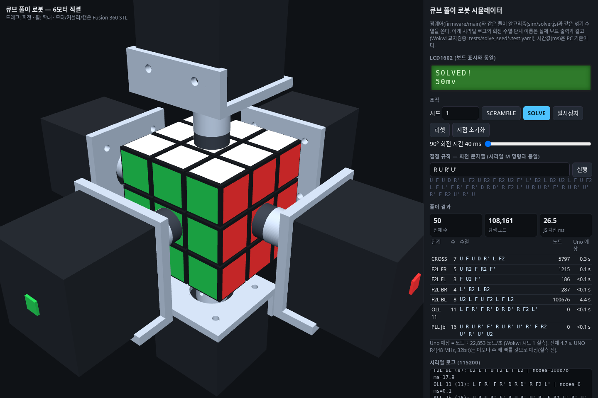

# 수행평가 완성도 검토 및 시연·코드 설명 가이드

검토일: 2026-10-23. 대상: 현재 저장소의 펌웨어, JS 시뮬레이터, 회로도, 기구 설계, 보고서.
학교의 실제 채점표는 제공되지 않았다. 아래 점수는 일반적인 수행평가를 가정한 참고 평가이며, 실물 제작·실행에 부여된 배점에 따라 달라진다.

## 1. 완성도 판단

**소프트웨어 중심 중간평가라면 약 90/100점 수준이다. 실물 구동을 필수로 보는 최종 피지컬 컴퓨팅 평가라면 현재 확인 가능한 증거만으로는 70~80/100점 정도로 판단한다.**

| 평가 항목 | 판단 | 근거 |
|---|---|---|
| 문제 해결·알고리즘 | 우수 | 보드에서 실행할 수 있는 CFOP, IDA*, BFS 거리표, OLL/PLL 조회를 구현했다. 섞은 순서의 역순을 출력하는 방식이 아니라 현재 큐브 상태에서 풀이를 계산한다. |
| 코드 구성 | 우수 | 상태 모델, 탐색, 모터 구동, 입출력을 파일과 클래스로 분리했다. 시리얼 명령과 단계별 로그가 있어 설명과 문제 추적이 쉽다. |
| 검증 | 우수, 실물 증거 보강 필요 | JS 300회 회귀 테스트와 표 생성 검증을 재실행했다. 보드 컴파일·Wokwi 통과 결과는 기존 보고서에 기록되어 있으나 이번 환경에서 재확인하지 못했다. |
| 시연 준비 | 양호 | 3D 시뮬레이터, 고정 시드, 버튼 조작, LCD, 풀이 수·노드 수·시간 출력이 있다. 시뮬레이터는 물리적 부하와 결합을 검증하지 않는다. |
| 하드웨어 통합 | 미검증 | 실제 큐브 한 층에 토크가 전달되는지, 90° 정렬이 유지되는지, 6면 조립이 가능한지 실험 증거가 필요하다. |
| 목표 달성 | 부분 달성 | 로봇이 직접 섞은 상태의 풀이를 구현했다. 사람이 섞은 큐브의 상태 인식, 실제 회전 감지, 실물 30초 이내 완료는 아직 입증되지 않았다. |

기술의 난도는 충분하다. 추가 기능보다 **실제 동작 증거와 본인의 코드 이해도**가 현재 점수를 가장 크게 바꿀 요소다.

## 2. 이번 검토에서 재확인한 내용

- `node tools/test_solver.js 300 1`: **300/300 성공**. 풀이 수 평균 54.7, 최대 70. 탐색 노드 평균 104,235, 최대 700,003(시드 157).
- 같은 실행의 PC 계산 시간: 평균 약 12.38 ms, 최대 약 87.6 ms. 실행 환경에 의존하며 아두이노 계산 시간으로 인용할 수 없다.
- 원본을 바꾸지 않고 임시 폴더에서 `tools/gen_tables.js` 실행: OLL/PLL 커버리지 검증 통과, 보충 공식 0건. 생성된 `tables.h`, `tables.js` 내용은 저장된 파일과 일치했다(헤더 날짜 제외).
- Chromium에서 시드 1의 SCRAMBLE → SOLVE를 실제 조작: 브라우저 스크립트 오류 0건, 50수·108,161노드·`SOLVED ok=1` 확인. 시뮬레이터의 실행 시간은 브라우저 렌더링 속도와 회전 시간 설정에 영향을 받는다.
- 보드 컴파일: 이번 환경에는 Arduino CLI가 있지만 보드 코어와 라이브러리 인덱스가 준비되지 않아 재검증하지 못했다.
- Wokwi: CLI는 있으나 이번 환경에는 토큰이 없어 재검증하지 못했다. 시나리오 파일의 존재와 기존 보고서의 통과 기록을 확인했다.

300회 성공은 검사한 합법적 섞기 표본에서의 결과다. 큐브의 모든 가능한 상태나 실제 모터 동작을 전수 검증했다는 뜻은 아니다.



## 3. 발표 전 보완 우선순위

### 최우선: 센터 결합이 실제 한 층을 돌리는지 확인

현재 설계는 모터 축을 커플러와 센터 캡에 연결한다(`fusion/scripts/cube_robot_parts.py`). 일반 큐브에서는 센터 캡 또는 센터 조각만 회전하고 주변 엣지·코너가 따라 돌지 않을 수 있다. 사용하려는 큐브의 구조에서 **센터에 가한 회전이 한 층 전체에 전달되는지** 한 면 시제품으로 먼저 확인해야 한다.

주변 조각이 따라오지 않으면 모터 속도를 조정해도 해결되지 않으므로, 외곽 조각까지 잡는 그리퍼 등 층에 토크를 전달하는 결합 구조를 검토한다. 3D 화면에서 한 층이 도는 것은 프로그램이 그렇게 그리기 때문에 가능한 것이며 실물 결합의 증거가 아니다.

### 높음: 내부 성공 판정과 실제 성공을 구분

`main.ino`의 `execute()`는 모터 명령을 보낸 뒤 `cube.move()`로 내부 상태를 갱신한다. 회전 성공을 센서로 확인하지 않는다. 따라서 탈조나 커플러 미끄러짐이 생겨도 `SOLVED ok=1`이 출력될 수 있다.

발표에서는 “내부 모델이 풀렸음을 검사하며, 실제 큐브는 눈으로 함께 확인한다”고 설명한다. 실물 5회 연속 성공 영상과 로그를 남기는 것이 가장 직접적인 보완이다.

### 높음: 스마트큐브 연동 방식 수정 필요

`M <수열>`은 상태만 반영하는 명령이 아니다. `handleLine()`에서 `execute()`를 호출해 모터와 내부 상태를 함께 움직인다. 사람이 이미 돌린 큐브의 회전 기록을 그대로 넣으면 모터가 같은 회전을 다시 수행한다.

스마트큐브 단계에서는 모터 실행 없이 모델만 갱신하는 입력 경로와, 로봇이 수행한 회전의 확인 경로를 별도로 설계해야 한다. 현재 `M`은 외부 장치에서 로봇에 회전 명령을 주는 용도로 설명하는 것이 정확하다.

### 높음: 30초 목표 실측

PC 계산 시간, Wokwi의 Uno 계산 시간, R4 실물의 계산·구동 시간을 구분한다. 현재 화면의 `Uno 예상`은 시드 1의 처리량에서 환산한 추정치다. 모든 섞기가 30초 안에 끝난다는 보장은 아니다.

R4 실물에서 여러 시드를 시험하고 `calc + exec`와 실제 큐브 상태를 함께 기록한다. JS 표본에서 노드가 가장 많았던 시드 157도 시험 후보로 삼되, 이것이 실물의 최악 시간을 반드시 만드는 것은 아니다.

### 추가 코드 보완

- 시리얼 수신 버퍼는 96바이트다. 긴 명령은 초과 부분을 버리고 잘린 줄을 처리할 수 있으므로, 초과 입력은 오류로 거절하는 편이 명확하다(`main.ino:149`).
- 풀이 결과를 `solution[128]`에 누적할 때 각 `memcpy` 전에 용량을 확인하지 않는다. 이번 표본의 실패는 없었지만, 누적 길이 제한을 코드로 명시하면 견고해진다(`solver.cpp:176` 이후).
- 탐색과 모터 실행은 동기식이다. 실행 중 시리얼 정지 명령이나 버튼 처리를 즉시 할 수 있는 구조는 아니다. 시뮬레이터의 일시정지 기능을 실물 펌웨어 기능으로 소개하면 안 된다.
- Three.js를 CDN에서 읽는다. 발표 장소 인터넷으로 미리 접속해 보고, 오프라인 시연이 필요하면 라이브러리의 로컬 배포를 준비한다.
- `diagram.json`에는 실물의 12V VMOT 공급·드라이버별 커패시터 배선이 표현되어 있지 않다. 실물 조립에는 보고서의 전원 구성을 반영한 배선 자료를 별도로 준비한다.

## 4. 권장 시연: 3~5분

### 준비

```text
node tools/serve.js
http://localhost:8765/sim/
```

시드 1, 기본 회전 시간 150 ms로 리허설한다. 시간을 줄여야 하면 화면에서 회전 시간을 조정하되, 이 값은 시각화용이며 실물 구동 속도의 증거가 아니다. 실물 시연은 실제 큐브와 내부 모델이 모두 맞춰진 상태에서 시작한다.

| 시간 | 보여 줄 내용 | 핵심 설명 |
|---|---|---|
| 0:00~0:30 | 전체 화면과 6모터 구조 | “로봇이 직접 큐브를 섞고, 보드 안에서 풀이를 계산해 각 면을 돌리는 프로젝트입니다.” |
| 0:30~1:00 | 시드 1 → SCRAMBLE | “같은 시드는 같은 20수 섞기를 만듭니다. 로봇이 실행한 회전을 내부 모델에도 반영해 현재 상태를 추적합니다.” |
| 1:00~1:40 | SOLVE → 단계표와 로그 | “Cross, F2L, OLL, PLL로 문제를 나눕니다. 앞의 두 단계는 탐색하고 뒤의 두 단계는 공식표를 조회합니다.” |
| 1:40~2:00 | 완료, 50수, 108,161노드, `SOLVED ok=1` | “시드 1은 합쳐서 50수로 풀립니다. 성공 로그는 내부 모델 기준이며 실물은 큐브 상태도 함께 확인합니다.” |
| 2:00~3:30 | 핵심 함수 4개 | 아래 코드 설명 순서로 입력 → 상태 → 풀이 → 모터 출력을 연결해 설명한다. |
| 3:30~4:30 | 300회 테스트 결과와 한계 | “표본 300회는 모두 성공했습니다. 실물 결합·실제 회전 확인·30초 실측은 별도로 검증할 항목입니다.” |

실물 시리얼 명령은 `S 1` → 섞기 완료 대기 → `V` → `SOLVED ok=1` 확인 순서다. `R`은 내부 모델만 초기화한다. 실제 큐브를 맞추는 명령으로 사용하면 안 된다.

발표에서는 **전체 풀이를 먼저 계산한 뒤 합쳐진 수열을 실행한다**고 설명한다. 현재 코드는 각 CFOP 단계를 물리적으로 실행하고 센서로 확인하는 구조가 아니다.

## 5. 코드 설명 순서와 말할 내용

### ① `main.ino`: 입력과 전체 흐름

- `setup()`(171행): 시리얼, 버튼 풀업, 모터 핀, LCD를 초기화한다.
- `loop()`(183행): 시리얼 입력과 버튼을 확인한다.
- `doScramble()`(63행): 20수 섞기를 생성하고 실행한다.
- `doSolve()`(89행): 현재 큐브 상태에서 풀이를 계산하고, 계산 성공 시 전체 수열을 실행하고, 내부 모델의 완료 여부를 출력한다.

설명: “버튼이나 시리얼로 작업을 시작하면, 계산 결과를 회전 번호 배열로 받아 모터 제어부에 전달합니다. 계산 시간과 실행 시간을 따로 출력해 병목을 확인합니다.”

### ② `cube.h`, `cube.cpp`: 큐브 상태 표현

`cp[8]`, `co[8]`, `ep[12]`, `eo[12]`로 코너와 엣지의 조각 번호·방향을 저장한다. 총 40바이트다. `Cube::move()`(`cube.cpp:8`)는 회전표를 이용해 배열을 갱신한다.

설명: “스티커 54개를 직접 움직이는 대신 조각의 위치와 방향을 저장합니다. 회전은 어떤 조각이 어디로 가는지와 방향이 어떻게 바뀌는지를 표로 적용합니다.”

회전 번호는 `face * 3 + k`다. `U R F D L B`가 각각 면 번호 0~5이고, `k=0`은 시계 90°, `k=1`은 180°, `k=2`는 반시계 90°다.

### ③ `solver.cpp`: CFOP와 IDA*

`Solver::solve()`(176행)는 Cross → F2L 네 쌍 → OLL → PLL을 진행한다. `ida()`(118행)는 탐색 한도를 높이고, `search()`(97행)는 가능한 다음 회전을 시도한다.

설명: “IDA*는 깊이 우선 방식으로 메모리를 아끼면서, 남은 최소 이동 수의 추정치를 이용해 한도 안에 풀 수 없는 가지를 버립니다. 거리표는 PC에서 BFS로 미리 만듭니다. 여러 조각 쌍의 거리 중 최댓값을 쓰는 이유는, 그중 가장 오래 걸리는 쌍도 해결해야 전체가 해결되기 때문입니다.”

`childFits()`(66행)는 거리표 하나만 봐도 한도를 넘는다면 나머지 계산과 재귀 호출을 생략한다. 탐색에서는 전체 큐브 대신 관심 조각만 추적한다. OLL/PLL은 윗면 패턴을 키로 바꿔 준비한 공식을 찾는다.

“CFOP 전체가 최단 풀이를 보장하나요?”라는 질문에는 **아니라고 답한다.** 문제를 단계로 나누고 제한된 시간·메모리에서 실용적인 수열을 구하는 설계다.

### ④ `motors.cpp`: 회전 번호를 실제 신호로 변환

`Motors::turn()`(17행)은 회전 번호에서 면과 방향을 구하고 DIR·STEP 신호를 보낸다. 200스텝/회전인 모터의 풀스텝 설정에서 90°는 50스텝, 180°는 100스텝이다. 반시계 90°는 방향을 바꾸고 50스텝 이동한다.

설명: “처음에는 펄스 간격을 길게 잡고 점점 줄였다가 끝에서 다시 늘립니다. 출발과 정지를 완만하게 해 탈조 가능성을 낮추려는 목적입니다. 한 수가 끝나면 정착 시간을 둡니다.”

### ⑤ `main.ino:50`: 소프트웨어와 모터의 연결

```cpp
motors.turn(seq[i]);
cube.move(seq[i]);
```

설명: “같은 회전 번호를 실제 모터와 내부 모델에 적용합니다. 다만 모터가 실제로 성공했는지를 측정하는 부분은 없어서 두 상태가 어긋날 수 있습니다.”

## 6. 예상 질문

| 질문 | 답변 핵심 |
|---|---|
| 섞기를 거꾸로 실행하는 것 아닌가요? | 풀이기는 섞기 이력을 입력으로 받지 않는다. `Solver::solve(const Cube& start, ...)`로 현재 조각 상태를 받아 CFOP 풀이를 새로 계산한다. |
| 센서가 없는데 상태를 어떻게 아나요? | 맞춰진 큐브에서 시작해 로봇이 수행한 회전을 내부 모델에도 적용한다. 사람이 임의로 바꾸거나 모터가 미끄러지면 정확성이 깨진다. |
| 왜 BFS나 A*를 그대로 쓰지 않았나요? | 전체 상태 공간이 크고 보드 메모리가 작다. 작은 조각 쌍의 BFS 거리표와 메모리를 적게 쓰는 IDA*를 결합했다. |
| 왜 거리들을 더하지 않나요? | 한 회전이 여러 쌍을 동시에 개선할 수 있어 단순 합은 남은 비용을 과대평가할 수 있다. 현재 표들의 최댓값은 하한으로 사용할 수 있다. |
| PC와 아두이노가 같다는 근거는요? | 동일 시드·탐색 순서와 단계별 수열을 기준으로 Wokwi 시나리오를 만들었다. 이번에는 JS 300회·공식표를 재검증했고, 보드 교차검증은 기존 기록이 있다. |
| 지금 사람이 섞은 큐브도 풀 수 있나요? | 상태를 정확하게 전달하는 경로가 아직 없다. 현재 완료 범위는 로봇이 직접 섞고 푸는 흐름이다. |
| AI가 만든 코드인가요? | 보고서에 작성·검토 보조 사용을 공개했다. 각자 담당 모듈의 설계 이유, 핵심 함수, 실패 조건을 직접 설명하고 수정할 수 있어야 한다. |

## 7. 제출 전 완료 기준

1. 한 면 결합 시험: 센터만 헛돌지 않고 해당 층 전체가 90°/180°/반시계로 움직이는 영상.
2. 6면 조립 후 최소 5회 연속 실제 성공, 각 시드·계산 시간·실행 시간·실제 완료 여부 기록.
3. 고정 시드 1 시연과 실패 복구 절차 리허설. 모형만 초기화하는 `R`의 한계 숙지.
4. 발표자는 상태 배열, 휴리스틱, 가지치기, STEP/DIR 네 가지를 코드에서 직접 짚어 설명.
5. 보고서의 실측·추정·향후 계획을 구분하고, 원래 목표와 현재 구현 범위를 정확히 표현.
