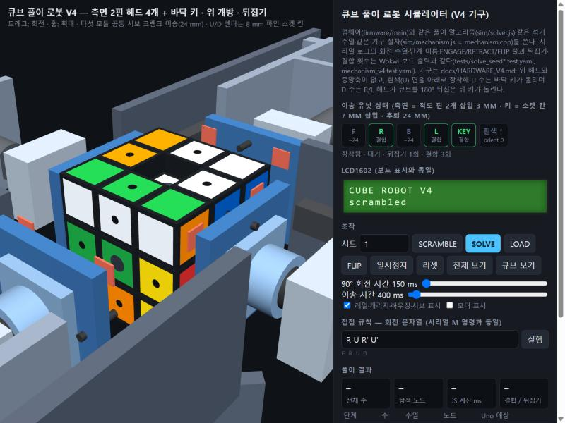
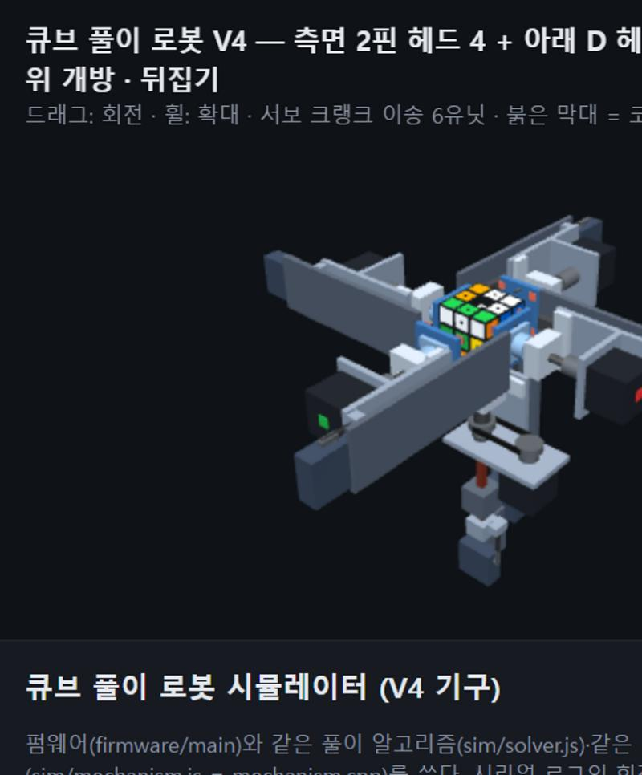

# 큐브 풀이 로봇 — 피지컬 컴퓨팅 수행평가 보고서

> **하드웨어 V4 (현재):** 아래 4·6장의 6모터 직결·센터 캡 구조는 V1 기록이고, V2(엣지 핀 구동·수동 이송)·V3(고정 중앙축·수동 잠금)는 이력이다. 현재 설계는 [HARDWARE_V4.md](HARDWARE_V4.md): **위 헤드를 없애고 중앙축 대신 승강 잠금 막대**를 쓴다. 측면 2핀 헤드 4개 + 아래 D 헤드(중공축·벨트)가 면을 돌리고, 8 mm 각재 막대가 아래에서 중공축을 지나 큐브 중심(도넛 큐브의 U/D 센터 판 소켓)까지 올라와 코어를 고정하며 뒤집기 때만 내려간다. 여섯 이송 유닛은 같은 서보 크랭크로 결합/후퇴하고 결합 스위치로 확인한다. U 층은 R/L 헤드가 큐브를 180° 뒤집은 뒤 아래에서 돌리고, 큐브는 열린 위로 넣고 뺀다(LOAD 버튼). 펌웨어 `mechanism.*`·시뮬레이터·Wokwi 시나리오가 이 절차를 구현·검증했고, 실물 출력·조립·부하·뒤집기 마찰 시험은 아직이다. 장치별 기능과 추가 이유는 HARDWARE_V4.md 0절.

컴퓨터과학 2 · 피지컬 컴퓨팅 · 팀: 김재혁, 나준우 · 2026-10-23 (중간 산출물)

> 섞인 3×3 큐브를 **아두이노 보드 안에서** CFOP(IDA* + 공식표)로 풀어 **6개 스텝모터가 각 면을 직접 돌려** 맞추는 로봇.
> 이번 산출물: 펌웨어(Uno·UNO R4 WiFi 컴파일 통과), Wokwi 회로·자동 검증, Fusion 360 출력 부품 3종(STL), JS 3D 시뮬레이터, 보고서.

관련 문서: [파이프라인](PIPELINE.md) · [자랑하고 싶은 기술](HIGHLIGHTS.md) · [알고리즘의 수학적 정리](MATH.md) · [3D 설계 검토](DESIGN_REVIEW.md) · [환경 설정](SETUP.md)

---

## 1. 작업 목표

| 구분 | 목표 | 완료 기준 (수치) | 이번 산출물 상태 |
|---|---|---|---|
| 1단계 (필수) | 로봇이 스스로 섞고 스스로 푼다 | 일반 큐브, 6모터, **보드 내 풀이 계산**, 오류 없이 5회 연속 성공 | 시뮬레이션에서 300회 연속 성공, Wokwi 보드 시뮬레이션에서 섞기→풀이→`SOLVED ok=1` |
| 2단계 (도전) | 사람이 손으로 섞은 큐브를 푼다 | 스마트큐브가 섞은 과정을 BLE로 전송, 로봇 명령과 교차검증 | 접점 규칙(`M <수열>` 명령)까지 준비, 하드웨어는 미착수 |
| 공통 | 30초 이내 풀이 | 장착 후 완료까지 30초 이하 (계산 포함) | 평균 55수 · 계산 노드 10만. 시드 1의 Uno 계산은 최적화 후 약 4.7 s. V4 기구 실행은 시드 1 기준 회전 60회 + 결합 45회 + 뒤집기 4회 — 현행 보수적 모터 상수(90° 0.7 s, 이송 0.4 s)로 약 82 s 추정, 30 s 는 회전 램프 단축·결합 수 최소화 과제. R4·실물 실측 예정 — 5장 |

한 문장 목표는 계획서와 같다: **"사람이 섞은 큐브를 올려두면, 로봇이 사람처럼 단계마다 상태를 확인하며 30초 안에 맞춘다."**

## 2. 선정 이유와 필요성

1. **수업에서 배운 탐색이 막히는 지점을 실물로 보여 준다.** 큐브의 상태는 4.3×10¹⁹개다. DFS는 끝없이 내려가고, BFS는 깊이마다 13배씩 늘어나 32 KB RAM이 금방 차며, A*도 열린 목록 때문에 메모리가 터진다. IDA*(DFS의 메모리 + A*의 휴리스틱)와 사람의 풀이법(CFOP)의 **문제 분해**가 왜 필요한지를 보드 한 장(2 KB RAM Uno에서도 동작)으로 증명한다.
2. **피지컬 컴퓨팅의 요소를 모두 쓴다.** 입력(버튼 2개, 시리얼), 처리(탐색 알고리즘), 출력(스텝모터 6개, LCD1602, 부저), 기구(3D 프린팅 커플러·캡·브래킷, 레이저커팅 프레임), 회로(A4988 드라이버 6개, 전원 분리).
3. **실패해도 시연이 무너지지 않는 구조.** 로봇이 스스로 섞으면서 그 수열을 기록하므로 센서 없이 큐브 상태를 정확히 안다. 가장 불확실한 부품(자작 스마트큐브)이 실패해도 1단계만으로 평가 조건을 충족한다.
4. **검증 가능한 소프트웨어.** 같은 알고리즘을 PC(JS)와 보드(C++)에서 돌려 결과가 글자 단위로 같은지 자동으로 비교한다. "돌아간다"가 아니라 "같은 답을 낸다"를 보여 줄 수 있다.

## 3. 계획서 대비 변경·추가 사항

변경은 모두 "이렇게 하면 더 좋은 평가(①~⑥)를 받을 수 있다"는 근거가 있을 때만 했다.

| # | 계획서 | 변경/추가 | 이유 (평가 요소) |
|---|---|---|---|
| 1 | F2L을 "쌍마다 IDA* 탐색, 페어 하나의 상태는 수백 개" | **쌍 거리표(24×24)를 PC에서 BFS로 생성해 플래시에 저장**, 탐색 중에는 큐브 전체가 아니라 관심 조각 상태만 추적 | ② 거리표를 플래시에 두고 작은 추적 배열(단계당 12 B)로 탐색하도록 설계해 근거가 수치로 남는다. ③ 32 KB RAM인 R4뿐 아니라 2 KB Uno에서도 실행됨을 검증해 보드 선택의 여유가 생긴다 |
| 2 | OLL 57·PLL 21 공식 문자열을 플래시에 저장, 패턴 매칭 | **공식의 역연산으로 인식 키를 자동 생성**하고, 생성 시 OLL 216·PLL 288 유효 상태 전부에 대해 조회·해결 결과를 검사. wide·슬라이스·회전이 든 사람 공식을 로봇용 6면 수열로 자동 변환 | ③ 사람이 패턴을 입력하지 않아 입력 오류 위험이 사라지고, 전수 검사 결과(보충 0건)가 남는다. ⑤ 발표에서 "표를 어떻게 믿는가"에 검사 결과로 답한다 |
| 3 | 보드 내 풀이 (Uno R4 WiFi) | 실물은 R4 WiFi 유지(컴파일 확인). **시뮬레이션은 Uno R3**(Wokwi가 R4 미지원, 헤더 핀 배치가 R4와 동일) | ③ 공통 핀 배치로 제어 흐름·회로 배선을 먼저 검증한다. 16 MHz AVR 측정값이 "최악의 경우" 기준이 된다. 실물에서는 모터 전원(VMOT)·회전 방향·시간을 별도 확인한다 |
| 4 | PC 시뮬레이터로 노드 수 측정 | **JS 풀이기 = 펌웨어 풀이기**로 만들고, JS가 만든 기대 출력으로 Wokwi 시나리오를 자동 생성해 보드 출력과 글자 단위 비교 | ③ "같은 답"을 자동으로 검증하는 회귀 테스트. ④ 알고리즘(준우)과 통합(재혁) 담당이 **같은 문자열**을 기준으로 따로 개발·검증할 수 있다 |
| 5 | 접점 규칙 = 회전 기호 문자열 | 시리얼 프로토콜로 고정: `S [seed]`, `V`, `M <수열>`, `P`, `R`, `Q` | ④ 담당자가 명령·출력 형식을 공유해 독립 개발과 통합 시험을 할 수 있다. ② 2단계 스마트큐브·PC 같은 외부 입력의 확장 경로(`M`)를 고정한다 |
| 6 | (없음) | **F2L 어려운 경우 전략**: 깊이 8 이내 슬롯 우선, 모두 실패 시 꺼내기→끼우기 2단 탐색 | ②·③ 어려운 F2L의 탐색량을 줄여 30초 목표 달성 가능성을 높인다. 300개 표본(20수 섞기)에서 F2L 한 쌍 최대 노드 292만 → 55만, 한 풀이 전체 최대 344만 → 70만. 수는 평균 54.6 → 54.7로 거의 같음 |
| 7 | 3D 프린팅 센터 소켓 + 축 커플러 | **Fusion 360 API 스크립트**로 커플러·센터 캡·모터 브래킷 3종을 파라메트릭 생성 + Codex 설계 검토 반영 | ② 기구 설계 근거(공차·벽 두께·토크)를 숫자로 설명. 위험 대책 "소켓 공차 시험 출력 여러 개"를 상수 1줄 변경으로 수행 |
| 8 | (없음) | **JS 3D 시뮬레이터**: 같은 명령·같은 로그·같은 LCD 문구로 V2 핀 구동 로봇(헤드 결합·후퇴 전환 포함)을 CAD 치수 그대로 애니메이션 | ⑤ 실물이 없는 자리(중간발표, 자료)에서도 단계별 동작을 보여 준다 |
| 9 | 풀이 중 단계마다 상태 확인 | 1단계는 보드 내부 모델로 확인(계획서와 같음). 실행 후 `cube.isSolved()`로 내부 모델의 논리적 성공을 `SOLVED ok=1/0` 로 출력 | ③ 실패를 숨기지 않는 출력. 단, 탈조·커플러 미끄러짐은 내부 모델이 감지하지 못하므로 실물에서는 눈으로 확인을 병행하고, 2단계 스마트큐브가 이 빈틈을 메운다 |
| 10 | 6면 직결 모터 | **V4 기구**: 위 헤드 제거, 중앙축 대신 승강 잠금 막대, 측면 2핀 헤드 4 + 아래 D 헤드(중공축), 서보 크랭크 자동 이송 + 결합 스위치, 뒤집기, LOAD 장착. 펌웨어 `mechanism.*` 가 매 수 앞에서 "새 지지 결합 → 센서 확인 → 기존 지지 해제 → 막대 확인 → 회전" 을 수행하고, 확인 실패 시 그 수를 돌리지 않고 중단 | ②③ 센터 캡 직결(V1)은 핀 걸림, 큐브 전체 회전 문제가 있었다. V4 는 위가 열려 큐브를 넣고 뺄 수 있고 막대가 축 역할을 하면서도 뒤집기를 허용한다. JS 기구 모델과 보드가 같은 절차·같은 횟수를 내는 것을 Wokwi 로 교차검증(7장) |

## 4. 하드웨어 구성

```
                 [UNO R4 WiFi / UNO R3]
 D2~D7  STEP ──┐                       A0  SCRAMBLE 버튼 (풀업, GND)
 D8~D13 DIR  ──┤  A4988 ×6 ──  NEMA17 ×6  A1  SOLVE 버튼
               │  (U R F D L B 순)      A2  부저
 A4/A5  I2C  ──┴─ LCD1602 (0x27)        12 V 어댑터 → A4988 VMOT (보드 5 V와 분리)
```

| 구성 | 부품 | 핀 | 역할 |
|---|---|---|---|
| 두뇌 | Arduino UNO R4 WiFi (시뮬: UNO R3) | — | 풀이 탐색, 6모터 제어, 시리얼 접점 |
| 구동 | NEMA17 ×6 + A4988 ×6 | STEP D2~D7, DIR D8~D13 (U,R,F,D,L,B) | 면 회전 90°/180°, 풀스텝 50스텝 = 90° |
| 결합 | 3D 출력 센터 커플러 ×6, 센터 캡 ×6 | — | 모터 D축 ↔ 큐브 센터 (십자 키) |
| 프레임 | 3D 출력 L브래킷 ×6 + 레이저커팅 판재 | — | 모터 6개를 큐브 둘레에 고정 |
| 조작·표시 | 택트 스위치 ×2, LCD1602 I2C, 부저 | A0, A1, A4/A5, A2 | 섞기·풀기 시작, 단계 표시, 완료 알림 |

- 회로도: [diagram.json](../diagram.json) (Wokwi). A4988 의 RESET–SLEEP 을 묶고 VDD 5 V, DIR HIGH = 시계 방향(`motors.h` `CW_LEVEL`, 실물 배선에 따라 한 줄로 반전).
- 전류: 모터 전원(12 V)과 보드 전원을 분리하고 **한 번에 한 면만** 회전해 동시 가속 전류를 피한다(계획서 위험 대책 그대로). 단, 현재 펌웨어는 A4988 ENABLE 을 제어하지 않아 정지 중인 5개 모터의 유지 전류는 계속 흐른다. 전원은 유지 전류까지 포함해 고른다(4.4 절).
- 핀 배치는 `diagram.json`, `firmware/main/motors.h`, `main.ino` 세 곳에서 함께 바꾼다.

### 4.4 전원·안전 (실물 조립 기준)

| 항목 | 값 / 방법 |
|---|---|
| 모터 전원 | 12 V 어댑터, 용량은 NEMA17 6개의 유지 전류 합 이상 (드라이버 전류 제한 0.8 A 기준 약 5 A 권장) |
| 드라이버 전류 제한 | A4988 Vref 로 모터당 0.8 A 이하로 설정 (저속·가벼운 부하라 정격보다 낮게) |
| 공통 GND | 12 V 어댑터 GND, A4988 GND, 보드 GND 를 한 점에서 연결 (Wokwi 회로도에도 반영) |
| 디커플링 | A4988 VMOT–GND 사이 100 µF 전해 커패시터 (드라이버마다), 핫플러그 금지 |
| 전원 차단 | 어댑터 스위치 → 모터 즉시 정지. 보드는 USB 로 따로 급전되어 상태(시리얼·LCD)는 유지 |
| 손 끼임 | 큐브가 돌 때 프레임 안에 손을 넣지 않는다. 시연 시 `SOLVE` 전에 "큐브 장착 완료" 확인 |

### 4.5 실패 시 동작과 복구

| 상황 | 로봇의 동작 | 복구 |
|---|---|---|
| 탈조·커플러 미끄러짐으로 실제 큐브와 내부 모델이 어긋남 | 내부 모델은 성공으로 판단할 수 있음 (`SOLVED ok=1` 은 모델 기준) | 전원 차단 → 손으로 큐브를 풀거나 맞춘 뒤 `R`(모델 리셋). `R` 은 물리 큐브를 되돌리지 않는다 |
| 풀이 계산 실패 (잘못된 상태 입력) | `SOLVE FAILED (invalid state)`, LCD `SOLVE FAILED`, 저음 부저 | 큐브를 맞춘 뒤 `R` |
| 면이 걸려 90°가 안 됨 | 다음 수에서 끼임 → 즉시 전원 차단 | 캡·커플러 공차 재출력(`SLOT_CLR`, `HOLE_CLR`), 가감속 상수(`START_US`) 완화 |
| 2단계 스마트큐브 기록과 로봇 명령 불일치 | 정지·알림 (계획서 대책) | 실제 상태에서 다시 탐색 (`P` 로 상태 확인 → 보정) |

## 5. 소프트웨어·알고리즘 설계

### 5.1 모듈 구조 (firmware/main)

| 파일 | 역할 |
|---|---|
| `cube.h/.cpp` | 큐비 모델(코너 8·엣지 12, 40 B), 18수 적용, 표기 파싱·출력, 섞기(xorshift32), 스티커 54개 출력 |
| `solver.h/.cpp` | Cross IDA* → F2L 4쌍 IDA* → OLL 조회 → PLL 조회. 단계 콜백으로 이름·수열·노드·시간 보고 |
| `tables.h` | **자동 생성**(`tools/gen_tables.js`): 치환표, 거리표, OLL/PLL 키·수열. 선언 배열 합계 10,769 B (PROGMEM, 실제 링크 크기는 미사용 제거에 따라 다름) |
| `motors.h/.cpp` | A4988 STEP/DIR 6채널, 사다리꼴 가감속, 정착 시간 |
| `main.ino` | 버튼(디바운스)·LCD·부저·시리얼 명령(S/V/M/P/R/Q), 섞기 기록 → 풀이 → 실행 → 검증 |

### 5.2 CFOP 단계별 처리

| 단계 | 하는 일 | 처리 | 휴리스틱 / 표 |
|---|---|---|---|
| Cross | 아랫면 엣지 4개 | IDA*, 18수, 최대 8수 | 크로스 엣지 두 개씩 6쌍의 거리표(24×24) 최댓값 |
| F2L | 코너·엣지 쌍 4개 | 쌍마다 IDA*, D 제외 15수. 거리표 값이 작은 슬롯부터 깊이 8 이내; 모두 실패하면 꺼내기→끼우기 | 슬롯별 코너·엣지 쌍 거리표(24×24) + 크로스 표 |
| OLL | 윗면 방향 | 방향 키(코너 3진 4자리 + 엣지 4비트) 조회, 사전 AUF 4가지 | 57공식, 역연산 키 |
| PLL | 윗면 위치 | 위치 키(코너·엣지 각 2비트×4) 조회, 사전 AUF + 공식 뒤 AUF | 21공식 × AUF 4 = 84항목 + AUF 전용 3항목 = 87항목 |

탐색 중 상태는 **관심 조각의 (위치, 방향) 1바이트**들이다. 한 수에 조각당 표 2번 조회(`EDGE_TO`, `EDGE_DO`)로 갱신되므로 큐브 40 B 복사가 없다. 가지치기: 같은 면 연속 금지, 반대면 쌍은 한 순서로만.

### 5.3 측정 결과

**PC (Node, 300개 섞기, 20수 섞기)** — `node tools/test_solver.js 300 1`

| 항목 | 평균 | 최대 |
|---|---|---|
| 풀이 수 | 54.7 | 70 |
| 탐색 노드 | 104,235 | 700,003 |
| 계산 시간 (Node) | 8.0 ms | 52.9 ms |
| F2L 한 쌍 노드 | 중앙값 8.5 k | p99 298 k / 최대 547 k |

**보드 (Wokwi, UNO R3 16 MHz, 시드 1)** — `tests/solve_seed1.test.yaml`

| 단계 | 수 | 노드 | 1차 구현 | Codex 최적화 후 |
|---|---|---|---|---|
| CROSS | 7 | 5,797 | 334 ms | — |
| F2L FR / FL / BR | 5 / 3 / 4 | 1,215 / 186 / 287 | 100 / 20 / 37 ms | — |
| F2L BL | 8 | 100,676 | 14,884 ms | ≈ 4,400 ms |
| OLL 11 / PLL Jb | 11 / 16 | 0 | 2 / 3 ms | — |
| **전체 계산** | **50** | **108,161** | **15.6 s** (6.9 k 노드/s) | **4.7 s** (22.9 k 노드/s, 3.3배) |
| 모터 실행 | 50수 | | 약 3.5 s | 약 3.5 s |

최적화(Codex 플러그인, `solver.cpp`)의 핵심: 자식 노드의 휴리스틱을 **부모에서 미리 계산**해 탈락할 자식은 재귀 호출 자체를 하지 않고, 거리표 중 하나라도 남은 깊이를 넘으면 나머지 조각 갱신을 생략한다. 거리표 행 주소를 IDA* 시작 때 한 번만 계산하고 코너 상태의 `/3`을 표 조회로 바꿨다. 탐색 순서·노드 수·출력은 글자 단위로 같다(교차검증 재통과).

→ 16 MHz AVR에서 평균 섞기(10.4만 노드)는 약 4.5 s, 300개 중 최악(70만 노드)은 약 31 s. 이 값이 "최악 보드" 기준이고, 실물 UNO R4 WiFi(48 MHz Cortex-M4, 32비트)는 이보다 수 배 빠를 것으로 예상한다(실측 예정).

**빌드 크기** (최적화 후)

| 보드 | 플래시 | RAM |
|---|---|---|
| UNO R3 (`arduino:avr:uno`) | 27,000 B (83 %) | 942 B (45 %) |
| UNO R4 WiFi (`arduino:renesas_uno:unor4wifi`) | 77,048 B (29 %) | 9,368 B (28 %) |

### 5.4 제어 루프와 접점 규칙

현재 구현은 **전체 CFOP 풀이(크로스→F2L→OLL→PLL)를 먼저 계산·보고한 뒤, 합쳐진 수열을 모터로 실행**하고 마지막에 내부 모델의 `isSolved()`로 확인한다(섞기도 로봇이 직접 돌리며 기록하므로 상태는 항상 내부 모델이 안다). 계획서의 "단계마다 실행·확인" 루프는 2단계에서 스마트큐브의 실제 회전 기록이 들어올 때 단계 콜백(`StageCallback`) 단위로 확장한다. 시리얼 115200:

| 명령 | 동작 | 출력 |
|---|---|---|
| `S [seed]` | 20수 섞기 생성·실행 | `SCRAMBLE seed=1 (20): D2 B' …` / `SCRAMBLED exec=…ms` |
| `V` | 풀이 계산 + 실행 | `CROSS (7): … | nodes=… ms=…` … `TOTAL 50: …` / `SOLVED ok=1 moves=50 calc=…ms exec=…ms` |
| `M <수열>` | 임의 수열 실행 (스마트큐브·PC 입력용) | `MOVED n` |
| `P` / `R` / `Q 0|1` | 상태 54자 출력 / 모델 리셋 / 모터 생략 모드 | |

## 6. 3D 모델 (Fusion 360 → STL)

[fusion/scripts/cube_robot_parts.py](../fusion/scripts/cube_robot_parts.py) 를 MCP(`fusion_exec`)로 실행하면 부품 3종이 생성되고 `models/` 에 STL과 `.f3d` 가 저장된다. Codex 설계 검토([DESIGN_REVIEW.md](DESIGN_REVIEW.md))를 반영한 2차 치수:

| 부품 | 치수 (mm) | 핵심 설계 |
|---|---|---|
| center_coupler ×6 | Ø16 × 22, 십자 키 10×4×3.5 | D컷 축 구멍 Ø5.2(평면 4.5+0.1) 깊이 12, Ø2.5 세트스크류 구멍(M3 탭) |
| center_cap ×6 | Ø15.6 × 6, 핀 Ø4×3 | 십자 슬롯 10.3×4.3×4 (공차 0.3), 큐브 센터 조각 위에 압입 |
| motor_mount ×6 | 48 × 48 × 4 판 + 발판 14 (높이 18) | NEMA17 31 mm 피치 Ø3.4 ×4, 보스 Ø22.5, 프레임 구멍 Ø3.4 ×2 |

조립 거리: 큐브 면 → 커플러 모터측 끝 28 mm, 모터 전면 → 큐브 면 ≈ 축 길이 + 16 mm. 출력 방향·서포트는 DESIGN_REVIEW.md 참고.

### 6.1 JS 3D 시뮬레이터 (V2 기구 반영)

`sim/index.html` (Three.js). 펌웨어와 같은 명령과 회전 수열·단계 이름을 내고(시간값과 일부 LCD 표시는 PC 기준이라 다름), 기구는 [HARDWARE_V2.md](HARDWARE_V2.md)의 CAD 를 그대로 따른다. `node tools/serve.js` 후 http://localhost:8765/sim/. Codex 리뷰로 회전 방향(반시계 90°)·일시정지 재개·리셋 버그를 잡았다.

- **치수**: `models/robot_v2/parameters.json` 을 읽어 57 mm 큐브(조각 18.8, 피치 19.1 mm), 엣지 노출면의 Ø3.4 구동 소켓, 센터 M3 포켓을 그린다. 헤드 7종(구동판·허브·베어링 하우징·캡 2·캐리지·레일 지지판)은 `tools/build_robot_v2.py` 가 내보낸 STL 을 `sim/models.js` 에 임베드한 것이고, 핀·축·커플링·베어링·NEMA17·MGN12 레일·M5 이송 나사는 같은 스크립트의 치수로 그린다. 면 좌표계도 CAD 의 `FACES` 와 같아 레일 방향이 `robot_assembly.step` 과 일치한다.
- **동작**: 회전할 면과 반대 면 두 헤드만 결합(핀 삽입 3 mm)하고 나머지 네 헤드는 24 mm 후퇴한다. 수열의 축이 바뀌면 **새 축 두 헤드 결합 → 기존 두 헤드 해제** 순서를 애니메이션으로 보여 주고(큐브가 지지되지 않는 순간 없음), 패널의 헤드 상태 칩과 "축 전환 n회"로 횟수를 센다. 이송 시간 슬라이더는 자동화 목표값이며 현재 시제품의 수동 M5 이송 시간이 아니다.
- **측정으로 드러난 점**: 시드 1 풀이 50수에는 축 전환이 **48회** 필요하다(연속 두 수가 같은 축인 경우가 거의 없다). 90° 회전 150 ms 기준 회전 시간은 약 9 s 인데 축 전환은 한 번에 결합·해제 두 번의 이송이 들어가므로 이송 500 ms 가정 시 48 s 가 더 든다. V2 에서 풀이 시간을 좌우하는 것은 모터 회전이 아니라 **헤드 이송 속도**이며, 자동화 단계의 설계 목표(이송 행정·속도)를 이 숫자로 정한다.





**V4 반영 (현재):** 시뮬레이터는 `sim/mechanism.js`(= `mechanism.cpp`)가 내는 동작 목록(ENGAGE/RETRACT FB·RL·D·LOCK, FLIP, 회전)을 그대로 애니메이션하고 로그에 같은 줄을 찍는다. 흰색(U) 면이 아래로 장착되므로 U 수는 D 헤드 회전, D 수는 뒤집기 후 D 헤드 회전이다. LOAD 버튼은 장착(D 결합 → 막대·F/B 결합)과 배출을 오가고 FLIP 버튼은 뒤집기를 시연한다. 시드 1 풀이 50수: 결합 45회·뒤집기 4회 (Wokwi 보드와 같은 값).

## 7. 검증

| 검증 | 방법 | 결과 |
|---|---|---|
| 공식표 정확성 | 생성기가 OLL 216 상태·PLL 288 상태 전수 조회 | 57 OLL + 21 PLL 전 경우 커버, 보충 0, 오타 0 |
| 풀이기 정확성 | Node 300개 섞기 → 풀이 → `isSolved()` | 300/300 |
| 컴파일 | Arduino CLI Uno / UNO R4 WiFi | 둘 다 통과 |
| 보드 = PC 동일성 | Wokwi `write-serial "S <seed>"`, `"V"` → 단계별 문자열이 JS 기대값과 일치 (시드 1·2·3) | 3/3 `Scenario completed successfully` (계산 4.7 / 6.2 / 3.1 s) |
| 회로·기구 동작 | Wokwi 에서 A4988 ×5 + NEMA17 ×5 + 서보 4 + 결합 스위치 6 + 버튼 1개(짧게 START / 길게 LOAD), 버튼 시나리오(무작위 시드) | 섞기·풀이 후 `SOLVED ok=1` (가상 모드) |
| V4 기구 절차 = JS | 가상 모드 시드 1·2·3: 보드의 뒤집기/결합 횟수(`flips= regrips=`)가 `sim/mechanism.js` 와 일치 | 시드 1: 섞기 4/21, 풀이 4/45 |
| V4 기구 절차 (실제 모드) | `tests/mechanism_v4.test.yaml`: LOAD 장착(D 결합 → 막대·F/B 결합), `M F R U D`(지지 전환·막대·뒤집기, 시나리오가 결합 스위치를 눌러 줌), 스위치를 안 눌러 주는 결합 실패 → `ERR ENGAGE FB timeout`·`ABORTED`·상태 보존, 배출 | PIPELINE 5'' 항목 |
| 3D 형상 | Fusion 부피·치수, Codex 메시 검사(수밀 단일 메시) | 3부품 모두 정상, 검토 반영 |

## 8. 역할 분담과 생성형 AI 활용

- 준우: 큐브 상태 표현, Cross·F2L IDA*, OLL·PLL 표, PC 시뮬레이터 — 이번 산출물의 `cube/solver/tables`, `sim/`.
- 재혁: 6모터 프레임·센터 소켓 설계·제작, 드라이버 회로, 통합 — `motors`, `diagram.json`, `fusion/`, 실물 조립.
- 공동: 접점 규칙(시리얼 프로토콜) 정의, 통합 테스트(Wokwi 시나리오), 발표 자료.
- 생성형 AI: 계획서 초안 정리와 코드 작성·검토 보조(Claude Code, Codex 플러그인: AVR 최적화·3D 설계 검토·코드 리뷰). 알고리즘 선택 이유와 기구 선택 이유는 두 사람이 직접 설명한다.

## 9. 남은 일 (실물 단계)과 제출·시연 체크리스트

| 주차 | 할 일 | 담당 | 완료 증거 |
|---|---|---|---|
| 10주차 | R4 WiFi 업로드(`scripts/upload.ps1 -Fqbn arduino:renesas_uno:unor4wifi -Port COMx`), `V` 로 계산 시간 실측 → 5.3 표 갱신 | 준우 | 시리얼 로그 캡처 (`CALC nodes= ms=`) |
| 10주차 | 모터 1개로 방향(`CW_LEVEL`)·90° 정확도 확인, 커플러·캡 공차 시편 출력(상수 변경) | 재혁 | 시편 사진, 확정 상수 커밋 |
| 11주차 | 큐브 센터 캡 실측 → `CAP_D`, `CAP_PEG_D` 확정 → 6면 조립 → **5회 연속 성공** 시연 (중간발표) | 공동 | 5회 로그 + 영상 |
| 12주차 | 2단계: 스마트큐브 회전 기록을 `M` 명령으로 보내 교차검증, 30초 단축 | 재혁 / 준우 | 교차검증 로그 |
| **12주차 (11/30 18:00)** | **산출물 제출**: 이 저장소(코드·`models/*.stl`·`docs/`·`sim/`), 보고서 PDF, 시연 영상 | 공동 | 제출 확인 |
| 13주차 | 최종 발표 (알고리즘: 준우, 기구·회로·시연: 재혁) | 공동 | 발표 자료 |

**시연 순서 (실물·시뮬레이터 공통)**: ① 전원·큐브 장착 확인 → ② `S 1`(또는 SCRAMBLE 버튼) → `SCRAMBLE seed=1 …` 출력과 로봇의 섞기 동작 → ③ `V`(SOLVE 버튼) → 단계별 출력(CROSS … PLL)과 LCD → ④ 모터 실행 → `SOLVED ok=1` + 부저 → ⑤ 큐브가 맞았는지 눈으로 확인. 시드 1의 기대 출력은 `tests/solve_seed1.test.yaml` 에 그대로 있다.
