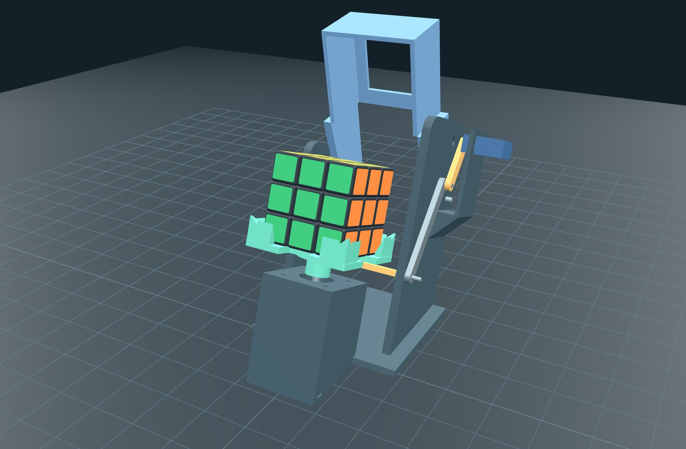
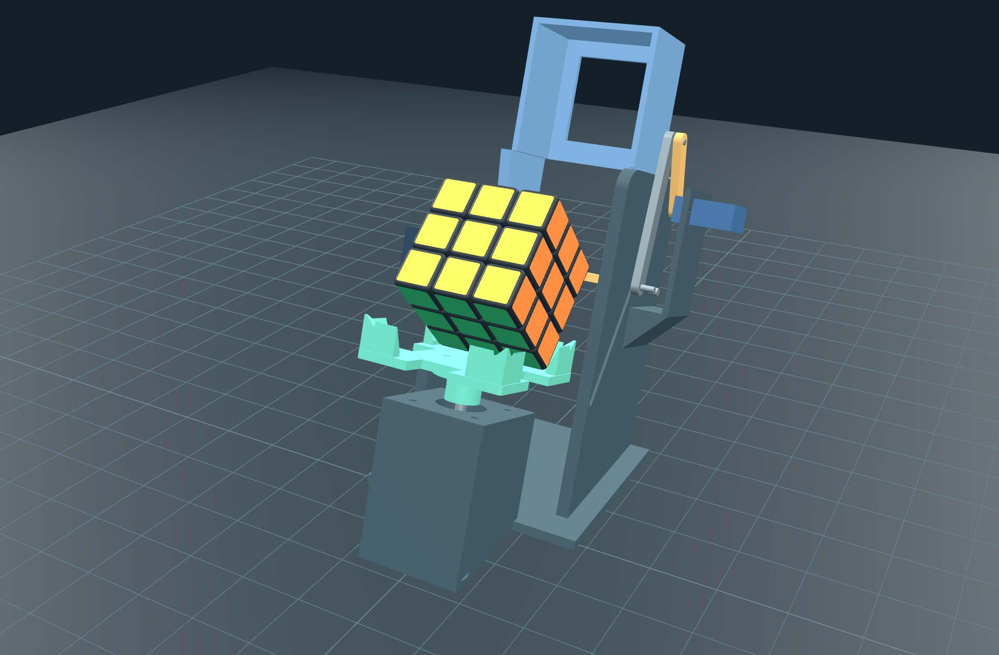

# V5 3D 시뮬레이터

2026-10-24. `docs/SIM_V5_BRIEF.md`의 V5 작업 지시에 따라 화면과 애니메이션을 교체했다. 기구 절차의 원본은 수정하지 않은 `sim/mechanism.js`이고, 큐브 논리 모델·CFOP 풀이기도 그대로 사용한다.

## 실행과 조작

```powershell
node tools/serve.js
# http://localhost:8765/sim/
```

이미 포트를 사용 중이면 `node tools/serve.js 8875`로 실행하고 `http://localhost:8875/sim/`을 연다. 이번 캡처는 직접 실행한 8875 서버에서 저장했다. 기존 8765 서버는 최신 정적 파일을 제공했지만 실행 중인 서버 코드에 캡처 엔드포인트가 없어 `not found`를 반환했다. 기존 프로세스는 종료하거나 변경하지 않았다.

1. **LOAD · 투입 준비**: 후드가 LOAD 150°로 열린다. LCD는 `PLACE CUBE SOLVED` / `WHITE DOWN GRN FRONT`이다.
2. **LOAD · 장착 완료**: 흰색 아래·초록색 앞의 해결된 큐브를 표시하고 후드를 OPEN 60°로 돌린다. LCD는 `CUBE LOADED` / `SCRAMBLE / SOLVE`이다.
3. **SCRAMBLE**: 시드에 따른 20수를 기구 액션으로 재생한다. **SOLVE**는 현재 논리 큐브를 CFOP로 풀고 같은 실행기로 재생한다. **MOVES**는 입력 수열을 실행한다. 초기 예시는 `R U R' U' F D2 B L`이다.
4. **FLIP**은 앞으로 한 번 넘기고, **SPIN · y**는 전체 큐브를 한 번 돌린다. 두 동작 모두 논리 큐브를 변경하지 않는다.
5. 장착된 상태에서 **LOAD · EJECT**를 누르면 `EJECT` → `HOOD LOAD` → `EJECTED`를 출력한다. LCD는 `REMOVE CUBE`이며 큐브가 사라진다.

RESET은 해결된 큐브·초기 자세·빈 장착 상태로 초기화한다. 동작 중 조작 버튼은 비활성화된다. 일시정지/계속과 0.25~100배 재생을 지원한다. 속도를 바꾸어도 예상 시간과 `exec`는 1배속의 기구 시간 합계다. 브라우저가 비활성 상태일 때 생긴 긴 프레임 공백은 100 ms로 제한한다.

카메라는 **관중(앞 약간 위)** / **옆** / **위** / **뒤 · 서보**의 네 프리셋이 있다. 캔버스를 드래그해 궤도 회전하고 휠로 확대한다. 후드·타워·베이스 가시성을 따로 바꿀 수 있다. 상태 패널은 재생 중 실제 표시 상태의 후드 각도, 리프터 이동량(mm), 물리 위치 U/R/F/D/L/B에 있는 논리 면, flips/spins/hoods를 보여 준다. `planSeq`가 미리 갱신한 최종 상태를 현재 상태로 표시하지 않는다.

## 좌표와 치수

- 단위는 mm. 홀더 좌표 원점은 장착된 큐브의 아래면 중심이고 +y는 관중 쪽, +z는 위다. 월드에서 관중 방향을 −y로 정하기 위해 먼저 z축 180°를 적용하고 장면을 월드 x축 −20° 기울인다. 결과 높이는 검사기와 같은 `z_world = z*cos(20°) + y*sin(20°)`이며 뒤가 낮다. 책상은 월드 z = −72이다.
- `tools/robot_v5_params.py`의 `P`를 기본값으로 복사했고, 검사 JSON의 `parameters`, V5 `CubeModels.params` 순으로 덮어쓴다. V4 파일의 `crank`/`link`가 잘못 선택되지 않도록 `hinge_y_mm`을 V5 판별 기준으로 쓴다.
- 큐브는 57 mm, 조각 피치 19 mm, 모서리 둥글기 1.5 mm의 일반 3×3이다. 26개 둥근 조각과 54개 스티커를 사용한다. 소켓·도넛 구멍·잠금 막대·측면 헤드는 없다. 스티커는 `cube.toFacelets()`로 칠한다.
- 논리 면의 R은 관중이 보는 오른쪽(홀더 −x)으로 정의한다. 이 기준에서 `y`의 R→F, `x'`의 F→D와 D의 회전 방향이 논리 큐브의 스티커 치환과 일치한다. 초기 자세는 `ORI_START = [D,L,F,U,R,B]`이다.
- 출력 부품 6종 `cube_holder / hood / lifter / base / crank / link`는 `parts[name].b64`와 `print_offsets[name]`으로 조립 좌표를 복원한다. 후드는 힌지, 크랭크는 서보 축, 링크는 슬라이더 핀을 피벗으로 삼는다. STL의 base에는 타워가 포함되므로 바깥쪽 삼각형을 분리해 가시성을 제어한다. 구입 부품은 `params.purchased`의 크기와 중심을 사용한다.
- V5 데이터나 개별 STL/오프셋이 없으면 그 부품을 기본 도형으로 만든다. 기본 도형에는 컵 노치·L자 기둥·모따기, 구멍 있는 후드 지붕·힌지 팔, 리프터 선반·입술·크로스바, 타워 슬롯과 모터 쐐기가 포함된다. `?geometry=primitive`로 이 경로를 별도로 확인할 수 있다.
- 리프터는 P로 계산한 `Q0 + s*(-sin26°, cos26°)`를 따른다. 크랭크 반경 33 mm, 링크 핀 중심 간 70 mm의 원 교점으로 각도를 역산한다. V5 CAD가 제공하는 `servo_axes.lift`를 우선 사용하고 없으면 P에서 직렬 슬라이더의 사점 축을 계산한다. 대략적인 문서 축 좌표를 강제해 링크 길이를 늘이거나 줄이지 않는다.

## 기구 액션과 애니메이션 대응

각 액션의 `a.line`을 순서대로 그대로 로그에 기록한다. 재생 시간은 모두 `Mechanism.durationMs(a)`를 사용한다. 기구 시간 상수가 작업 중 갱신되어도 뒤집기 전체 단계가 완료되도록 위상 시간을 정규화했다.

| 액션 | 시각 동작 | 완료 처리 |
|---|---|---|
| `hood` | 국소 힌지 `(y=-82,z=14.4)`, x축 주위로 현재 각→CLOSE 0° / OPEN 60° / LOAD 150° | 표시 hood/hoods 갱신 |
| `turn` | 컵과 현재 물리 아래층 조각 9개만 z축으로 D +90° / D2 +180° / D′ −90°. 목표보다 7.2° 진행한 뒤 복귀 | `cube.move(a.m)`, 조각 위치 복구 후 스티커 재도색. 큐브 전체 quaternion 유지 |
| `spin` | 컵과 전체 큐브를 y −90° / y2 −180° / y′ +90° 회전 | 전체 quaternion과 표시 ori 누적, spins 증가. 논리 큐브 유지 |
| `flip` | 후드 60→70°, 리프터 상승, 검사 `flip_trace`의 `s/theta_deg/yf` 보간. 약 65.1° 이후 앞 아래 모서리 `(y=-28.3,z=0)`를 축으로 90°까지 가속 전복. 리프터 하강, 후드 70→60° | x′ quaternion 누적, F→D. 큐브 중심을 `(0,0,28.5)`로 정렬(바닥 원점 `(0,0,0)`에 착지). 리프터 0 복귀, flips 증가 |
| `msg` | 이동 없음 | `READY TO LOAD` / `EJECT` 로그·LCD 갱신 |
| `loaded` | 추가 기구 이동 없음 | `LOADED`와 장착 LCD. 해결된 큐브·초기 자세 표시 |
| `ejected` | 추가 기구 이동 없음 | `EJECTED`와 제거 LCD. 큐브 표시 해제 |

뒤집기의 기준 위상은 후드 275 + 상승 900 + 전복 250 + 하강 600 + 후드 275 ms이다. 총 2300 ms에 대한 비율을 실제 `durationMs(flip)`에 맞춰 재생한다. 따라서 기구 모듈이 더 짧은 총 시간을 지정하면 모든 위상이 함께 빨라진다. 선반이 큐브 바닥에 닿기 전에는 큐브를 움직이지 않는다. 전복 완료 직후 기둥 안 정렬 위치로 스냅하므로 다음 동작에 위치 오차가 누적되지 않는다. 검사 JSON을 읽을 수 없으면 검사기와 같은 기하식을 사용한다.

완료 로그는 다음 형식이다. `regrips`는 사용하지 않는다.

```text
SCRAMBLED exec=<ms>ms flips=<n> spins=<n>
SOLVED ok=1 moves=<n> flips=<n> spins=<n> calc=<ms>ms exec=<ms>ms
MOVED <n> flips=<n> spins=<n>
```

## 스크린샷

실제 저장한 JPEG 두 장(각 1911×1200):

- [sim_v5_robot.jpg](images/sim_v5_robot.jpg): 관중 시점, 장착된 큐브, 후드 OPEN 60°.
- [sim_v5_flip.jpg](images/sim_v5_flip.jpg): 같은 관중 시점, 뒤집기 상승 중간. 후드 70°, 리프터 약 60 mm.





`tools/serve.js`는 이름에 `.png`만 허용한다. 따라서 지시서의 `POST /__screenshot?name=sim_v5_robot.jpg`는 **400**으로 거절된다. 서버는 수정하지 않았다. 실제 브라우저에서 **캡처 · 검증 → 로봇 PNG 저장 / 뒤집기 PNG 저장** 버튼을 눌러 아래 경로로 저장하고 Windows System.Drawing JPEG 인코더(품질 95)로 JPG 두 장을 만들었다. 중간 PNG 파일은 제거했다. Headless 브라우저는 사용하지 않았다.

```javascript
// 브라우저 콘솔에서도 동일하게 캔버스를 서버로 보낼 수 있다.
document.getElementById('view').toBlob(async (blob) => {
  const r = await fetch('/__screenshot?name=sim_v5_robot.png', {
    method: 'POST', headers: {'Content-Type': 'image/png'}, body: blob
  });
  console.log(await r.text());
}, 'image/png');
```

**뒤집기 중간 정지** 버튼은 실제 FLIP을 실행하다 상승 구간의 정해진 지점에서 일시정지한다. 이때 **뒤집기 PNG 저장**을 누른다. 계속 버튼으로 나머지 동작을 재생할 수 있다. 캡처는 캔버스의 3D 장면만 저장한다.

## 검증 기록

- `node --check sim/app.js`: 통과.
- `node tools/test_solver.js 20 1`, 이어서 `node tools/test_solver.js 300 1`: 모두 통과. 300 시드 평균 56.2수, 최대 70수.
- 실제 Edge 브라우저에서 Three.js CDN·전체 페이지 로드, 콘솔 error/warn 0.
- **캡처 · 검증 → 300 시드 검증**: STL 6/6 경로 및 `?geometry=primitive`의 0/6 경로에서 각각 `PASS · 300 / 300 SOLVED ok=1`, **110,870 액션** 통과.
- 검증은 재생기와 같은 `beginAction / sampleAction / finishAction`을 사용한다. 장착·배출·예제 수열·스핀 세 방향·수동 뒤집기·300회 섞기→풀이에서 7개 액션 타입을 모두 검사했다. 각 액션의 9개 위상에서 수치 유효성과 70 mm 링크 폐합을 검사하고, 매 층 회전 경계에서 54개 스티커의 위치·법선·색 연결을 검사한다. 표시 ori와 quaternion, 기구 모듈의 ori·hood·loaded·카운터가 일치한다. 뒤집기 완료 시 리프터 0·후드 OPEN·정렬 위치도 검사한다.
- 실제 재생의 LOAD→MOVES→SCRAMBLE→SOLVE와 EJECT, 일시정지/재개, 카메라 네 프리셋·가시성 세 토글과 캡처 저장을 별도로 확인했다. 예제 8수의 37개 액션 로그는 Node의 `Mechanism.planSeq` 출력과 줄 순서까지 정확히 일치했다(`MOVED 8 flips=8 spins=6`). 이어 실제 UI 풀이가 `SOLVED ok=1 moves=53 flips=53 spins=43 calc=3ms exec=160150ms`로 완료됐다.
- 서버 저장 후 JPEG를 다시 열어 해상도, 바이트 크기와 실제 JPEG 형식을 확인했다. `sim_v5_robot.jpg` 269,248 B, `sim_v5_flip.jpg` 276,601 B.

## 변경 범위와 남은 문제

이번 작업이 쓴 파일은 `sim/app.js`, `sim/index.html`, 이 문서와 위 JPEG 두 장이다. `sim/models.js`는 읽기만 했으며 작업 중 다른 작업이 갱신한 V5 모델을 반영했다. 큐브·풀이기·기구 모듈, 펌웨어, tests, tools는 수정하지 않았고 커밋하지 않았다.

남은 제한은 브라우저 애니메이션이 검사 궤적을 재현하는 시각화라는 점이다. 실제 접촉·충격·마찰·서보 성능을 새로 물리 시뮬레이션하지 않는다. 구입 부품은 제공된 상자 외곽이고 STL base의 타워 분리는 x좌표 기준이므로 베이스 숨김 시 가장자리 데크 일부도 타워 그룹에 남을 수 있다. Three.js는 기존 CDN 연결이 필요하다. JPG 직접 저장 엔드포인트는 원본 서버의 PNG 전용 제한으로 지원하지 않으며 문서의 변환 절차를 사용한다.
